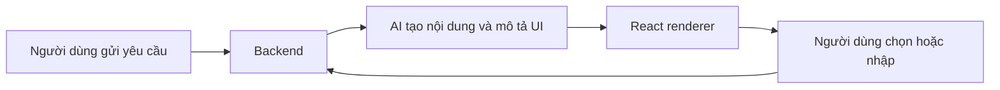

# Từ chatbot văn bản đến Generative UI

**Loại bài:** Bài học thực hành · **Mục tiêu:** Phân biệt được câu trả lời dạng văn bản với giao diện tạo sinh; lựa chọn đúng thành phần trình bày cho một yêu cầu.

**Bối cảnh:** Khóa học Generative UI với Next.js và Thesys C1. Nội dung C1 dùng API legacy; với dự án mới, xem OpenUI ở https://www.openui.com/docs.

## 1. Vấn đề của chat thuần văn bản
Một chatbot có thể viết rất nhiều chữ nhưng người dùng vẫn phải đọc, lọc thông tin rồi tự thực hiện bước tiếp theo. Khi hỏi về diễn biến thị trường, một đoạn mô tả dài khiến người đọc khó so sánh các nhóm ngành. Khi hỏi “hãy cho tôi chọn một mã cổ phiếu”, câu trả lời chỉ bằng chữ buộc người dùng nhập lại mã và chuyển ngữ cảnh. Đây là hạn chế về **hình thức tương tác**, không nhất thiết là hạn chế về năng lực suy luận của mô hình.

**Generative UI** cho phép hệ thống sinh ra một cách trình bày phù hợp nội dung: thẻ KPI, biểu đồ cột, bảng, tab, form, nút, lựa chọn và lời giải thích. Phản hồi AI trở thành một *giao diện có thể hành động*, thay vì một chuỗi chữ dài. Cần phân biệt “AI chọn cách biểu diễn dữ liệu” với “AI có quyền tự ý thực thi hành động”: thao tác ảnh hưởng dữ liệu hoặc tiền vẫn cần backend xác thực và kiểm soát.

## 2. Chọn giao diện dựa trên mục đích
| Yêu cầu | Cách trình bày ưu tiên | Tương tác hữu ích |
| --- | --- | --- |
| So sánh doanh thu theo tháng | Biểu đồ cột hoặc đường | Đổi khoảng thời gian |
| Xem danh sách SKU | Bảng có cột rõ nghĩa | Sắp xếp, lọc, mở chi tiết |
| Chọn cổ phiếu để tìm hiểu | Ô nhập mã, nút xác nhận | Gửi mã đã chọn vào hội thoại |
| Học trắc nghiệm | Câu hỏi, nút radio | Nộp câu trả lời, nhận giải thích |
| Tìm sản phẩm | Thẻ sản phẩm | Xem chi tiết, mở trang sản phẩm |

Không phải phản hồi nào cũng cần widget. Câu hỏi “API này nghĩa là gì?” có thể trả lời bằng văn bản; dùng biểu đồ chỉ để làm đẹp dễ khiến giao diện rối. Nguyên tắc là **mỗi thành phần phải giúp người dùng hiểu hoặc thao tác tốt hơn**.

## 3. Vòng lặp tương tác

Luồng trên mô tả điểm khác biệt quan trọng: thông tin từ form phải quay lại backend và/hoặc hội thoại để hệ thống biết người dùng chọn gì. Nếu chỉ render nút đẹp mà không có xử lý sự kiện, giao diện vẫn là trang trí tĩnh.

## 4. Nguyên tắc thiết kế tốt
Trước khi sinh giao diện, xác định: mục đích chính, dữ liệu đáng tin cậy, hành động người dùng có thể làm và trạng thái thành công/thất bại. Biểu đồ cần đơn vị và nhãn; bảng cần tên cột; form cần kiểm tra dữ liệu; nút tạo tác dụng phụ cần thông báo và xác nhận. Với nội dung tài chính hay sức khỏe, dữ liệu phải có thời điểm, nguồn và mức độ tin cậy.

## 5. Bài thực hành
Viết ba yêu cầu: (1) “tổng hợp doanh thu theo tháng”, (2) “chọn sản phẩm có biên lợi nhuận từ 5%”, (3) “kiểm tra kiến thức React”. Với mỗi yêu cầu, phác thảo phần văn bản giải thích, loại thành phần cần render và dữ liệu sự kiện gửi về backend. Thành phẩm là một bảng đặc tả tối thiểu, không cần code.

## 6. Tổng kết
Generative UI là cách đóng gói câu trả lời thành giao diện có ngữ cảnh. Chất lượng đến từ việc kết hợp nội dung, kiểu trực quan, trạng thái tương tác và luồng dữ liệu; vẻ đẹp thị giác chỉ là một phần.

## 7. Câu hỏi ôn tập

**Câu 1.** Tại sao biểu đồ có thể tốt hơn đoạn văn khi so sánh doanh thu theo tháng?

A. Vì cho phép nhìn xu hướng và đối chiếu nhanh  
B. Vì mô hình không thể viết số liệu  
C. Vì mọi truy vấn đều cần biểu đồ  
D. Vì biểu đồ tự kiểm chứng được dữ liệu  

**Đáp án:** A. **Giải thích:** Biểu đồ hỗ trợ so sánh, nhưng vẫn cần dữ liệu đúng.

**Câu 2.** Một nút trong phản hồi AI cần thêm gì để thật sự tương tác?

A. Đổ bóng  
B. Xử lý sự kiện và phản hồi trạng thái  
C. Ảnh nền  
D. Nội dung lorem ipsum  

**Đáp án:** B. **Giải thích:** Hành động phải chuyển được lựa chọn về logic ứng dụng.

**Câu 3.** Câu hỏi định nghĩa đơn giản thường phù hợp nhất với?

A. Bảng thanh toán  
B. Bản đồ  
C. Giải thích văn bản rõ ràng  
D. Biểu đồ tài chính  

**Đáp án:** C. **Giải thích:** Không cần sinh widget khi văn bản đã đủ.

**Câu 4.** Trong Generative UI, ai chịu trách nhiệm cấp quyền sửa dữ liệu?

A. CSS  
B. Màu giao diện  
C. Tên biểu đồ  
D. Backend và hệ thống xác thực  

**Đáp án:** D. **Giải thích:** Mô hình không được tự vượt kiểm tra quyền.

**Câu 5.** Thành phần nào phù hợp để người dùng chọn một phương án quiz?

A. Radio hoặc lựa chọn  
B. Heatmap  
C. Footer thuần  
D. Đoạn mã SQL  

**Đáp án:** A. **Giải thích:** Đầu vào có cấu trúc giúp ghi nhận đáp án.

