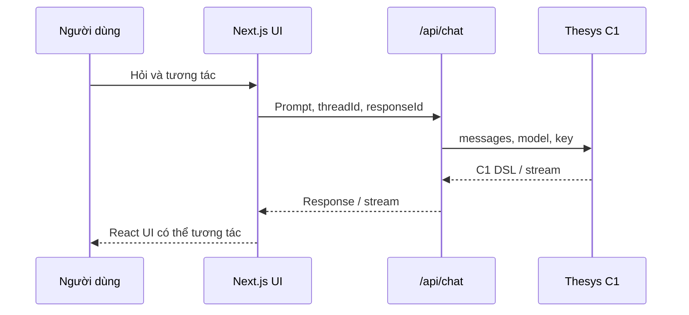

# Kiến trúc C1: API, DSL và React renderer

**Loại bài:** Bài học thực hành · **Mục tiêu:** Mô tả được luồng browser → backend → C1 API → DSL → React; xác định vị trí đặt khóa bí mật và điểm kiểm soát dữ liệu.

**Bối cảnh:** Khóa học Generative UI với Next.js và Thesys C1. Nội dung C1 dùng API legacy; với dự án mới, xem OpenUI ở https://www.openui.com/docs.

## 1. Ba lớp chính
Ứng dụng gồm **frontend React**, **backend do bạn quản lý** và **C1 API**. Browser gửi yêu cầu lên route nội bộ. Backend tổ chức lịch sử hội thoại và dữ liệu; gọi endpoint C1 thông qua giao thức tương thích OpenAI Chat Completions; nhận chuỗi phản hồi diễn tả cấu trúc UI; gửi về frontend để React SDK chuyển thành phần giao diện.

## 2. DSL không đồng nghĩa HTML tùy ý
DSL (domain-specific language) là định dạng biểu diễn các thành phần và cấu trúc giao diện. Nó cho renderer biết nên hiển thị hình thức gì, nhưng không nên được xem là quyền thực thi mã tùy ý từ mô hình. Frontend chỉ nên dùng renderer chính thức hoặc các thành phần do ứng dụng đăng ký, với quy tắc xử lý sự kiện rõ ràng.

Một thông điệp có thể cần cả đoạn văn giải thích, thẻ KPI, biểu đồ và form. Cách biểu diễn được chọn ở thời điểm phản hồi. Điều đó khác template cố định “câu nào cũng hiển thị 3 card”.

## 3. Trách nhiệm từng lớp
| Lớp | Chịu trách nhiệm | Không nên làm |
| --- | --- | --- |
| Browser | Render, thu thập lựa chọn, thông báo loading | Chứa API key C1 |
| Backend | Auth, query dữ liệu, chọn tool, quản lý history, gọi C1 | Tin mọi tham số LLM như đã xác thực |
| C1 | Sinh nội dung có cấu trúc renderable | Được coi là nguồn dữ liệu thực tế mặc định |
| Database | Lưu bản ghi và quyền truy cập | Cho phép câu truy vấn chưa được cấp phép |

## 4. Phân biệt context và state
**Conversation state** là lịch sử lượt hỏi/đáp và thread ID. **UI state** là dữ liệu người dùng đang chọn trong form, tab hay input. **Server state** là dữ liệu bền vững như tài khoản, sản phẩm và báo cáo. Thực tế thường xảy ra lỗi khi chỉ lưu hội thoại nhưng quên lưu lựa chọn của người dùng, hoặc khi gán mọi thread vào một biến toàn cục.

## 5. Debug bằng cách chia lớp
Nếu chat không phản hồi: kiểm tra network tới `/api/chat`, HTTP status, key tại server, model ID, body truyền đến C1, rồi mới kiểm tra renderer. Nếu có chữ nhưng không ra biểu đồ: kiểm tra liệu backend đã trả đúng C1 response chưa và SDK có import stylesheet chưa. Nếu nút không chạy: kiểm tra callback/action mapping, schema, quyền và server log.

## 6. Bài tập
Vẽ sequence diagram cho câu: “Tháng trước tôi tiêu bao nhiêu?”. Chỉ ra dữ liệu giao dịch được lấy tại đâu, tại sao API key không ở client, và vị trí thích hợp để phân quyền theo user ID.

## 7. Tổng kết
C1 có thể được nhìn như một lớp tạo biểu diễn, nhưng ứng dụng vẫn phải giữ quyền sở hữu dữ liệu, bảo mật, thao tác và trạng thái.

## 8. Câu hỏi ôn tập

**Câu 1.** Khóa THESYS_API_KEY nên lưu ở đâu?

A. Biến JavaScript trên client  
B. Config backend không gửi về client  
C. Query URL  
D. Local storage trình duyệt  

**Đáp án:** B. **Giải thích:** Khóa bí mật chỉ được sử dụng từ môi trường server.

**Câu 2.** Vai trò chính của C1 DSL là gì?

A. Mã hóa cơ sở dữ liệu  
B. Lưu cookie  
C. Mô tả cấu trúc UI để renderer hiển thị  
D. Biên dịch TypeScript  

**Đáp án:** C. **Giải thích:** DSL là biểu diễn trung gian cho UI.

**Câu 3.** Thread ID thường phục vụ mục đích nào?

A. Gắn các lượt chat vào cùng cuộc hội thoại  
B. Chọn CSS  
C. Thay API key  
D. Đặt tên tệp  

**Đáp án:** A. **Giải thích:** Thread ID giúp liên kết lịch sử hội thoại.

**Câu 4.** Phân quyền truy cập dữ liệu nên thực hiện ở đâu?

A. Trong màu button  
B. Dựa hoàn toàn vào lời mô hình  
C. Trong browser HTML  
D. Ở backend khi truy vấn dữ liệu  

**Đáp án:** D. **Giải thích:** Chỉ backend có thể cưỡng chế quyền đáng tin cậy.

**Câu 5.** Có response nhưng không hiển thị đúng widget: kiểm tra gì trước?

A. Ổ cứng máy người dùng  
B. Response C1 và renderer SDK  
C. Tăng nhiệt độ mô hình vô điều kiện  
D. Xóa database  

**Đáp án:** B. **Giải thích:** Response và SDK là điểm nối của quá trình render.

