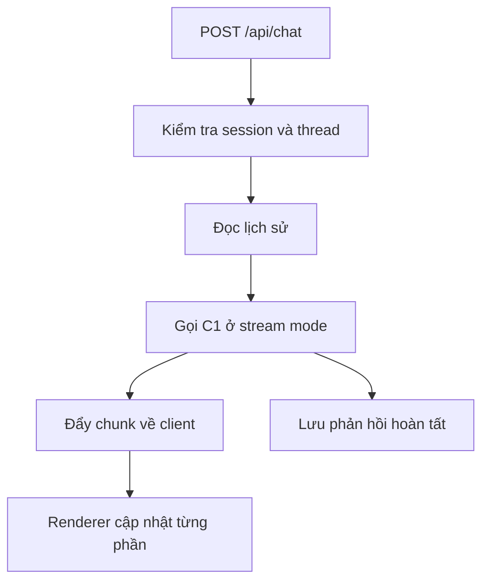

# Streaming, threadId, responseId và quản lý lịch sử

**Loại bài:** Bài học thực hành · **Mục tiêu:** Giải thích được streaming, trạng thái hội thoại, giới hạn in-memory; thiết kế cách lưu thread khi đưa lên production.

**Bối cảnh:** Khóa học Generative UI với Next.js và Thesys C1. Nội dung C1 dùng API legacy; với dự án mới, xem OpenUI ở https://www.openui.com/docs.

## 1. Streaming là gì?
Không cần đợi toàn bộ câu trả lời được sinh xong mới hiển thị. Backend có thể nhận các chunk từ C1 và chuyển tiếp để frontend render dần. Hiệu quả là **thời gian tới phản hồi đầu tiên** ngắn hơn và người dùng biết hệ thống đang làm việc. Streaming không đồng nghĩa response luôn nhanh hơn về tổng thời gian.

## 2. Quy trình backend
Một route chat thường nhận `prompt` có ID, `threadId`, `responseId`, rồi truy xuất messages thuộc thread, bổ sung user message, gọi C1 và stream về UI. Đối với luồng đa bước hoặc tool-calling, cần phân biệt chunk giao diện với sự kiện tool; không đơn giản cắt chuỗi tùy ý rồi parse thành JSON từng phần.

## 3. Thread và Response ID
`threadId` định danh một hội thoại; `responseId` giúp hệ thống gắn kết phản hồi đang được tạo với lượt assistant tương ứng. Cần kiểm tra `threadId` thuộc user hiện tại trước khi đọc hoặc ghi. Khi tạo request id mới, tránh ghi chồng response cũ khi người dùng gửi liên tiếp hai tin nhắn.

## 4. Lưu trữ bền vững
Store mặc định in-memory phù hợp demo. Production nên có bảng `conversations` và `messages` với owner, timestamps, role, content, status, message_id. Khi request bị ngắt: lưu trạng thái `interrupted` hoặc áp dụng quy tắc nhất quán; không đánh dấu hoàn tất trước khi stream hoàn thành. `useThreadManager` và `useThreadListManager` là hướng tiếp cận khi tích hợp thread bền vững theo tài liệu C1.

## 5. Xử lý lỗi và trải nghiệm
Hiển thị loading sớm, có nút thử lại khi lỗi mạng, ghi nhận `requestId` để tra log. Timeout, refresh, mất kết nối và gửi trùng cần được kiểm thử. Không lưu toàn bộ payload chứa thông tin nhạy cảm vào log truy cập. Khi streaming bị lỗi giữa chừng, thông báo rõ rằng phản hồi chưa hoàn tất.

## 6. Bài thực hành
Viết bảng test: gửi một câu, refresh, gửi hai câu liên tiếp, ngắt mạng giữa stream, mở thread khác. Ghi expected UI, expected database và điều kiện pass/fail cho từng test.

## 7. Tổng kết
Streaming là tối ưu trải nghiệm; state và tính toàn vẹn history mới là nền tảng của chat đáng tin cậy.

## 8. Câu hỏi ôn tập

**Câu 1.** Streaming chủ yếu cải thiện điều gì?

A. Thời gian xuất hiện phản hồi đầu  
B. Dung lượng ổ đĩa  
C. Quyền SQL  
D. Tính xác thực dữ liệu tự động  

**Đáp án:** A. **Giải thích:** Người dùng thấy nội dung xuất hiện dần.

**Câu 2.** threadId dùng để?

A. Thay theme  
B. Đặt giá sản phẩm  
C. Liên kết lịch sử cuộc trò chuyện  
D. Lưu khóa API  

**Đáp án:** C. **Giải thích:** Thread ID quản lý từng cuộc hội thoại.

**Câu 3.** Khi người dùng reload, lịch sử in-memory có thể?

A. Tự sao lưu  
B. Bị mất  
C. Được đảm bảo  
D. Chuyển thành file CSV  

**Đáp án:** B. **Giải thích:** Memory store không phải persistence.

**Câu 4.** Khi stream bị ngắt trước khi hoàn tất, trạng thái nào hợp lý?

A. Đã thành công chắc chắn  
B. Không cần log  
C. Xóa dữ liệu tất cả thread  
D. Đánh dấu interrupted hoặc xử lý nhất quán  

**Đáp án:** D. **Giải thích:** Không được lưu response dở như hoàn tất.

**Câu 5.** Trước khi đọc thread từ DB, cần kiểm tra?

A. Ownership và authentication  
B. CSS font  
C. Tên biểu đồ  
D. Số tab mở  

**Đáp án:** A. **Giải thích:** Phải ngăn truy cập chéo giữa người dùng.

