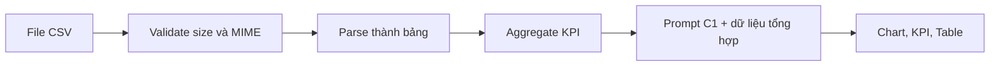

# Phân tích CSV doanh số thành dashboard chat

**Loại bài:** Bài học thực hành · **Mục tiêu:** Thiết kế được pipeline đọc CSV, kiểm tra dữ liệu, tính KPI và đưa dữ liệu tổng hợp cho C1 render.

**Bối cảnh:** Khóa học Generative UI với Next.js và Thesys C1. Nội dung C1 dùng API legacy; với dự án mới, xem OpenUI ở https://www.openui.com/docs.

## 1. Đặt bài toán
Người dùng tải bảng doanh số rồi hỏi “tháng nào bán tốt nhất?” hoặc “cho tôi dashboard”. C1 giải quyết **cách trình bày**; đọc file, kiểm tra kiểu, làm sạch và tính số vẫn là công việc backend. Không đẩy CSV tùy ý vào prompt mà không kiểm tra kích thước và thông tin nhạy cảm.

## 2. Schema đầu vào
Dữ liệu minh họa:
```csv
order_id,date,sku,quantity,unit_price
A001,2026-10-01,P001,2,120000
A002,2026-10-02,P002,1,350000
A003,2026-10-03,P001,1,120000
```
Từ đó doanh thu một dòng là `quantity * unit_price`. Kiểm tra ngày parse được, quantity là số không âm trong phạm vi hợp lý, đơn vị tiền tệ thống nhất và order ID không trùng theo quy tắc hệ thống. Quyết định rõ xử lý hoàn tiền trước khi tính tổng.

## 3. Kiến trúc upload và phân tích

Dữ liệu lớn nên tính toán bằng thư viện backend hoặc truy vấn SQL, rồi truyền bảng tóm tắt hữu hạn. Không yêu cầu mô hình tính toán chính xác trên hàng trăm nghìn dòng văn bản. Với dữ liệu cá nhân, chỉ đưa trường được phép và tránh lưu thông tin nhạy cảm trong prompt.

## 4. Ví dụ tổng hợp JavaScript
```typescript
type Order = { quantity: number; unit_price: number };
const revenue = (rows: Order[]) =>
  rows.reduce((sum, r) => sum + r.quantity * r.unit_price, 0);
```
Hàm chỉ tính toán trên dữ liệu đã parse và validate. Trong ứng dụng, dùng parser CSV có xử lý dấu ngoặc kép, dấu phẩy trong field và encoding; không tự `split(",")` cho CSV thực tế.

## 5. Prompt render
```text
Tạo dashboard doanh số từ dữ liệu tổng hợp sau.
Không tự tạo dòng dữ liệu mới. Sử dụng VND.
Trả về thẻ tổng doanh thu, biểu đồ theo ngày và bảng top SKU.
Nếu không đủ dữ liệu để tính tăng trưởng, nói rõ chưa đủ kỳ so sánh.
```

## 6. Lab và checkpoint
Upload dữ liệu mẫu, tự tính doanh thu = 710.000 VND, kiểm tra UI trùng kết quả. Thử CSV rỗng, sai cột, số âm và file quá lớn; mỗi trường hợp phải có thông báo dễ hiểu. Sản phẩm là mô tả API, kết quả kiểm tra và ảnh dashboard.

## 7. Tổng kết
CSV analytics tốt cần validation và tính toán ngoài LLM; C1 là lớp chuyển kết quả thành trải nghiệm trực quan.

## 8. Câu hỏi ôn tập

**Câu 1.** Nên tính tổng doanh thu từ CSV ở đâu?

A. Từ màu chart  
B. Backend sau parse/validate  
C. Từ logo app  
D. Trong CSS  

**Đáp án:** B. **Giải thích:** Backend phù hợp xử lý dữ liệu có cấu trúc.

**Câu 2.** Với dữ liệu mẫu 3 dòng, tổng doanh thu là?

A. 590000  
B. 610000  
C. 710000  
D. 830000  

**Đáp án:** C. **Giải thích:** 2×120000 + 350000 + 120000 = 710000.

**Câu 3.** Vì sao không split CSV bằng dấu phẩy đơn giản?

A. Trường có thể chứa dấu phẩy được quote  
B. Vì JavaScript không có split  
C. Vì CSV chỉ dùng Excel  
D. Vì không đọc được số nguyên  

**Đáp án:** A. **Giải thích:** CSV thực có quoting và escaping.

**Câu 4.** Khi thiếu kỳ so sánh tăng trưởng cần?

A. Bịa kỳ trước  
B. Luôn hiển thị 100%  
C. Bỏ timestamp  
D. Thông báo không đủ dữ liệu  

**Đáp án:** D. **Giải thích:** Không tính tăng trưởng khi thiếu mẫu số/đối chứng.

**Câu 5.** File upload lớn nên xử lý ra sao?

A. Gửi toàn bộ vào prompt  
B. Kiểm tra giới hạn và tổng hợp trước  
C. Bỏ xác thực  
D. Tin MIME từ client tuyệt đối  

**Đáp án:** B. **Giải thích:** Cần bảo vệ tài nguyên và giảm dữ liệu cho mô hình.

