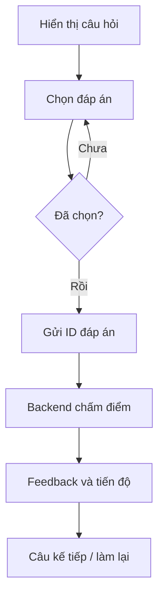

# Quiz tương tác cho EdTech: chọn đáp án và theo dõi tiến độ

**Loại bài:** Bài học thực hành · **Mục tiêu:** Thiết kế một quiz có lựa chọn, nộp đáp án, feedback và trạng thái tiến độ qua nhiều lượt.

**Bối cảnh:** Khóa học Generative UI với Next.js và Thesys C1. Nội dung C1 dùng API legacy; với dự án mới, xem OpenUI ở https://www.openui.com/docs.

## 1. Bài toán học tập
Ứng dụng học không nên chỉ hỏi “đáp án là gì?” và ngay lập tức hiển thị kết quả. Một quiz có flow: chọn chủ đề → sinh câu hỏi → người học chọn A/B/C/D → nộp → đánh giá → giải thích → cập nhật tiến độ. Các thao tác diễn ra trong UI phản hồi của AI, nhưng điểm số cần quy tắc nhất quán.

## 2. State tối thiểu
```typescript
type QuizState = {
  questionId: string;
  selectedOptionId: string | null;
  submitted: boolean;
  correctCount: number;
  totalAnswered: number;
};
```
Nên dùng `questionId` để tránh gán đáp án của câu cũ sang câu mới. Với bài đánh giá chính thức, **đáp án và điểm số phải ở backend** chứ không để client tự quyết định kết quả đúng/sai.

## 3. Giao diện
Mỗi câu nên có nội dung rõ, 4 lựa chọn, nút “Nộp đáp án” chỉ kích hoạt khi có lựa chọn; sau khi nộp hiển thị kết quả và giải thích. Progress bar phải phản ánh số câu đã hoàn tất. Nếu cho phép làm lại, cần thống nhất lần thử nào được tính điểm.

## 4. Flow sự kiện

C1 có thể đưa form và lựa chọn vào phản hồi; backend cần đọc đúng kết quả tương tác và trả feedback phù hợp. Nếu model trả đáp án trái với key chấm điểm đã lưu, luôn dùng kết quả backend để chấm.

## 5. Lab
Tạo 3 câu hỏi về React/Next.js, mỗi câu 4 lựa chọn. Thực hiện hai lượt: một lượt đúng cả 3, một lượt sai một câu. Kiểm tra số điểm, feedback, retry, reload, và việc chọn không bị thay đổi sau nộp. Xây rubric đánh giá: 50% chấm đúng; 25% UX; 25% trạng thái ổn định.

## 6. Tổng kết
Quiz là ví dụ tốt cho Generative UI vì buộc phải nối UI state, event và backend state thay vì chỉ hiển thị thông tin.

## 7. Câu hỏi ôn tập

**Câu 1.** Điểm số chính thức nên do ai xác định?

A. CSS  
B. Backend với đáp án đã định  
C. Nhạc nền  
D. Browser tự quyết định  

**Đáp án:** B. **Giải thích:** Tránh thao túng điểm từ client.

**Câu 2.** Trước khi nộp quiz, cần gì?

A. Có câu trả lời được chọn  
B. Có biểu đồ cột  
C. Có thanh toán  
D. Có 20 tab  

**Đáp án:** A. **Giải thích:** Không nên chấm đáp án rỗng.

**Câu 3.** Trường nào giúp tránh nhầm câu hỏi giữa các lượt?

A. Theme name  
B. Font size  
C. questionId  
D. Viewport width  

**Đáp án:** C. **Giải thích:** ID gắn đáp án với đúng câu.

**Câu 4.** Progress nên dựa vào?

A. Số token LLM  
B. Số icon  
C. Độ dài prompt  
D. Số câu đã hoàn tất  

**Đáp án:** D. **Giải thích:** Thể hiện tiến độ học thực sự.

**Câu 5.** Vì sao phải ghi nhận retry rõ?

A. Để thống nhất cách tính điểm  
B. Để tăng màu  
C. Để bypass auth  
D. Để giảm RAM  

**Đáp án:** A. **Giải thích:** Kết quả đánh giá cần quy tắc lần thử minh bạch.

