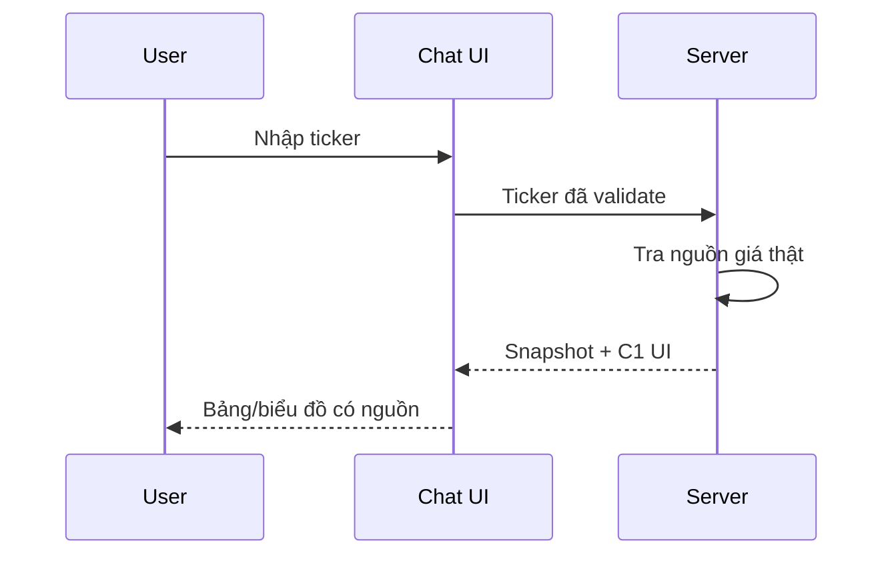

# Demo dữ liệu tài chính và câu hỏi mã chứng khoán

**Loại bài:** Bài học thực hành · **Mục tiêu:** Phân biệt dữ liệu demo với số liệu thời gian thực; tạo được quy trình hỏi mã chứng khoán, nhận lựa chọn và hiển thị bảng/biểu đồ.

**Bối cảnh:** Khóa học Generative UI với Next.js và Thesys C1. Nội dung C1 dùng API legacy; với dự án mới, xem OpenUI ở https://www.openui.com/docs.

## 1. Kịch bản
Người dùng hỏi “Thị trường chứng khoán đang ra sao?” và mong nhận tổng quan nhanh: chỉ số, chuyển động nhóm ngành, bảng thay đổi theo phiên và biểu đồ. Trợ lý cũng có thể đề nghị người dùng nhập ticker để đi sâu. Lời giải thích cần nhấn mạnh mốc dữ liệu: dữ liệu ngày trước, trong phiên hay kết phiên.

## 2. Nguồn dữ liệu và độ trễ
Generative UI không tự cung cấp feed thị trường. API dữ liệu giá cần được backend truy cập với giấy phép và điều khoản phù hợp. Mọi chỉ số tài chính hiển thị phải có `asOf`, đơn vị, mã thị trường và nguồn. Nếu API trả dữ liệu chậm 15 phút, UI phải ghi rõ độ trễ thay vì viết “live”.

## 3. Hợp đồng dữ liệu minh họa
```typescript
type MarketSnapshot = {
  asOf: string;
  source: string;
  indexName: string;
  lastValue: number;
  changePct: number;
  sectors: { name: string; changePct: number }[];
};
```
Đây là schema backend tự thiết kế, không phải định dạng bắt buộc của Thesys. Server xác minh feed rồi đưa dữ liệu snapshot vào prompt render. Ưu tiên card tổng quan, chart sector và form ticker. Không biến giải thích thị trường thành khuyến nghị mua bán cá nhân.

## 4. Flow ticker

Chuẩn hóa mã `trim/uppercase`, kiểm tra ký tự và giới hạn chiều dài; chỉ truy vấn nguồn được phép. Nếu mã không tồn tại, hiển thị lỗi lịch sự thay vì bịa công ty tương ứng.

## 5. Lab
Sử dụng **dữ liệu tự tạo và ghi nhãn DEMO** cho ba nhóm ngành, thử câu hỏi tổng quan và câu hỏi theo ticker. Xác nhận form gửi đúng ticker; cố tình chọn mã sai để kiểm tra trạng thái rỗng. Nếu có feed giá thực, kiểm tra giấy phép và ngày cập nhật.

## 6. Tổng kết
Biểu đồ tài chính là ví dụ nổi bật của Generative UI, song độ tin cậy bắt đầu từ nguồn dữ liệu và thời điểm hiển thị.

## 7. Câu hỏi ôn tập

**Câu 1.** Thị trường đang diễn ra cần ghi chú gì?

A. Thời điểm và nguồn dữ liệu  
B. Chỉ font  
C. Chỉ màu chart  
D. Số token  

**Đáp án:** A. **Giải thích:** Dữ liệu thị trường phụ thuộc thời gian và feed.

**Câu 2.** Nếu dữ liệu có độ trễ 15 phút?

A. Gọi là real-time tuyệt đối  
B. Ghi rõ độ trễ  
C. Bỏ timestamp  
D. Cho mô hình đoán  

**Đáp án:** B. **Giải thích:** Phải minh bạch độ trễ.

**Câu 3.** Người dùng nhập ticker không tồn tại?

A. Bịa tên công ty  
B. Mua ngay  
C. Thông báo không tìm thấy  
D. Tự động đổi ticker  

**Đáp án:** C. **Giải thích:** Không được bịa mapping mã.

**Câu 4.** Dữ liệu snapshot từ server đóng vai trò?

A. CSS  
B. Password  
C. Dấu trang  
D. Nguồn có cấu trúc cho UI  

**Đáp án:** D. **Giải thích:** Renderer cần dữ liệu thực và có schema.

**Câu 5.** Khi dùng dữ liệu tự tạo để demo nên?

A. Ghi nhãn DEMO  
B. Gọi là chỉ số live  
C. Ẩn nguồn  
D. Tự nhận là báo cáo chính thức  

**Đáp án:** A. **Giải thích:** Không làm người dùng nhầm dữ liệu giả với thực.

