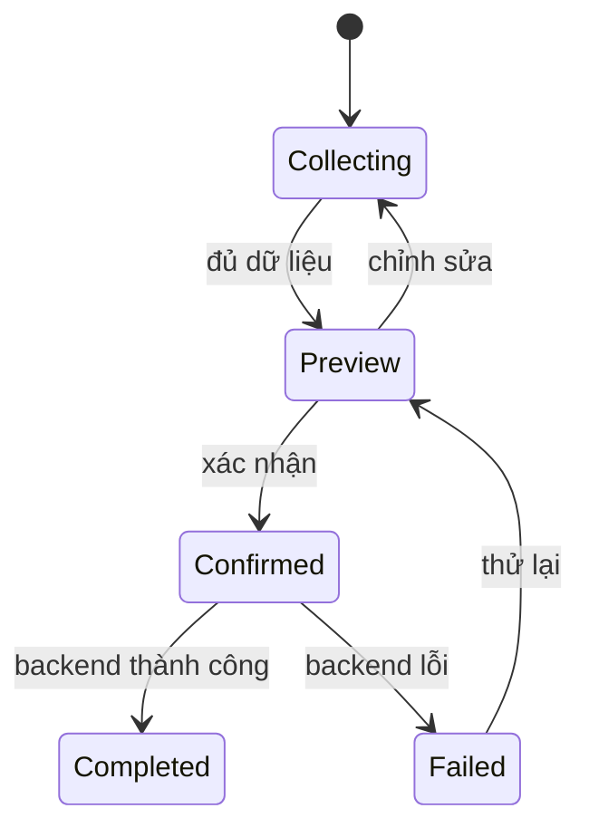

# Flow nhiều bước: form tiếp nối, xác nhận và tiến trình

**Loại bài:** Bài học thực hành · **Mục tiêu:** Thiết kế flow hỏi-đáp nhiều bước mà không áp đặt một workflow cứng cho mọi ý định người dùng.

**Bối cảnh:** Khóa học Generative UI với Next.js và Thesys C1. Nội dung C1 dùng API legacy; với dự án mới, xem OpenUI ở https://www.openui.com/docs.

## 1. Trải nghiệm nhiều bước
Một người dùng có thể hỏi thẳng “cho bảng SKU” hoặc “giúp tôi tạo báo cáo”. Trường hợp hai có thể cần chọn kỳ, nhóm hàng, định dạng và xác nhận. AI nên quyết định khi nào cần hỏi thêm thông tin thiết yếu, nhưng không biến mọi yêu cầu thành form gồm 5 bước. Mỗi câu hỏi thêm phải có lý do và giá trị rõ.

## 2. State machine tối giản

Tại mỗi bước, server phải kiểm tra dữ liệu nhận được có còn hợp lệ. Nếu người dùng sửa khoảng thời gian, cập nhật cả kết quả preview thay vì để preview cũ nhưng submit mới.

## 3. Kiểm soát side effect
Tạo báo cáo read-only có thể chạy không cần xác nhận nếu ít rủi ro. Gửi email, tạo đơn hoặc thanh toán thường cần xác nhận rõ người nhận, nội dung và hậu quả. Không để mô hình tự tạo hành động nhạy cảm khi user chỉ yêu cầu “xem thử”.

## 4. Ví dụ payload nghiệp vụ
```json
{
  "type": "report_preview_request",
  "period": "2026-10",
  "category": "all",
  "format": "csv"
}
```
Đây là một hợp đồng nghiệp vụ minh họa, được backend validate. Mô hình có thể diễn đạt bằng giao diện lựa chọn; khi submit, server xác minh `period`, `category`, `format` và quyền của người gửi.

## 5. Lab
Thiết kế flow tạo báo cáo gồm chọn tháng, preview KPI, xác nhận tải file. Đặt test: người dùng đổi tháng lúc preview, bấm submit hai lần, reload, sai quyền và mất mạng. Ghi rõ khi nào nên hỏi user và khi nào có thể đưa kết quả ngay.

## 6. Tổng kết
Generative UI tốt không đồng nghĩa workflow cố định hay hoàn toàn tùy ý. Đó là sự phối hợp linh hoạt giữa hiểu intent và quy tắc nghiệp vụ an toàn.

## 7. Câu hỏi ôn tập

**Câu 1.** Có nên bắt mọi yêu cầu đi qua cùng form?

A. Không, nên theo intent và thông tin thiếu  
B. Có luôn  
C. Chỉ vì đẹp  
D. Chỉ khi mobile  

**Đáp án:** A. **Giải thích:** Flow cần thích ứng với mục đích.

**Câu 2.** Khi sửa kỳ báo cáo trong preview cần?

A. Không cập nhật gì  
B. Cập nhật lại preview  
C. Xóa tài khoản  
D. Tăng giá  

**Đáp án:** B. **Giải thích:** Preview phải phản ánh lựa chọn hiện tại.

**Câu 3.** Hành động nào cần xác nhận rõ hơn?

A. Xem định nghĩa  
B. Lọc bảng  
C. Gửi email thật  
D. Chuyển tab  

**Đáp án:** C. **Giải thích:** Gửi email là tác dụng phụ bên ngoài.

**Câu 4.** Để tránh tạo đơn hàng hai lần nên dùng?

A. Đổi màu  
B. Tăng context  
C. Xóa lịch sử  
D. Idempotency/deduplication  

**Đáp án:** D. **Giải thích:** Cần bảo vệ trước submit lặp.

**Câu 5.** Nếu chưa đủ dữ liệu thiết yếu cho báo cáo?

A. Hỏi một thông tin cần thiết  
B. Bịa kỳ báo cáo  
C. Làm hành động ngay  
D. Đóng ứng dụng  

**Đáp án:** A. **Giải thích:** Chỉ hỏi khi thông tin thật sự cần.

