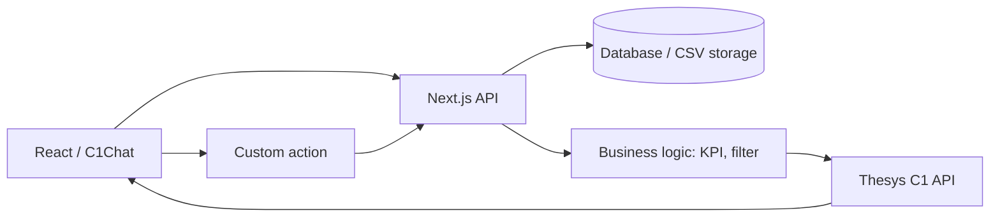

# Đồ án: AI Data Copilot với CSV và dashboard tương tác

**Loại bài:** Bài học thực hành · **Mục tiêu:** Thiết kế sản phẩm end-to-end sử dụng chat, dữ liệu thật, widget và hành động có kiểm soát.

**Bối cảnh:** Khóa học Generative UI với Next.js và Thesys C1. Nội dung C1 dùng API legacy; với dự án mới, xem OpenUI ở https://www.openui.com/docs.

## 1. Bài toán sản phẩm
Tạo AI Data Copilot cho cửa hàng nhỏ. Người dùng tải file doanh số, hỏi bằng tiếng Việt và nhận phản hồi có KPI, biểu đồ, bảng SKU. Họ có thể chọn kỳ báo cáo hoặc tải CSV tổng hợp. Không bắt buộc mọi câu hỏi đều sinh UI: nếu người dùng hỏi định nghĩa, câu trả lời văn bản hợp lý hơn.

## 2. Chức năng bắt buộc
- Upload CSV hợp lệ với schema rõ và thông báo lỗi nếu sai.
- Giao diện chat hỗ trợ gửi câu hỏi, loading, render response C1.
- Câu hỏi KPI sử dụng kết quả backend tính từ dữ liệu.
- Bảng SKU lọc theo ngưỡng margin, có cột đơn vị.
- Một form hoặc selector thay đổi kỳ/ngưỡng lọc.
- Một custom action tải báo cáo từ backend có xác thực.
- Lịch sử thread tối thiểu phân biệt được hai cuộc hội thoại; nếu chưa có DB, ghi rõ giới hạn prototype.

## 3. Kiến trúc đề xuất

C1 chỉ tạo lớp hiển thị; server tính toán và xác thực. Nếu chọn triển khai mới bằng OpenUI, thay lớp C1 và renderer bằng chuẩn mới, giữ các tầng dữ liệu, nghiệp vụ, auth.

## 4. Milestones
**M1 – Dữ liệu:** parse/validate CSV, unit tests cho doanh thu, margin và file sai. **M2 – Chat:** route API, render, loading/error và hỏi đáp văn bản. **M3 – Dashboard:** biểu đồ và bảng từ dữ liệu tổng hợp. **M4 – Interactivity:** form lọc và action download. **M5 – Production basics:** auth, rate limit, logging không lộ key, responsive, keyboard tests.

## 5. API contract gợi ý (do ứng dụng tự thiết kế)
| Endpoint | Ý nghĩa | Biện pháp |
| --- | --- | --- |
| `POST /api/imports` | Nhận và kiểm tra CSV | Size/type/owner |
| `POST /api/chat` | Chat C1 theo contract SDK | Auth/thread ownership |
| `GET /api/reports/:id` | Lấy tóm tắt | Check owner |
| `POST /api/reports/:id/export` | Xuất báo cáo | Auth/rate limit |

## 6. Bộ kiểm thử nghiệm thu
Hỏi “Doanh thu tháng 10?”, “Top SKU?”, “Loại sản phẩm margin trên 5%?”, “Giải thích gross margin?”, “Tải báo cáo”. Đáp ứng: đúng số tính thủ công; giao diện phù hợp intent; hành động kiểm tra quyền; thông báo khi thiếu dữ liệu. Kiểm thử gửi prompt chứa yêu cầu bỏ qua quyền hoặc bịa dữ liệu: hệ thống phải từ chối thao tác trái phép.

## 7. Definition of Done
Dự án chạy được, README thiết lập không lộ khóa, có dữ liệu mẫu, test cases/ảnh UI, giải thích giới hạn và chi phí API, video demo (nếu tự ghi) và hướng dẫn triển khai.

## 8. Tổng kết
Đồ án hoàn chỉnh khi vừa có chat đẹp vừa có dữ liệu chuẩn, flow tương tác thực và kiểm tra an toàn.

## 9. Câu hỏi ôn tập

**Câu 1.** Ai tính KPI trong capstone?

A. Backend/business logic  
B. ThemeProvider  
C. Nút chọn  
D. Logo  

**Đáp án:** A. **Giải thích:** KPI cần phép tính xác định từ dữ liệu.

**Câu 2.** Ai chịu trách nhiệm hiển thị widget C1?

A. Cơ sở dữ liệu  
B. React SDK renderer  
C. Hệ điều hành  
D. CSV parser  

**Đáp án:** B. **Giải thích:** Renderer là lớp trình bày.

**Câu 3.** Khi người dùng yêu cầu báo cáo người khác cần?

A. Tự động cho phép  
B. Hiển thị đại khái  
C. Kiểm tra owner và từ chối nếu không có quyền  
D. Đổi màu nút  

**Đáp án:** C. **Giải thích:** Quyền truy cập là bắt buộc.

**Câu 4.** Một chức năng tối thiểu của capstone?

A. Tự đặt giá bằng LLM  
B. Tự thanh toán  
C. Chỉ có text tĩnh  
D. Chat có dữ liệu và UI tương tác  

**Đáp án:** D. **Giải thích:** Đồ án phải có đầu cuối dữ liệu và tương tác.

**Câu 5.** Khi câu hỏi chỉ cần định nghĩa, nên?

A. Trả lời rõ bằng văn bản  
B. Luôn sinh chart  
C. Luôn hỏi thêm 5 câu  
D. Không trả lời  

**Đáp án:** A. **Giải thích:** Generative UI phải phù hợp intent.

