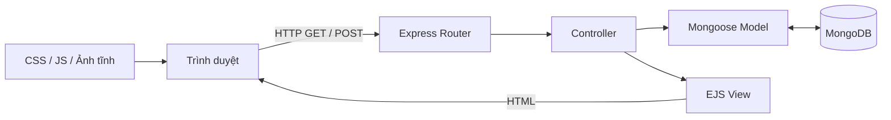

# Bài 01 — Tổng quan sản phẩm và kiến trúc ứng dụng

## 1. Tóm tắt

Xây dựng một website công thức nấu ăn có trang chủ, danh mục ẩm thực, chi tiết món ăn, tìm kiếm, danh sách món mới nhất, gợi ý ngẫu nhiên và chức năng gửi công thức kèm ảnh. Hệ thống sử dụng Node.js, Express, EJS, Bootstrap, MongoDB và Mongoose.

## 2. Mục tiêu học tập

- Mô tả được luồng HTTP từ trình duyệt đến cơ sở dữ liệu và quay về HTML.
- Phân biệt vai trò của `routes`, `controllers`, `models`, `views` và `public`.
- Lập danh sách chức năng và dữ liệu cần thiết cho một website công thức.

## 3. Bối cảnh

Đích đến của bài học là một website công thức nấu ăn: người dùng xem, tìm, lọc và đóng góp món ăn; ứng dụng Node.js xử lý HTTP, còn MongoDB lưu dữ liệu công thức. Mỗi khái niệm dưới đây được trình bày cùng tình huống sử dụng trực tiếp trong dự án.

## 4. Nội dung chính

### 4.1. Chức năng cần xây dựng

| Chức năng | Dữ liệu hoặc trang liên quan |
| --- | --- |
| Trang chủ | Khối giới thiệu, danh mục, món mới, liên kết khám phá |
| Danh mục | Các nhóm món, chẳng hạn Thái, Mỹ, Trung Quốc, Mexico, Ấn Độ |
| Trang món ăn | Tên, mô tả, email người gửi, nguyên liệu, ảnh, danh mục |
| Tìm kiếm | Từ khóa nhập từ biểu mẫu, kết quả phù hợp |
| Khám phá | Món mới nhất hoặc một món ngẫu nhiên |
| Gửi món | Biểu mẫu, xác thực, lưu bản ghi và tải ảnh |

Phạm vi là ứng dụng web render HTML trên server, không phải ứng dụng React hay AI Agent. Có thể mở rộng thành hệ thống gợi ý hội thoại sau khi hoàn thiện nền tảng dữ liệu.

### 4.2. Thành phần hệ thống



`Router` nhận URL và phương thức; `Controller` quyết định xử lý; `Model` truy vấn hoặc ghi dữ liệu; `View` biến dữ liệu thành HTML. Thư mục `public` cung cấp các tài nguyên CSS, JavaScript phía trình duyệt và hình ảnh.

### 4.3. Cấu trúc thư mục đề xuất

```text
cooking-blog/
├── app.js
├── .env
├── package.json
├── public/
│   ├── css/
│   ├── js/
│   ├── img/
│   └── uploads/
├── server/
│   ├── controllers/
│   ├── models/
│   └── routes/
└── views/
    └── layouts/
```

Mô hình thư mục này giảm sự phụ thuộc giữa giao diện và truy vấn. `app.js` lo cấu hình; đường dẫn và xử lý nghiệp vụ không nên dồn vào một tệp khi dự án bắt đầu mở rộng.

### 4.4. Luồng thao tác mẫu

Khi người học mở `/recipe/<id>`, Express khớp route; Controller đọc `req.params.id`, Mongoose lấy bản ghi tương ứng từ MongoDB; EJS dựng trang chi tiết và Express trả HTML về trình duyệt. Khi gửi biểu mẫu, dữ liệu đi chiều ngược lại qua HTTP `POST`, được kiểm tra rồi mới lưu.

## 5. Thực hành

1. Vẽ lại sơ đồ từ người dùng đến MongoDB; ghi rõ điểm nhận yêu cầu HTTP và điểm render HTML.
2. Viết bảng mô tả ít nhất sáu trang/chức năng, chỉ rõ route và dữ liệu đầu vào.
3. Tạo cây thư mục rỗng như mục 4.3; không đưa bí mật vào `public`.

**Hoàn thành khi:** giải thích được tại sao mã truy vấn nằm ở model/controller chứ không phải trong EJS.

## 6. Câu hỏi ôn tập

**Câu 1. Thành phần nào xử lý yêu cầu HTTP theo đường dẫn?**

A. EJS  
B. Express Router  
C. MongoDB collection  
D. Bootstrap  

**Đáp án:** B. **Giải thích:** Router ánh xạ URL và HTTP method tới hàm xử lý.

**Câu 2. Vai trò chính của EJS trong kiến trúc này là gì?**

A. Lưu ảnh lên đĩa  
B. Kết nối Atlas  
C. Render HTML bằng dữ liệu  
D. Định nghĩa index MongoDB  

**Đáp án:** C. **Giải thích:** EJS là template engine phía server.

**Câu 3. Nơi phù hợp để giữ stylesheet công khai là gì?**

A. `public/css`  
B. `.env`  
C. `server/models`  
D. `node_modules`  

**Đáp án:** A. **Giải thích:** Express có thể phục vụ CSS như tài nguyên tĩnh.

**Câu 4. Thành phần nào biểu diễn schema và cung cấp API truy vấn MongoDB?**

A. Bootstrap  
B. Nodemon  
C. EJS  
D. Mongoose Model  

**Đáp án:** D. **Giải thích:** Model bọc cấu trúc dữ liệu và thao tác DB.

**Câu 5. Khi mở trang chi tiết, dữ liệu từ DB được gửi sang đâu để dựng HTML?**

A. `.env`  
B. EJS view  
C. npm  
D. CSS  

**Đáp án:** B. **Giải thích:** Controller truyền dữ liệu cho view qua `res.render`.

## 7. Tổng kết

Website được tách thành tầng tiếp nhận HTTP, nghiệp vụ, dữ liệu và giao diện. Kiến trúc này giúp các chức năng tìm kiếm, gửi món và phân loại được phát triển dần mà không làm rối `app.js`.
