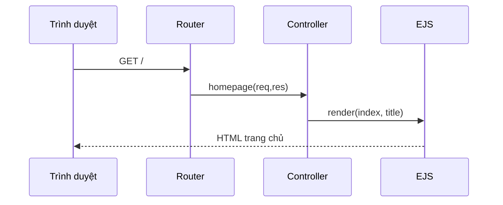

# Bài 03 — Express Router, Controller và middleware

## 1. Tóm tắt

Xây dựng nền tảng điều hướng web, cho phép một URL gọi đúng controller và trả về trang EJS. Thực hành với `express.urlencoded()`, `express.static()`, `app.set()` và cấu hình view engine.

## 2. Mục tiêu học tập

- Viết được Router riêng cho nhóm trang công thức.
- Giải thích và áp dụng được middleware đọc form và phục vụ tài nguyên tĩnh.
- Sửa được lỗi thiếu view engine hoặc export controller.

## 3. Bối cảnh

Đích đến của bài học là một website công thức nấu ăn: người dùng xem, tìm, lọc và đóng góp món ăn; ứng dụng Node.js xử lý HTTP, còn MongoDB lưu dữ liệu công thức. Mỗi khái niệm dưới đây được trình bày cùng tình huống sử dụng trực tiếp trong dự án.

## 4. Nội dung chính

### 4.1. Thiết lập Express

```js
// app.js
require('dotenv').config();
const express = require('express');
const expressLayouts = require('express-ejs-layouts');
const recipeRoutes = require('./server/routes/recipeRoutes');
const app = express();

app.use(express.urlencoded({ extended: true }));
app.use(express.static('public'));
app.use(expressLayouts);
app.set('view engine', 'ejs');
app.set('layout', './layouts/main');
app.use('/', recipeRoutes);

app.listen(process.env.PORT || 3000);
```

`urlencoded` phân tích body từ form dùng `application/x-www-form-urlencoded`. Với form có ảnh, cần thêm xử lý `multipart/form-data` ở bài tải tệp. `static` cho phép trình duyệt truy cập `/css/styles.css` thay vì biết đường dẫn vật lý `public/css/styles.css`.

### 4.2. Tách route và controller

```js
// server/routes/recipeRoutes.js
const express = require('express');
const router = express.Router();
const recipeController = require('../controllers/recipeController');
router.get('/', recipeController.homepage);
module.exports = router;
```

```js
// server/controllers/recipeController.js
exports.homepage = async (req, res) => {
  res.render('index', { title: 'Trang chủ' });
};
```

`router.get()` chỉ đăng ký route; `res.render('index')` yêu cầu file `views/index.ejs`. Nếu tên view sai, Express sẽ không tìm thấy template.

### 4.3. Dữ liệu trên request và response

- `req.params`: tham số nằm trong đường dẫn, ví dụ `/recipe/:id`.
- `req.query`: tham số trên URL, ví dụ `?q=mi`.
- `req.body`: dữ liệu đã được middleware phân tích từ form `POST`.
- `res.render()`: trả HTML được dựng bằng EJS.
- `res.redirect()`: yêu cầu trình duyệt điều hướng đến URL khác.

### 4.4. Sơ đồ xử lý route



Sơ đồ chưa có truy vấn dữ liệu; bài kết nối MongoDB sẽ thêm bước đó mà không thay đổi vai trò Route và View.

## 5. Thực hành

1. Tạo hai tệp `recipeRoutes.js` và `recipeController.js`.
2. Trả về `views/index.ejs` từ route `/`.
3. Thêm `public/css/styles.css`; đặt một quy tắc đổi nền và kiểm tra DevTools → Network.
4. Cố ý bỏ `app.set('view engine', 'ejs')`, quan sát lỗi rồi khôi phục.

**Checkpoint:** controller truyền đúng `title` tới view, CSS được trả về HTTP 200.

## 6. Câu hỏi ôn tập

**Câu 1. Đâu là nơi đọc giá trị `:id` trong route `/recipe/:id`?**

A. `req.query`  
B. `req.params`  
C. `req.files`  
D. `res.locals`  

**Đáp án:** B. **Giải thích:** Tham số động trong đường dẫn nằm ở `req.params`.

**Câu 2. Middleware nào phục vụ file CSS công khai?**

A. `express.static`  
B. `express.json`  
C. `mongoose.connect`  
D. `connect-flash`  

**Đáp án:** A. **Giải thích:** Static middleware ánh xạ tài nguyên bên trong `public`.

**Câu 3. Điều gì xảy ra nếu dùng `res.render("index")` nhưng chưa cấu hình EJS?**

A. MongoDB tự kết nối  
B. JS tự dựng HTML  
C. Router tự chuyển sang JSON  
D. Có thể phát sinh lỗi view engine  

**Đáp án:** D. **Giải thích:** Express cần biết template engine để render file.

**Câu 4. `req.body` được dùng để lấy gì?**

A. Mã phản hồi HTTP  
B. Tên model  
C. Giá trị từ body yêu cầu  
D. Tên file CSS  

**Đáp án:** C. **Giải thích:** Body parser gắn dữ liệu đã phân tích vào request.

**Câu 5. Vì sao `module.exports = router` cần thiết?**

A. Để tải ảnh lên Atlas  
B. Để app.js có thể import router  
C. Để tăng số cổng  
D. Để render Bootstrap  

**Đáp án:** B. **Giải thích:** CommonJS cần export router khi sử dụng qua require.

## 7. Tổng kết

Router xác định đường vào, Controller xử lý, middleware chuẩn hóa yêu cầu. Mọi trang tiếp theo có thể thêm route mới mà không chất logic nghiệp vụ vào `app.js`.
