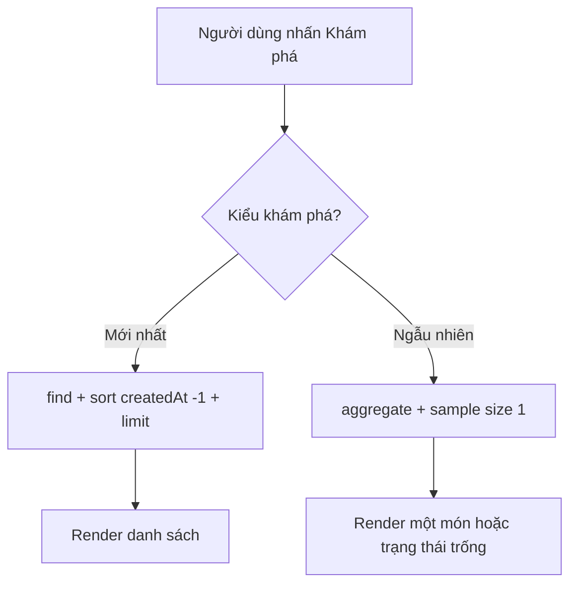

# Bài 11 — Khám phá công thức mới nhất và ngẫu nhiên

## 1. Tóm tắt

Xây dựng hai kiểu khám phá món: sắp xếp theo thời gian tạo và chọn ngẫu nhiên một món bằng MongoDB Aggregation Pipeline.

## 2. Mục tiêu học tập

- Phân biệt truy vấn theo thứ tự với truy vấn ngẫu nhiên.
- Dùng được `sort`, `limit` và `$sample`.
- Render đúng kiểu array và object từ hai dạng truy vấn.

## 3. Bối cảnh

Đích đến của bài học là một website công thức nấu ăn: người dùng xem, tìm, lọc và đóng góp món ăn; ứng dụng Node.js xử lý HTTP, còn MongoDB lưu dữ liệu công thức. Mỗi khái niệm dưới đây được trình bày cùng tình huống sử dụng trực tiếp trong dự án.

## 4. Nội dung chính

### 4.1. Trang món mới nhất

Định nghĩa route `/explore-latest` và query:

```js
const latest = await Recipe.find({})
  .sort({ createdAt: -1 })
  .limit(12);
res.render('explore/latest', { title: 'Món mới nhất', recipes: latest });
```

Nếu model không bật `timestamps`, sắp xếp theo `createdAt` không có ý nghĩa; model minh họa trong khóa học đã bật timestamps. Bản ghi có thể dùng `_id` làm một chỉ báo trình tự tương đối nhưng không thay thế thời gian tạo chính xác.

### 4.2. Công thức ngẫu nhiên

```js
const results = await Recipe.aggregate([{ $sample: { size: 1 } }]);
const recipe = results[0] || null;
if (!recipe) return res.render('explore/random', { title: 'Ngẫu nhiên', recipe: null });
res.render('explore/random', { title: 'Ngẫu nhiên', recipe });
```

`aggregate()` luôn trả array kết quả; ngay cả khi `$sample` lấy 1 món, biến `results` vẫn là array. Truy cập `results[0]` để lấy object truyền sang template.

### 4.3. Sơ đồ hai truy vấn



Trang mới nhất thường dùng `.forEach()` vì nhận array. Trang một món ngẫu nhiên dùng `recipe.name` và `recipe.description` vì nhận một object sau khi lấy phần tử đầu.

### 4.4. Khi cơ sở dữ liệu trống

Với `$sample`, mảng kết quả sẽ rỗng nếu không có dữ liệu. Kiểm tra null trước khi render; không truy cập trực tiếp `recipe.name` khi `recipe` chưa tồn tại.

## 5. Thực hành

1. Tạo hai route và hai view độc lập.
2. Thêm một món mới, kiểm tra nó xuất hiện đầu danh sách `latest`.
3. Mở `/explore-random` nhiều lần, quan sát món thay đổi khi dữ liệu đủ phong phú.
4. Xóa dữ liệu trên môi trường thử nghiệm rồi kiểm tra empty state.

**Checkpoint:** không dùng vòng lặp trên object từ `results[0]` và không crash khi DB trống.

## 6. Câu hỏi ôn tập

**Câu 1. Truy vấn nào lấy bản ghi mới nhất trước?**

A. `sort({createdAt: -1})`  
B. `sort({createdAt: 1})`  
C. `$sample: {size:1}`  
D. `findOne({random:true})`  

**Đáp án:** A. **Giải thích:** -1 sắp xếp giảm dần theo thời gian.

**Câu 2. `$sample` dùng để làm gì?**

A. Cập nhật công thức  
B. Xóa ảnh  
C. Chọn mẫu ngẫu nhiên  
D. Tạo form  

**Đáp án:** C. **Giải thích:** Aggregation stage sample chọn ngẫu nhiên theo số lượng.

**Câu 3. `Recipe.aggregate([...])` trả gì khi `$sample` size=1?**

A. Luôn một object  
B. Một array tối đa 1 phần tử  
C. Chuỗi JSON  
D. EJS view  

**Đáp án:** B. **Giải thích:** Aggregate trả array.

**Câu 4. Nếu kết quả random rỗng, giải pháp tốt nhất là gì?**

A. Gọi `.name` ngay  
B. Xóa MongoDB  
C. Trả file CSS  
D. Render thông báo không có công thức  

**Đáp án:** D. **Giải thích:** Dữ liệu trống cần được xử lý riêng.

**Câu 5. Với biến `recipes` từ `find()`, template phù hợp?**

A. Lặp các món với `forEach`  
B. Coi như một chuỗi  
C. Lấy `.name` trực tiếp của mảng  
D. Chỉ dùng `<h1>`  

**Đáp án:** A. **Giải thích:** `find` trả danh sách.

## 7. Tổng kết

Khám phá món mới và ngẫu nhiên dùng các truy vấn khác nhau và trả về kiểu dữ liệu khác nhau ở tầng view. Nắm rõ kiểu trả về giúp tránh lỗi render.
