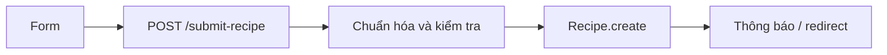

# Bài 12 — Biểu mẫu gửi công thức và thêm nguyên liệu động

## 1. Tóm tắt

Xây dựng form tạo món với tên, mô tả, email, nguyên liệu, category và ảnh; sử dụng JavaScript phía trình duyệt để thêm ô nguyên liệu mới.

## 2. Mục tiêu học tập

- Dựng form HTML có `name` khớp trường schema.
- Tạo được thao tác thêm input nguyên liệu bằng JavaScript.
- Chuẩn hóa được giá trị nguyên liệu nhận từ request thành array.

## 3. Bối cảnh

Đích đến của bài học là một website công thức nấu ăn: người dùng xem, tìm, lọc và đóng góp món ăn; ứng dụng Node.js xử lý HTTP, còn MongoDB lưu dữ liệu công thức. Mỗi khái niệm dưới đây được trình bày cùng tình huống sử dụng trực tiếp trong dự án.

## 4. Nội dung chính

### 4.1. Form HTML

```ejs
<form action="/submit-recipe" method="POST" enctype="multipart/form-data">
  <label>Tên món <input name="name" required></label>
  <label>Mô tả <textarea name="description" required></textarea></label>
  <label>Email <input name="email" type="email" required></label>
  <div id="ingredients-container">
    <input name="ingredients" placeholder="Nguyên liệu 1" required>
  </div>
  <button type="button" id="add-ingredient">Thêm nguyên liệu</button>
  <label>Danh mục
    <select name="category" required>
      <option value="Thai">Thai</option>
      <option value="American">American</option>
      <option value="Chinese">Chinese</option>
      <option value="Mexican">Mexican</option>
      <option value="Indian">Indian</option>
    </select>
  </label>
  <label>Ảnh món ăn <input name="image" type="file" accept="image/*"></label>
  <button type="submit">Gửi công thức</button>
</form>
<script src="/js/script.js" defer></script>
```

`enctype="multipart/form-data"` cần thiết để gửi cả dữ liệu văn bản và file. Thuộc tính `accept` chỉ hỗ trợ chọn file ở UI, **không** thay thế xác thực file phía server.

### 4.2. Thêm input động

```js
// public/js/script.js
const btn = document.querySelector('#add-ingredient');
const container = document.querySelector('#ingredients-container');
if (btn && container) {
  btn.addEventListener('click', () => {
    const input = document.createElement('input');
    input.name = 'ingredients';
    input.placeholder = 'Nguyên liệu tiếp theo';
    input.required = true;
    container.appendChild(input);
  });
}
```

Cách này tạo nhiều input cùng `name="ingredients"`. Tùy middleware, một input có thể nhận dạng chuỗi; nhiều input có thể nhận dạng array. Ở controller phải chuẩn hóa thay vì giả định chỉ có array.

### 4.3. Chuẩn hóa và kiểm tra body

```js
const raw = req.body.ingredients;
const ingredients = (Array.isArray(raw) ? raw : [raw])
  .filter(x => typeof x === 'string')
  .map(x => x.trim())
  .filter(Boolean);

const name = String(req.body.name || '').trim();
const description = String(req.body.description || '').trim();
const category = String(req.body.category || '').trim();
```

Dù HTML có `required`, server vẫn phải xác thực. Giới hạn số input, độ dài từng nguyên liệu và danh mục hợp lệ trước khi tạo bản ghi. Không tin tưởng giá trị select bởi người dùng có thể tự sửa request.

### 4.4. Luồng gửi



Bước ảnh phải được xử lý riêng trước khi lưu đường dẫn ảnh; bài kế tiếp triển khai upload và thông báo phản hồi.

## 5. Thực hành

1. Tạo `GET /submit-recipe` render form.
2. Nhấn nút thêm nguyên liệu ba lần, điền đủ tên/mô tả/email và chọn category.
3. Log dữ liệu đã chuẩn hóa trên server trong môi trường phát triển.
4. Thử gửi một input nguyên liệu và nhiều input để kiểm tra cùng nhận thành array.

**Checkpoint:** form gửi đúng tên trường; nguyên liệu không bị ghép hoặc mất phần tử.

## 6. Câu hỏi ôn tập

**Câu 1. Cần `enctype` nào khi form có ảnh?**

A. `application/json`  
B. `text/plain`  
C. `multipart/form-data`  
D. `application/xml`  

**Đáp án:** C. **Giải thích:** Multipart gửi tệp và các trường văn bản trong một request.

**Câu 2. Nút thêm nguyên liệu nên dùng type nào để không submit form ngay?**

A. button  
B. submit  
C. reset  
D. hidden  

**Đáp án:** A. **Giải thích:** type button chỉ thực hiện hành động JavaScript.

**Câu 3. Khi có nhiều input cùng name ingredients, controller nên làm gì?**

A. Luôn coi là số  
B. Chỉ dùng đầu tiên  
C. Bỏ hết input  
D. Chuẩn hóa thành array  

**Đáp án:** D. **Giải thích:** Server cần thống nhất kiểu dữ liệu để lưu schema mảng.

**Câu 4. `accept="image/*"` đã đủ bảo vệ upload?**

A. Đủ hoàn toàn  
B. Không, server vẫn phải kiểm tra  
C. Tự quét virus  
D. Chỉ kiểm tra với HTTPS  

**Đáp án:** B. **Giải thích:** `accept` là gợi ý phía browser, dễ bị thay đổi.

**Câu 5. Trường nào cần khớp danh sách `enum` model?**

A. name  
B. description  
C. category  
D. email  

**Đáp án:** C. **Giải thích:** Schema Recipe giới hạn category trong tập cho phép.

## 7. Tổng kết

Form là nguồn dữ liệu mới của ứng dụng. Thao tác thêm nguyên liệu động cần được kết hợp chuẩn hóa và validation phía server để lưu tài liệu đúng schema.
