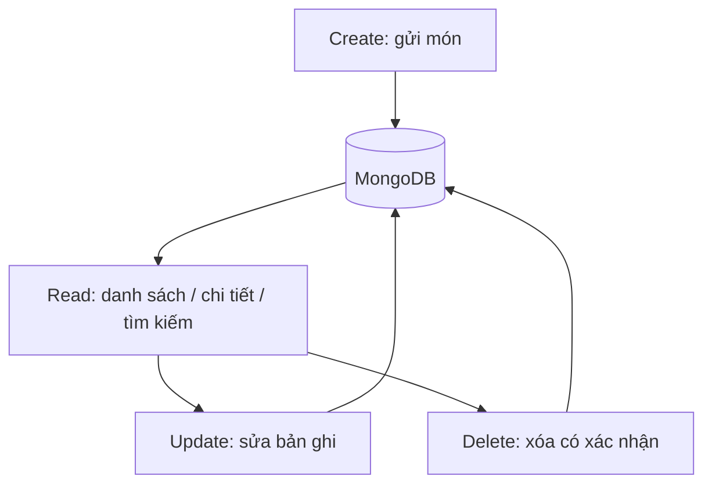

# Bài 14 — Cập nhật, xóa và tổng kết CRUD

## 1. Tóm tắt

Thực hành hai truy vấn cuối trong CRUD: `updateOne` và `deleteOne`, kiểm tra số bản ghi được khớp/thay đổi/xóa và nhận biết rủi ro ghi dữ liệu vô tình.

## 2. Mục tiêu học tập

- Viết được thao tác cập nhật và xóa theo điều kiện cụ thể.
- Phân biệt `matchedCount`, `modifiedCount` và `deletedCount`.
- Đề xuất được nguyên tắc bảo vệ các hành động ghi dữ liệu.

## 3. Bối cảnh

Đích đến của bài học là một website công thức nấu ăn: người dùng xem, tìm, lọc và đóng góp món ăn; ứng dụng Node.js xử lý HTTP, còn MongoDB lưu dữ liệu công thức. Mỗi khái niệm dưới đây được trình bày cùng tình huống sử dụng trực tiếp trong dự án.

## 4. Nội dung chính

### 4.1. CRUD trong dự án

| Loại | Mongoose | Ứng dụng |
| --- | --- | --- |
| Create | `Recipe.create()` | Gửi công thức |
| Read | `find()`, `findById()` | Trang chủ, search, chi tiết |
| Update | `updateOne()` | Sửa công thức |
| Delete | `deleteOne()` | Xóa công thức |

### 4.2. Cập nhật đúng một bản ghi

```js
const result = await Recipe.updateOne(
  { _id: recipeId },
  { $set: { name: 'Mì rau củ phiên bản mới' } },
  { runValidators: true }
);
console.log(result.matchedCount, result.modifiedCount);
```

`matchedCount` cho biết có bao nhiêu tài liệu khớp bộ lọc; `modifiedCount` cho biết bao nhiêu tài liệu thực sự bị sửa. Giá trị mới giống giá trị cũ có thể khiến matchedCount là 1 nhưng modifiedCount là 0.

### 4.3. Xóa một bản ghi

```js
const result = await Recipe.deleteOne({ _id: recipeId });
console.log(result.deletedCount);
```

Điều kiện cần đủ cụ thể. Tuyệt đối không dùng `deleteMany({})` cho bài xóa một món và không tự chạy thao tác xóa trong controller của route GET trang chủ.

### 4.4. Không cập nhật/xóa khi refresh trang

Cần tách thao tác ghi thành HTTP `POST`, `PATCH` hoặc `DELETE` phù hợp với giao diện/API; có xác thực quyền sở hữu và cơ chế chống CSRF. Không đặt mã update/delete ở ngoài route để tự chạy khi app khởi động hoặc mỗi lần trình duyệt tải trang. Với ảnh tải lên, xóa món cần xem xét xóa file liên quan và cơ chế hoàn tác.

### 4.5. Tự kiểm tra cuối khóa



Luồng CRUD này thể hiện các thao tác cốt lõi. Việc bổ sung quyền truy cập, form edit và giao diện quản trị là phần mở rộng cần thiết nếu xuất bản cho người dùng thật.

## 5. Thực hành

1. Trong một script thử nghiệm riêng, tạo một Recipe demo, sửa tên nó rồi kiểm tra `matchedCount` và `modifiedCount`.
2. Xóa đúng bản ghi demo bằng ID, xác nhận `deletedCount`.
3. Thử cập nhật ID không tồn tại và ghi lại kết quả.
4. Hoàn thành dự án cuối khóa tại `Bai_tap/du-an-cuoi-khoa.md`.

**Checkpoint:** các thao tác không chạy lại khi refresh trình duyệt và không chạm bản ghi ngoài mục tiêu.

## 6. Câu hỏi ôn tập

**Câu 1. Phương thức nào cập nhật một bản ghi?**

A. `Recipe.find()`  
B. `Recipe.updateOne()`  
C. `Recipe.sample()`  
D. `Recipe.render()`  

**Đáp án:** B. **Giải thích:** `updateOne` sửa theo bộ lọc cho tối đa một tài liệu.

**Câu 2. `matchedCount=1`, `modifiedCount=0` có thể nghĩa là gì?**

A. Không kết nối được DB  
B. Xóa thất bại  
C. Có bản ghi khớp nhưng giá trị không đổi  
D. Luôn là lỗi 500  

**Đáp án:** C. **Giải thích:** Khớp bản ghi không nhất thiết làm dữ liệu khác trước.

**Câu 3. Kết quả nào phản ánh số bản ghi bị xóa bởi `deleteOne`?**

A. `deletedCount`  
B. `matchedCount`  
C. `limit`  
D. `_id`  

**Đáp án:** A. **Giải thích:** Đối tượng kết quả deleteOne có deletedCount.

**Câu 4. Vì sao không đặt delete trong route GET?**

A. GET không nhận req  
B. MongoDB từ chối GET  
C. EJS sẽ bị lỗi  
D. Refresh/link preview có thể kích hoạt xóa ngoài ý muốn  

**Đáp án:** D. **Giải thích:** GET phải dùng cho truy xuất, không gây side effect phá hủy.

**Câu 5. Để chỉ sửa một món an toàn, điều kiện quan trọng nào cần có?**

A. Chỉ so theo category  
B. Bộ lọc theo ID và kiểm tra quyền  
C. Dùng CSS selector  
D. Không cần xác thực  

**Đáp án:** B. **Giải thích:** ID định vị đối tượng, authorization quyết định người dùng được sửa.

## 7. Tổng kết

Hoàn thành CRUD nghĩa là tạo, đọc, sửa, xóa có điều kiện và kiểm soát lỗi. Khi ứng dụng tiến tới môi trường thật, bổ sung xác thực, phân quyền, chống CSRF và quản lý ảnh đi kèm.
