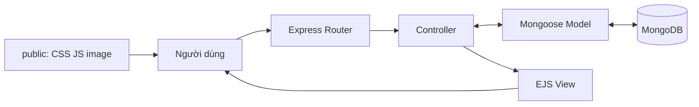
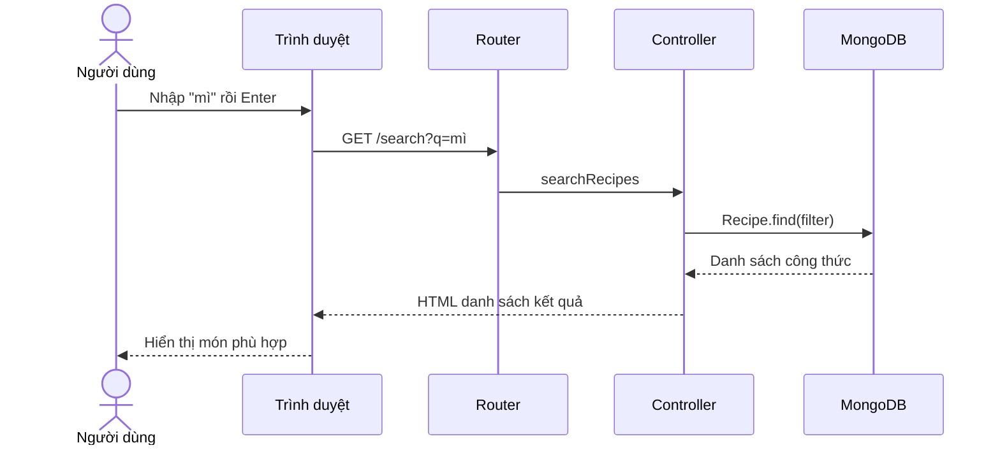
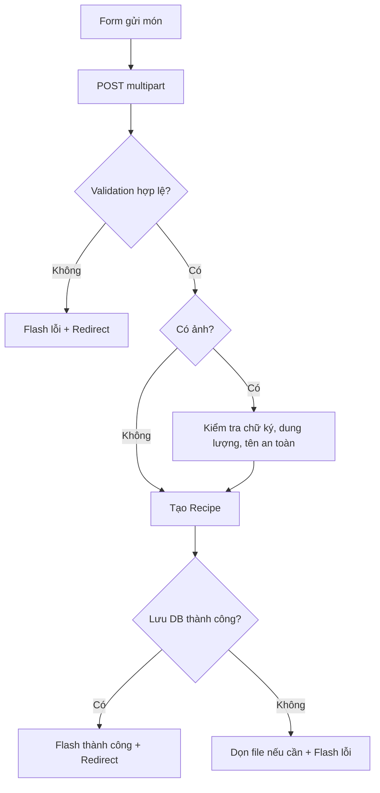

# Sơ đồ kiến trúc và luồng dữ liệu

## 1. Kiến trúc tổng quan

`Express Router` khớp phương thức và URL. `Controller` xử lý dữ liệu và ra quyết định. `Mongoose Model` tiếp cận database. `EJS View` trả HTML; `public` cung cấp tài nguyên tĩnh.

## 2. Tìm món ăn

Tìm kiếm cơ bản dùng điều kiện tên món. Nếu muốn hỗ trợ tiếng Việt không dấu hoặc yêu cầu tự nhiên theo nghĩa, cần cải thiện thiết kế tìm kiếm.

## 3. Gửi công thức

Khi có ảnh, server không nên chỉ tin `accept` của thẻ input; cần xác thực file độc lập ở server.
