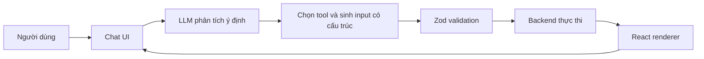

# Generative UI: Từ chatbot văn bản tới giao diện phản hồi theo ngữ cảnh

> **Loại bài:** lesson · **Chuyên đề:** Module 01 — Nền tảng và kiến trúc

## 1. Tóm tắt

Generative UI là phương pháp dùng LLM lựa chọn **kiểu hiển thị** theo ý định và dữ liệu, thay vì trả về một đoạn văn cho mọi câu hỏi. Ứng dụng vẫn sử dụng các React component đã được lập trình, kiểm thử và cấp quyền từ trước; AI chỉ đề xuất hành động và dữ liệu đầu vào.

## 2. Mục tiêu học tập

- Phân biệt chatbot văn bản, tool calling và Generative UI.
- Mô tả chuỗi xử lý từ lời nhắc đến React component.
- Đề xuất ít nhất ba trạng thái giao diện cho một công cụ.

## 3. Vấn đề của giao diện chat thuần văn bản

Một câu hỏi như “Hiển thị ví của tôi dưới dạng biểu đồ” chứa cả ý định **truy vấn dữ liệu** và **cách trình bày**. Nếu LLM trả về đoạn văn “BTC chiếm 60%, ETH chiếm 40%”, người dùng khó so sánh số dư và phải tự tưởng tượng tỷ trọng. Generative UI dùng lời nhắc để chọn component phù hợp, ví dụ `WalletDonutChart`, rồi chuyển dữ liệu đã xác minh cho component đó.

Ba lớp cần tách bạch: **hiểu ý định** (LLM), **thực hiện nghiệp vụ** (tool/backend) và **hiển thị** (React). Gộp chúng trong một đoạn JSX lớn khiến khó quản lý lỗi, bảo mật và kiểm thử.

## 4. Cơ chế từ prompt đến component

Mỗi mũi tên là một trách nhiệm. LLM không được quyền tự tạo HTML/JavaScript bất kỳ để chạy trong trình duyệt; ứng dụng quyết định danh sách tool và component được phép dùng. Ví dụ câu “Tạo dashboard 3 cột, 2 hàng” được chuyển thành `drawGrid({ columns: 3, rows: 2 })` và renderer sẽ nhận hai số nguyên đã kiểm tra.

## 5. Kịch bản điển hình

| Yêu cầu | Tool được chọn | Component đầu ra |
| --- | --- | --- |
| “Tạo lưới 3 × 2” | `drawGrid` | `GridPreview` |
| “Xem cơ cấu tài sản” | `getWalletBalances` | `WalletDonutChart` |
| “Có airdrop nào cho Cosmos?” | `findAirdrops` | `AirdropCards` |
| “Cho xem ABI này” | `inspectContractABI` | `ContractInterface` |
| “Mua token X” | `preparePurchase` | `PurchaseReview` và bước xác nhận |

Cùng một chatbot có thể chọn trả **văn bản thông thường** nếu yêu cầu chỉ là giải thích khái niệm. Không nên ép mọi câu hỏi thành card hay biểu đồ.

## 6. Thiết kế trạng thái hiển thị

Mỗi component cần các trạng thái: `loading` (skeleton), `ready` (có dữ liệu), `empty` (không có kết quả), `error` (lỗi API hoặc dữ liệu) và, với giao dịch, `requires-confirmation` (chưa được phép thực hiện). Trạng thái này là logic ứng dụng, không phải mệnh lệnh mơ hồ của LLM.

Một lỗi thiết kế thường gặp là coi mô tả của AI như số dư thật. Mọi dữ liệu nhạy cảm, số dư và giao dịch phải đến từ nguồn dữ liệu đáng tin cậy, không được gán bằng câu văn do mô hình tự tạo.

## 7. Thực hành và kiểm tra

**Bài tập:** Phác thảo giao diện cho ba câu: “Chào bạn”, “Vẽ lưới 4 hàng 2 cột” và “Mua 0,02 ETH”. Ghi tên tool, dữ liệu bắt buộc, component và trạng thái hiển thị. Câu giao dịch phải có bước xác nhận và tuyệt đối không thực hiện ngay. **Đạt** khi giải thích được vì sao câu chào không cần tool.

## 8. Câu hỏi ôn tập

### Câu 1

Người dùng yêu cầu vẽ lưới 2 × 3. Ai nên chịu trách nhiệm dựng HTML cuối cùng?

A. Component React được khai báo trước  
B. Prompt của người dùng  
C. Zod render trực tiếp
D. LLM tự chạy mã bất kỳ  

**Đáp án:** A.

**Giải thích:** React renderer đã được lập trình và kiểm thử; LLM chỉ chọn tool và cung cấp input.

### Câu 2

Khi nào nên dùng câu trả lời dạng văn bản?

A. Mọi yêu cầu đều cần biểu đồ  
B. Khi người dùng chỉ hỏi khái niệm  
C. Khi có tool  
D. Khi backend đang lỗi

**Đáp án:** B.

**Giải thích:** Generative UI không thay thế câu trả lời văn bản cho yêu cầu không cần cấu trúc trực quan.

### Câu 3

Bước nào ngăn rows=-5 từ AI?

A. Spinner
B. Tooltip  
C. Zod validation  
D. CSS  

**Đáp án:** C.

**Giải thích:** Schema kiểm tra các ràng buộc dữ liệu trước khi renderer sử dụng.

### Câu 4

Ứng dụng nhận yêu cầu mua crypto. Hành động an toàn trước tiên là gì?

A. Đổi model
B. Gửi giao dịch ngay  
C. Bỏ xác thực  
D. Hiện màn hình review và chờ xác nhận  

**Đáp án:** D.

**Giải thích:** Tool tác động tài sản phải có xác thực, phê duyệt và xác nhận tường minh.

### Câu 5

Vì sao không dùng số dư do LLM tự viết làm dữ liệu hiển thị?

A. LLM có thể tạo dữ liệu không được kiểm chứng  
B. React không nhận JSON  
C. Zod chỉ chạy client
D. Biểu đồ không hỗ trợ số  

**Đáp án:** A.

**Giải thích:** Dữ liệu nghiệp vụ phải được lấy từ nguồn đáng tin và được kiểm tra.

## 9. Tổng kết

Generative UI là phương pháp dùng LLM lựa chọn **kiểu hiển thị** theo ý định và dữ liệu, thay vì trả về một đoạn văn cho mọi câu hỏi. Ứng dụng vẫn sử dụng các React component đã được lập trình, kiểm thử và cấp quyền từ trước; AI chỉ đề xuất hành động và dữ liệu đầu vào.
