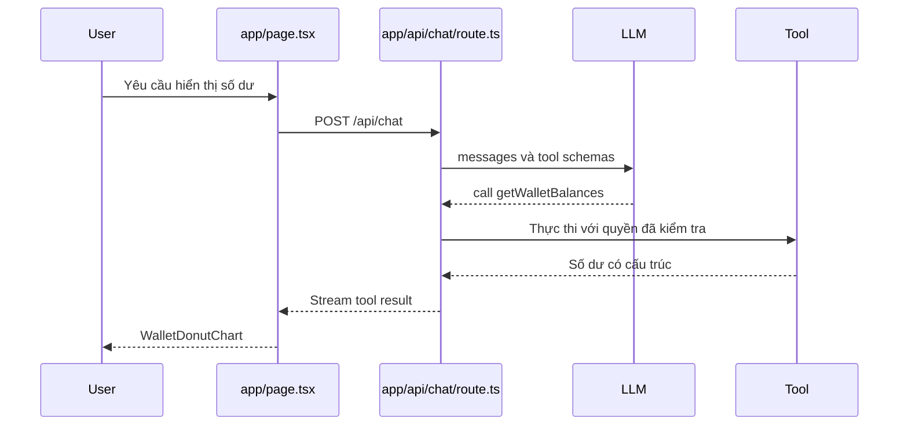

# Kiến trúc Next.js App Router và cấu trúc mã nguồn

> **Loại bài:** lesson · **Chuyên đề:** Module 01 — Nền tảng và kiến trúc

## 1. Tóm tắt

Tổ chức rõ `app/api`, `app/actions`, `app/layout`, `app/page`, `components` và `schemas` giúp tách phần mô hình, hành động và render. Kiểu tổ chức này cũng thích hợp khi ứng dụng Generative UI được ghép vào monorepo có sẵn.

## 2. Mục tiêu học tập

- Thiết kế cây thư mục Next.js theo trách nhiệm.
- Giải thích ranh giới Server Component và Client Component.
- Lập bản đồ dữ liệu từ route handler đến giao diện.

## 3. Bản đồ thư mục tham chiếu

```text
app/
  api/chat/route.ts        # Streaming endpoint của mô hình
  actions.tsx              # Server Actions (nếu sử dụng RSC)
  layout.tsx               # Root layout và providers
  page.tsx                 # Trang chat, shortcut, gửi prompt
components/
  chat.tsx                 # Client UI, message list, form
  grid-preview.tsx         # Dashboard grid
  wallet-donut.tsx         # Biểu đồ ví
  airdrop-cards.tsx        # Danh sách airdrop
  contract-interface.tsx   # ABI read/write UI
  providers.tsx            # Client-side UI providers
schemas/
  dashboard.ts             # Zod schema lưới
  wallet.ts                # Kiểm tra kết quả số dư
lib/
  ai-model.ts              # Provider/model config trên server
  authorization.ts         # Xác thực và quyền truy cập
```

Đường dẫn `app/api/route.ts` cũng có thể dùng nhưng sẽ tạo endpoint `/api`, trong khi `app/api/chat/route.ts` tạo endpoint `/api/chat` khớp mặc định của `useChat`.

## 4. Chức năng mỗi file

`route.ts` nhận JSON request, kiểm tra dữ liệu, tạo stream và trả HTTP response. `actions.tsx` là lựa chọn cho những thao tác server xuất phát từ UI, đặc biệt khi học kiến trúc RSC cũ. Không cần khai báo cùng một logic ở cả route handler lẫn server action chỉ để “cho đầy đủ”.

`layout.tsx` là server component mặc định. UI provider dùng hook hoặc browser API phải được đặt trong một client wrapper như `components/providers.tsx`. Khi dùng Chakra UI, phần provider cần được đánh dấu `'use client'`; không nhất thiết biến toàn bộ root layout thành client component.

## 5. Monorepo và tái sử dụng component

Ứng dụng lớn thường có một package UI chung và nhiều app. `components/` có thể dần được thay bằng `packages/ui` cho những thành phần như Button, Airdrop Card, biểu đồ và theme. Đảm bảo package chung không import server-only credentials vào client bundle.

Một đường phụ thuộc hợp lý là `app -> components -> schemas` ở UI, và `app/api -> lib -> databases/providers` ở backend. Không để component `WalletDonutChart` tự gọi secret-key API hoặc quyết định quyền truy cập tài sản.

## 6. Luồng yêu cầu end-to-end



Các endpoint và trường JSON phụ thuộc phiên bản SDK. Sơ đồ nhằm làm rõ trách nhiệm, không phải wire format của một phiên bản cụ thể.

## 7. Thực hành và kiểm tra

**Bài thực hành:** Tạo cấu trúc thư mục mẫu trên giấy hoặc trong editor. Với từng yêu cầu “stream tin nhắn”, “vẽ donut”, “validate rows” và “bật Chakra theme”, chọn đúng file. **Đạt** khi không đưa API key vào component client và phân biệt được `/api` với `/api/chat`.

## 8. Câu hỏi ôn tập

### Câu 1

Muốn endpoint `/api/chat`, file route nên đặt ở đâu?

A. schemas/chat.ts
B. app/chat/page.tsx  
C. app/api/chat/route.ts  
D. components/chat.tsx  

**Đáp án:** C.

**Giải thích:** App Router ánh xạ thư mục route.ts thành endpoint tương ứng.

### Câu 2

Nên đặt wrapper cho Chakra provider phụ thuộc client ở đâu?

A. Trong API route  
B. Trong Zod schema  
C. Trong ENV file
D. Trong client component `providers.tsx`  

**Đáp án:** D.

**Giải thích:** Provider cần client boundary để dùng hooks/context.

### Câu 3

Nơi hợp lý để giữ model API key là?

A. Server config hoặc environment của server  
B. Shortcut text
C. Client JSX  
D. CSS  

**Đáp án:** A.

**Giải thích:** Secret không được bundling xuống browser.

### Câu 4

Chức năng chính của `schemas/dashboard.ts` là gì?

A. Lưu API key  
B. Mô tả và kiểm tra đầu vào grid  
C. Tạo HTTP response  
D. Render widget

**Đáp án:** B.

**Giải thích:** Schema định nghĩa dữ liệu hợp lệ.

### Câu 5

Tại sao tách component khỏi tool?

A. Để loại bỏ backend
B. Để JSX chạy trong LLM  
C. Để test và tái sử dụng UI độc lập  
D. Để bỏ validation  

**Đáp án:** C.

**Giải thích:** Render, nghiệp vụ và điều phối cần được kiểm thử riêng.

## 9. Tổng kết

Tổ chức rõ `app/api`, `app/actions`, `app/layout`, `app/page`, `components` và `schemas` giúp tách phần mô hình, hành động và render. Kiểu tổ chức này cũng thích hợp khi ứng dụng Generative UI được ghép vào monorepo có sẵn.
