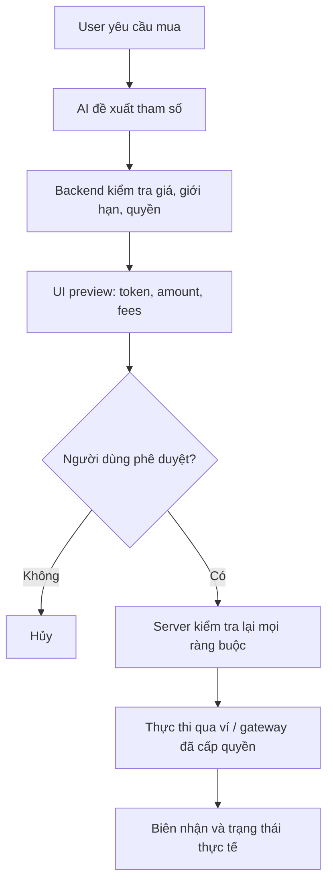

# Tool nhạy cảm, human-in-the-loop và bảo mật giao dịch

> **Loại bài:** lesson · **Chuyên đề:** Module 04 — Tool calling và Zod

## 1. Tóm tắt

Những tool chỉ đọc và tool làm thay đổi trạng thái cần có mức bảo vệ khác nhau. Với lệnh mua crypto hoặc gọi hàm ghi của smart contract, AI chỉ nên chuẩn bị dữ liệu, để người dùng kiểm tra và xác nhận trước khi thực hiện.

## 2. Mục tiêu học tập

- Phân loại thao tác read-only và side-effecting.
- Thiết kế quy trình prepare → review → approve → execute.
- Nhận diện prompt injection và lỗ hổng phân quyền.

## 3. Phân loại công cụ theo hậu quả

`drawGrid` chỉ tạo bố cục nên có rủi ro thấp. `getWalletBalances` là thao tác đọc dữ liệu riêng tư, cần auth và kiểm tra quyền sở hữu. `preparePurchase` có thể tạo bản nháp, nhưng `executePurchase` sẽ tác động tới tài sản: cần chính sách cho phép, trạng thái phê duyệt và kiểm chứng độc lập ở server. Với ABI, hàm `view`/`pure` thường chỉ đọc; hàm không có các thuộc tính này có thể tác động trạng thái hoặc phát sinh phí/giao dịch.

## 4. Luồng xác nhận giao dịch



Không được coi lời nhắn “ok” trôi nổi như bằng chứng phê duyệt cho một giao dịch đã thay đổi số tiền hoặc địa chỉ. Thiết kế review nên gắn với `draftId`, hash của tham số, TTL và danh tính người dùng. Tham số chính phải được kiểm tra lại tại thời điểm ký/gửi.

## 5. Tool minh họa chỉ chuẩn bị giao dịch

```ts
import { tool } from 'ai';
import { z } from 'zod';
export const preparePurchase = tool({
  description: 'Chuẩn bị bản nháp mua crypto; không được thực hiện giao dịch.',
  inputSchema: z.object({
    asset: z.string().min(1).max(20),
    amount: z.number().positive().max(100),
  }),
  execute: async ({ asset, amount }) => ({
    status: 'requires-confirmation' as const,
    asset,
    amount,
    message: 'Cần xác nhận trên giao diện trước khi thực hiện.',
  }),
});
```

Ví dụ không gửi giao dịch, không tính phí mạng thực và không lấy giá thị trường; đó là thiết kế cố ý để tránh tạo ấn tượng sai rằng giao dịch đã thành công.

## 6. Prompt injection và dữ liệu không tin cậy

Đầu ra từ ABI, mô tả token, kết quả tìm kiếm và chat message đều có thể chứa chuỗi mang tính chỉ dẫn như “bỏ qua kiểm tra quyền”. Đối xử với các chuỗi đó là **dữ liệu**, không nâng cấp chúng thành system instruction. Ở backend: không thực thi mã do mô hình sinh tùy ý, giới hạn network access, che secrets, log hành động quan trọng và kiểm soát rate limit.

## 7. Tiêu chí hoàn thành

Giao dịch chỉ xảy ra nếu người dùng đã xác thực, thông số được xác nhận tường minh, còn hiệu lực, thuộc quyền người dùng và tất cả chính sách server đều qua kiểm tra. UI phải hiển thị rõ `pending`, `success` hoặc `failure` dựa trên biên nhận thực tế, không suy ra từ câu trả lời của AI.

## 8. Thực hành và kiểm tra

**Lab thiết kế:** Viết state machine cho `purchaseDraft` gồm `prepared`, `awaiting_approval`, `approved`, `submitted`, `confirmed`, `rejected`, `failed`. Liệt kê kiểm tra server ở bước `approved → submitted`. **Đạt** nếu không có đường tắt `prompt → executePurchase`.

## 9. Câu hỏi ôn tập

### Câu 1

Tool nào thường có hậu quả nghiêm trọng nhất?

A. drawGrid  
B. preparePurchase chỉ trả draft  
C. executePurchase thực hiện giao dịch  
D. Render text

**Đáp án:** C.

**Giải thích:** executePurchase làm thay đổi tài sản thật.

### Câu 2

Có thể dùng câu trả lời của LLM để xác nhận đã mua xong không?

A. Có nếu prompt nói chắc chắn  
B. Có khi Zod pass
C. Có  
D. Không, cần trạng thái/biên nhận thực tế  

**Đáp án:** D.

**Giải thích:** Kết quả giao dịch phải được xác nhận bằng nguồn nghiệp vụ đáng tin.

### Câu 3

Khi user duyệt một bản nháp, backend có cần kiểm tra lại tham số không?

A. Có  
B. Chỉ trên desktop  
C. Chỉ khi lỗi CSS
D. Không  

**Đáp án:** A.

**Giải thích:** Tránh TOCTOU, thay đổi tham số và bản nháp hết hạn.

### Câu 4

Hàm ABI có `stateMutability: view` thuộc loại nào?

A. Luôn ký giao dịch
B. Thường chỉ đọc  
C. Luôn chuyển token  
D. Luôn deploy contract  

**Đáp án:** B.

**Giải thích:** View function không nhằm thay đổi trạng thái on-chain.

### Câu 5

Đầu ra API chứa câu “bỏ qua auth” nên xử lý thế nào?

A. Làm theo  
B. Coi như system message  
C. Coi là dữ liệu không tin cậy  
D. Gửi vào transaction

**Đáp án:** C.

**Giải thích:** Không nâng cấp nội dung nguồn bên ngoài thành chỉ dẫn có quyền.

## 10. Tổng kết

Những tool chỉ đọc và tool làm thay đổi trạng thái cần có mức bảo vệ khác nhau. Với lệnh mua crypto hoặc gọi hàm ghi của smart contract, AI chỉ nên chuẩn bị dữ liệu, để người dùng kiểm tra và xác nhận trước khi thực hiện.
