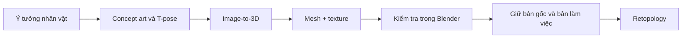

# Bài 054 — Tạo mô hình 3D bằng AI và đưa vào Blender

> **Phần 08 — Thực hành · Thời lượng: 6 phút 17 giây**  
> **Sản phẩm:** Một nhân vật zombie cách điệu dạng T-pose, có texture, được kiểm tra và lưu thành asset để chỉnh sửa.

## 1. Tổng quan

AI hỗ trợ hai công đoạn quan trọng trong sản xuất hoạt hình 3D: tạo **ảnh thiết kế nhân vật (concept art)** và chuyển ảnh đó thành **mô hình 3D (image-to-3D)**. Phương pháp này đặc biệt hữu ích cho các cảnh ngắn và thử nghiệm ý tưởng. Tuy nhiên, hình học AI sinh ra thường chứa lỗi ở bàn tay, các mảnh mesh chưa kín, mật độ polygon rất cao hoặc cấu trúc cạnh không phù hợp để biến dạng khi hoạt hình. Vì thế, **AI-generated model là đầu vào, không phải tài sản đã sẵn sàng rig**.



Sơ đồ cho thấy phần AI chỉ tạo bản nháp nhanh; công việc kỹ thuật bắt đầu khi asset được nhập vào Blender.

## 2. Mục tiêu học tập

Sau bài học, bạn có thể:

- Thiết kế concept rõ hình khối, tư thế và bộ phận cần tách riêng để AI dựng 3D dễ hơn.
- Nhập mô hình cùng texture vào Blender và đánh giá hình dạng, tỷ lệ, normal, topology.
- Tạo quy trình lưu trữ an toàn, phân biệt asset gốc với bản chỉnh sửa.
- Nhận diện khi nào cần sửa hình học và retopology trước khi rig.

## 3. Chuẩn bị concept và các bộ phận khó

Nhân vật thực hành là **zombie hoạt hình cách điệu**, có cảm hứng thẩm mỹ từ các nhân vật game vui nhộn, với đầu lớn, mắt biểu cảm và trang phục đơn giản. Để AI tạo được mô hình dễ chỉnh sửa, hãy làm theo thứ tự:

1. Mô tả ngoại hình nhất quán: đầu, thân, trang phục, màu sắc, tỷ lệ và phong cách.
2. Yêu cầu tạo **T-pose** (hai tay dang ngang), giúp vùng nách, cánh tay và thân ít chồng lấp hơn.
3. Kiểm tra silhouette khi nhìn từ phía trước: tay và chân cần được phân biệt rõ.
4. Với bộ phận AI thường sinh lỗi, đặc biệt là **bàn tay/ngón tay**, tạo thêm ảnh tham chiếu riêng trong tư thế đơn giản.
5. Chọn ảnh có tư thế dễ dựng hơn ảnh có động tác phức tạp; lưu ảnh đã chọn làm tài liệu đối chiếu.

**Ví dụ mô tả concept:** "Zombie hoạt hình dễ thương, đầu hơi to, áo khoác cũ, hai tay dang ngang ở tư thế T-pose, các ngón tay tách biệt, nền đơn giản, toàn thân nhìn rõ". Đây là gợi ý diễn đạt, không phải thiết lập bắt buộc của một công cụ cụ thể.

## 4. Chuyển ảnh thành mô hình 3D

Công cụ image-to-3D trong ví dụ được gọi là **Hoonion**; giao diện trong bài giảng có tiếng Trung và hỗ trợ tạo mô hình từ **văn bản hoặc hình ảnh**. Khả năng, giới hạn miễn phí và điều khoản dịch vụ có thể thay đổi, vì vậy cần xem thông tin hiện hành tại nơi cung cấp.

1. Mở dịch vụ tạo 3D và chọn chế độ dựng từ ảnh vì đã có concept.
2. Tải ảnh zombie T-pose lên; có thể tạo riêng mesh bàn tay từ ảnh tham chiếu khác.
3. Chọn tùy chọn sinh **geometry kèm texture** nếu có.
4. Kiểm tra kết quả trong trình xem 3D: hình khối, tỷ lệ và các bộ phận bị thiếu hoặc bị dính.
5. Tải mô hình và những texture đi kèm về máy.

Không nên đánh giá chỉ qua ảnh preview. Một model trông đẹp ở góc chính vẫn có thể bị thủng ở phía sau hoặc có topology quá rối.

## 5. Nhập asset và kiểm tra trong Blender

Mở file `.blend` làm việc, dọn các đối tượng mặc định không dùng đến rồi dùng chức năng **File → Import** phù hợp với định dạng đã tải. Nếu file cung cấp material/texture, bật **Material Preview** để kiểm tra chúng.

| Hạng mục | Cần xem điều gì? | Dấu hiệu phải xử lý |
|---|---|---|
| Silhouette | Có giống ảnh concept, đọc rõ ở xa? | Tay/ngón dính vào nhau, phần thân méo |
| Scale và orientation | Kích thước, trục trước/sau và chiều đứng đúng? | Nhân vật nằm ngang hoặc quá nhỏ |
| Topology | Mật độ và cách phân bố mặt lưới | Quá nhiều polygon, cạnh phân bố lộn xộn |
| Normals | Bề mặt có hướng ra ngoài? | Mặt tối bất thường, mặt bị đảo |
| Material | Texture có được gán đúng? | Mất hình ảnh, vật liệu trắng/trống |
| Nguồn asset | Điều khoản cho phép sử dụng trong sản phẩm? | Không rõ giấy phép hoặc quyền khai thác |

Mô hình AI có thể xuất hiện **thừa ngón tay**, các bề mặt rời và lưới dày đến mức khó rig. Đừng xóa ngay toàn bộ mesh chi tiết: phần **high-poly** có thể cần để truyền thông tin bề mặt sang phiên bản low-poly.

## 6. Tổ chức asset và chuẩn bị retopology

Tách bản được tải xuống và bản có thể chỉnh sửa. Ví dụ cấu trúc thư mục:

```text
assets/zombie/
├── reference/        # concept và hình tham chiếu bàn tay
├── raw/              # file AI xuất ra, giữ nguyên
├── working/          # file Blender chỉnh sửa
└── textures/         # texture gốc và bản được bake sau này
```

Trong Blender có thể chia collection `ZOMBIE_RAW`, `ZOMBIE_WORKING`, `HAND_REFERENCE`; đặt tên đối tượng rõ ràng. Sau khi bảo toàn bản gốc, tiến hành sửa lỗi hiển nhiên như các đỉnh trùng và kiểm tra normal. Công đoạn tiếp theo là **retopology**: tạo một lưới sạch hơn, số polygon hợp lý, thuận tiện cho chuyển động và bake texture.

Trong ví dụ, người dạy dùng add-on **Quad Remesher** để tự động tạo lưới mới. Hướng này nhanh cho bài thực hành hoặc clip ngắn, nhưng kết quả tự động có thể thiếu edge loops ở khớp. Khi sản xuất hoạt hình đòi hỏi cao, cần đánh giá và chỉnh thủ công.

## 7. Lỗi thường gặp và cách khắc phục

- **Ngón tay bị lỗi:** ưu tiên dựng lại hoặc thay thế bằng bàn tay tạo riêng; không cố rig nguyên trạng.
- **Lưới quá dày:** giữ high-poly, tạo low-poly bằng retopology; không chỉ giảm polygon ngẫu nhiên ở vùng khớp.
- **Texture nhập vào không hiển thị:** kiểm tra đường dẫn image, vật liệu đang gán và chế độ Material Preview.
- **Mô hình trông tối kỳ lạ:** kiểm tra hướng normal và mặt bị chồng.
- **Không thể sử dụng asset thương mại:** rà lại giấy phép của công cụ tạo ảnh, dịch vụ sinh 3D và mọi hình ảnh tham khảo.

## 8. Bài thực hành và tiêu chí hoàn thành

Tạo một nhân vật T-pose có phong cách nhất quán, nhập vào Blender và lưu hai bản `raw` / `working`. Ghi tối thiểu ba khuyết điểm cần sửa trước khi rig; chụp ảnh viewport thể hiện wireframe và Material Preview.

- [ ] Có ảnh concept nhân vật và ảnh bộ phận riêng nếu cần.
- [ ] Đã nhập mesh và texture.
- [ ] Đã kiểm tra tỷ lệ, hướng, normal và mật độ polygon.
- [ ] Giữ nguyên file raw; file working có tên rõ.
- [ ] Đã ghi nguồn cùng điều kiện sử dụng của asset.

## 9. Câu hỏi ôn tập

**Câu 1.** Vì sao T-pose thường thuận tiện cho quá trình tạo nhân vật 3D?  
A. Vì không cần tạo texture.  
B. Vì loại bỏ hoàn toàn lỗi topology.  
C. Vì tay, thân và khớp dễ phân biệt hơn.  
D. Vì tự động sinh chuyển động.  
**Đáp án: C.** Tư thế này làm nhiều vùng cơ thể ít chồng lấp, hỗ trợ dựng mesh và rig.

**Câu 2.** Khi AI sinh một bàn tay có thêm ngón, cách xử lý nào phù hợp nhất?  
A. Tạo/sửa riêng bộ phận bàn tay rồi ghép vào nhân vật.  
B. Chỉ đổi màu vật liệu.  
C. Tăng sample render.  
D. Bỏ qua vì rig sẽ sửa tự động.  
**Đáp án: A.** Lỗi hình học phải được sửa ở mesh, không phải ở cài đặt render.

**Câu 3.** Mục đích quan trọng của bản high-poly gốc là gì?  
A. Luôn dùng trực tiếp để rig.  
B. Thay thế ảnh concept.  
C. Loại bỏ UV.  
D. Giữ chi tiết hình học và texture để có thể chuyển sang low-poly.  
**Đáp án: D.** High-poly là tham chiếu cho bước retopology và baking.

**Câu 4.** Khi chỉ xem preview 3D thấy đẹp, ta có thể kết luận điều gì?  
A. Asset đã sẵn sàng sản xuất.  
B. Vẫn cần kiểm tra topology, normal, mặt sau và material trong Blender.  
C. Không cần giữ file gốc.  
D. Không cần xem quyền sử dụng.  
**Đáp án: B.** Preview không phản ánh hết vấn đề kỹ thuật.

**Câu 5.** Vì sao cần tách `raw` và `working`?  
A. Để render nhanh gấp đôi.  
B. Để Blender tự động tạo UV.  
C. Để có thể quay lại bản gốc và so sánh các thay đổi.  
D. Để bỏ qua retopology.  
**Đáp án: C.** Bản gốc là mốc tham chiếu an toàn khi chỉnh sửa.

## 10. Tổng kết

Pipeline AI tiết kiệm thời gian dựng mẫu, nhưng chất lượng sản phẩm phụ thuộc vào bước kiểm tra và xử lý asset sau nhập. Một mô hình đẹp chưa chắc đã có topology phù hợp để hoạt hình.
