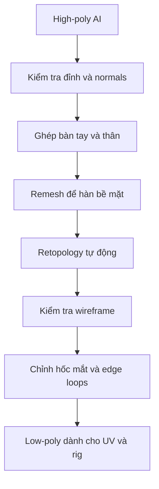

# Bài 055 — Retopology: tái cấu trúc lưới nhân vật để hoạt hình

> **Phần 08 — Thực hành · Thời lượng: 7 phút 36 giây**  
> **Sản phẩm:** Zombie low-poly có cấu trúc lưới đủ sạch để UV, bake texture và biến dạng theo xương; đôi mắt được tách để tạo chuyển động riêng.

## 1. Tổng quan

Mô hình sinh bằng AI thường có mesh dày, thiếu edge loops quanh khớp và có những phần chưa nối nhau. **Retopology** là quá trình xây dựng lại topology trên bề mặt cũ để giảm polygon và thiết kế đường chạy cạnh (*edge flow*) hợp lý. Mục đích không chỉ là "làm nhẹ" mô hình: một mesh có số mặt ít hơn nhưng edge flow sai vẫn dễ bị gãy ở khuỷu tay hoặc vai khi rig.



Sơ đồ phân biệt **Remesh** (tái lấy mẫu bề mặt, có thể làm lưới dày hơn) với **Retopology** (thiết kế lại topology phù hợp cho sử dụng tiếp).

## 2. Mục tiêu và chuẩn bị

Sau bài này, bạn có thể kiểm tra/đổi hướng normal, làm sạch điểm trùng, ghép một bộ phận riêng lên thân, chạy retopology tự động, đánh giá vùng khớp và tạo mắt độc lập.

Cần có một zombie high-poly và mesh bàn tay riêng, một phiên bản lưu trữ chưa chỉnh sửa, cùng Blender. Ví dụ sử dụng add-on **Quad Remesher**; bản dùng thử hoặc điều kiện cấp phép tùy thời điểm và nhà cung cấp.

## 3. Làm sạch hình học trước khi remesh

1. Vào **Edit Mode** (`Tab`), chọn toàn bộ đỉnh (`A`) của bàn tay và zombie.
2. Dùng **Mesh → Clean Up → Merge by Distance** (`M` → By Distance ở những bố cục phù hợp) để loại đỉnh trùng hoặc quá gần. Chọn ngưỡng nhỏ, quan sát vì ngưỡng quá lớn có thể làm dính ngón tay.
3. Căn bàn tay đúng kích thước và vị trí cổ tay. Nếu đối xứng là phù hợp, có thể nhân đối xứng; nếu hai bên khác nhau, chỉnh độc lập.
4. Kiểm tra **Face Orientation**. Khi mặt hướng vào trong, chọn mặt cần sửa và dùng `Alt + N` → **Flip** hoặc **Recalculate Outside** nếu thích hợp.
5. Dùng `Shift + D` tạo bản sao **high-poly tham chiếu** trước khi xử lý phá hủy.

**Lưu ý:** `Ctrl + J` chỉ gộp nhiều object thành **một object**; nó **không** tự hàn các bề mặt xuyên nhau thành một khối liên tục. Muốn tạo một lưới nối liền thường cần thêm Remesh và chỉnh lại đường ghép.

## 4. Ghép bàn tay vào thân zombie

Phần tay do AI sinh trong cùng mesh với thân có thể sai số ngón. Vì vậy, loại bỏ phần tay lỗi, đưa bàn tay được dựng riêng vào đúng cổ tay rồi tái tạo bề mặt:

1. Trên phiên bản làm việc, chọn vùng tay lỗi tại cổ tay và cắt bỏ các polygon không cần. Kiểm tra hướng mặt cắt.
2. Đặt bàn tay mới sao cho mép cổ tay khớp hình thể và không có khoảng trống lớn.
3. Chọn thân và bàn tay, thực hiện `Ctrl + J` để gộp object.
4. Chuyển sang **Sculpt Mode**, dùng **Voxel Remesh** hoặc thao tác remesh tương ứng để tạo bề mặt liền; chọn mật độ đủ bảo tồn ngón và đường nét.
5. Làm mịn vùng nối ở cổ tay; tránh làm mất silhouette của bàn tay.
6. So sánh với bản gốc để đảm bảo các chi tiết chủ đạo không bị mất.

Độ phân giải Voxel Remesh cần cân bằng: voxel quá to sẽ xóa ngón nhỏ; quá mịn làm lưới dày, tốn bộ nhớ.

## 5. Tái cấu trúc lưới bằng add-on

Sau khi có high-poly liền mạch, chọn đối tượng làm việc và chạy chức năng **Remesh/Quad Remesher**. Với nhân vật zombie không đối xứng ở mặt và áo, không nên ép đối xứng chỉ để có hai bên giống nhau. Nếu model thật sự đối xứng, có thể bật tùy chọn symmetry theo trục thích hợp.

Kiểm tra mesh ở chế độ **Wireframe**. Hãy nhìn kỹ:

| Vùng | Edge flow mong muốn | Dấu hiệu cần chỉnh |
|---|---|---|
| Vai và nách | Có các vòng cạnh hỗ trợ xoay tay | Cạnh hội tụ bất thường ở nách |
| Khuỷu, cổ tay | Có đủ loop để uốn cong | Mặt quá dài, khớp bị gãy |
| Mắt, miệng | Vòng cạnh bao quanh chi tiết | Loop chạy dạng xoắn khó chọn |
| Bàn tay | Ngón tách rõ, mật độ cân đối | Mặt dính hoặc ngón bẹt |

Retopology tự động thường **không hiểu ngữ nghĩa khớp và mí mắt**. Kết quả chấp nhận được cho video ngắn có thể chưa đủ cho một production rig đòi hỏi biểu cảm tinh vi.

## 6. Chỉnh sửa hốc mắt và tạo nhãn cầu

Trong tình huống thực hành, auto-retopology tạo vòng cạnh xoắn, khiến lệnh chọn edge loop không chạy trọn quanh hốc mắt. Có thể xử lý theo cách sau:

1. Chọn một nhóm face tại vùng hốc mắt; dùng **Select More** (`Ctrl + Numpad +`) để mở rộng vùng chọn khi cần.
2. Sửa vùng chọn thủ công để xác định đúng đường ranh giới cần khoét.
3. Xóa face (`X` → Faces), nối hoặc hàn các đỉnh bị rời (`M` → At Last khi phù hợp).
4. Chọn biên hốc mắt, dùng **Extrude** (`E`) để đẩy vào trong, điều chỉnh độ sâu và **Bevel** (`Ctrl + B`) nếu cần mép mềm.
5. Thêm nhãn cầu bằng **UV Sphere**; trong ví dụ, thiết lập khoảng **20 segments, 12 rings** để giữ phong cách ít polygon.
6. Đặt từng nhãn cầu vào hốc; nếu mặt không đối xứng, `Shift + D` rồi căn riêng thường chính xác hơn Mirror.
7. Đặt **Origin** của mắt về gần tâm hình cầu để xoay tự nhiên.

Nhãn cầu là object độc lập; không cần hàn vào khuôn mặt nếu muốn điều khiển hướng nhìn riêng.

## 7. Kiểm tra chuyển động mắt bằng constraint

Tạo một đối tượng **Empty** làm mục tiêu nhìn. Với từng mắt, thêm constraint **Track To** và gán Empty vào trường Target. Thiết lập **Track Axis** và **Up Axis** phù hợp với hướng mặt trước của object. Ví dụ học tập thử `-Y` làm trục hướng tới và `Z` làm trục lên; nếu nhập/export làm thay đổi orientation, phải kiểm tra lại bằng cách di chuyển Empty.

```text
Empty (điểm nhìn)
       ↑ mục tiêu Track To
   Mắt trái      Mắt phải
        \        /
        Khuôn mặt zombie
```

Di chuyển Empty theo các hướng khác nhau và kiểm tra mắt quay đúng, không lật bất thường. Các trục theo dõi không có một lựa chọn cố định đúng với mọi mesh; phụ thuộc vào trục cục bộ của từng đối tượng.

## 8. Kiểm tra đầu ra và lỗi thường gặp

- **Sau `Ctrl + J` thấy đường giao nhau:** cần hàn hình học bằng remesh/bridge, không chỉ Join.
- **Normal bị đảo:** bật Face Orientation; sửa theo vùng hoặc recalculate.
- **Auto-retopology tạo vòng cạnh xoắn:** sửa tay ở hốc mắt, miệng và khớp.
- **Mắt xoay sai:** kiểm tra origin, Track Axis/Up Axis và rotation của mắt.
- **Mất chi tiết khi Remesh:** chọn độ phân giải thích hợp hoặc quay lại bản high-poly.

**Đầu ra:** `zombie_high` giữ nguyên làm nguồn bake, `zombie_low` là bản retopo, `eye_L` và `eye_R` là mắt riêng.

- [ ] Khớp vai, khuỷu và cổ tay có edge flow đủ tốt.
- [ ] Không còn đỉnh/mặt trùng gây lỗi rõ rệt.
- [ ] Normal hướng đúng; silhouette không bị méo sau retopo.
- [ ] Mắt quay quanh tâm và có thể điều khiển bằng Empty.
- [ ] High-poly và low-poly được lưu riêng.

## 9. Câu hỏi ôn tập

**Câu 1.** Khác biệt quan trọng giữa `Ctrl + J` và Remesh khi nối hai bộ phận là gì?  
A. `Ctrl + J` tự tạo UV.  
B. Remesh chỉ đổi vật liệu.  
C. Cả hai đều chỉ đổi tên object.  
D. `Ctrl + J` gộp object, còn Remesh có thể tái tạo bề mặt liền.  
**Đáp án: D.** Join không bảo đảm hình học đã được hàn.

**Câu 2.** Vì sao không nên dùng ngay lưới AI dày để rig?  
A. Luôn thiếu texture.  
B. Mật độ cao và edge flow kém có thể làm biến dạng xấu.  
C. Không thể export sang Blender.  
D. Vì không có camera.  
**Đáp án: B.** Rig phụ thuộc cấu trúc cạnh quanh khớp, không chỉ số polygon.

**Câu 3.** Auto-retopology tạo vòng xoắn qua hốc mắt, thao tác phù hợp là gì?  
A. Chỉnh thủ công vùng topology cần tạo vòng quanh mắt.  
B. Tăng sample render.  
C. Xóa hết normal map.  
D. Chỉ scale object.  
**Đáp án: A.** Công cụ tự động không luôn đặt loop theo cấu trúc giải phẫu.

**Câu 4.** Vì sao cần đặt Origin của nhãn cầu gần tâm hình cầu?  
A. Để tăng polygon.  
B. Để bake nhanh hơn.  
C. Để mắt xoay quanh tâm hợp lý.  
D. Để xóa constraint.  
**Đáp án: C.** Origin xác định tâm xoay của object.

**Câu 5.** Khi nhân vật không đối xứng ở mặt, lựa chọn nào thường an toàn hơn?  
A. Ép symmetry cho mọi vị trí.  
B. Bỏ qua bên trái.  
C. Dùng Mirror bất kể vị trí mắt.  
D. Cân chỉnh mắt riêng và cân nhắc tắt symmetry khi remesh.  
**Đáp án: D.** Ép đối xứng có thể làm mất đặc điểm tạo hình.

## 10. Tổng kết

Retopology tạo nền tảng cho UV, baking và rig. Các bước quan trọng nhất là bảo vệ high-poly, nối bề mặt đúng, kiểm tra edge flow và chỉnh những vùng auto-retopology không làm tốt.
