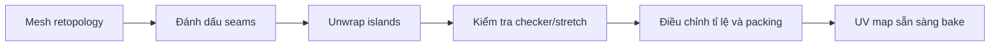

# Bài 056 — Trải UV cho nhân vật 3D

> **Phần 08 — Thực hành · Thời lượng: 9 phút 50 giây**  
> **Sản phẩm:** Một UV map được chia seam hợp lý, các UV island được sắp xếp gọn, có không gian ưu tiên vùng mặt để chuẩn bị bake texture 4K.

## 1. UV Unwrapping giải quyết vấn đề gì?

Một texture là hình ảnh 2D, trong khi character là vật thể 3D. **UV mapping** gán tọa độ hai chiều `(U, V)` cho từng điểm trên bề mặt để xác định vị trí lấy màu hay dữ liệu vật liệu. **Unwrap** là thao tác "trải" bề mặt 3D thành các mảnh 2D (*UV islands*). Các đường cắt (*seams*) quyết định nơi bề mặt được tách ra.

Một đường seam được đặt tốt giúp giảm méo texture, nhưng quá nhiều seam có thể tạo thêm mép dễ lộ sau khi bake hoặc paint.

## 2. Mục tiêu và thông số thực hành

Sau bài này, bạn có thể tự chọn đường seam ở đầu, tai, cánh tay và thân; kiểm tra UV distortion; ưu tiên vùng cần chi tiết; đóng gói island không chồng nhau; và chuẩn bị một texture dùng chung.

Trong bài thực hành, nhân vật tương đối đơn giản nên sử dụng **một UV map** cho toàn thân, định hướng **texture cuối 4096 × 4096 px**. Để kiểm tra nhanh, tạo **ảnh checker/UV Grid 1024 × 1024 px** trước khi dùng texture độ phân giải lớn. Hai kích thước phục vụ hai mục đích khác nhau.

## 3. Đặt đường seam trên đầu, tai và thân

### 3.1. Đầu và tai

Đầu là nơi người xem nhìn vào nhiều nhất nên được ưu tiên diện tích UV lớn. Trong ví dụ, vùng đầu được bố trí chiếm phần đáng kể, gần một nửa không gian, tùy nhu cầu chi tiết của cảnh.

1. Vào **Edit Mode** (`Tab`), chọn cạnh ở khu vực ít thấy trên đầu.
2. Dùng **Mark Seam** để đánh dấu ranh giới tách UV.
3. Tạo đường seam chạy dọc về phía đỉnh/sau đầu sao cho bề mặt có thể trải phẳng hợp lý.
4. Tách vùng tai thành đảo phù hợp. Với tai có mặt cong, có thể cần chia thành hai mảnh thay vì cố trải cả tai thành một mảnh.
5. Dùng `L` chọn phần hình học liên thông và kiểm tra vùng được tách như mong muốn.

Không có một đường cắt duy nhất tốt cho mọi nhân vật; chọn sao cho các vết nối ít xuất hiện ở góc máy chính.

### 3.2. Cánh tay và thân

Ở phần thân, thường nên tách cánh tay khỏi thân theo vùng khuất hoặc chỗ nối, rồi trải các phần tương đối độc lập. Kiểm tra đường seam có **liên tục** không: thiếu một cạnh seam ở phía sau có thể khiến toàn bộ UV bị kéo thành hình méo. Chọn mặt cần unwrap, bấm `U` → **Unwrap** hoặc phương pháp theo góc được dùng trong giao diện phiên bản hiện tại.

Chú ý không chọn lại những island đã hoàn tất nếu không muốn xáo trộn bố cục; có thể xử lý từng nhóm rồi sắp xếp chung.

## 4. Kiểm tra méo UV bằng checker

Tạo ảnh **UV Grid** 1024 × 1024 trong Image Editor và hiển thị ảnh trên mesh để kiểm tra. Khi nhìn bề mặt, các ô checker nên có kích thước tương đối đều và không bị kéo dài quá mạnh.

| Hiện tượng | Nguyên nhân thường gặp | Cách sửa |
|---|---|---|
| Ô checker bị kéo dài | Thiếu seam hoặc island bị méo | Thêm/chỉnh seam, unwrap lại |
| Ô quá nhỏ so với vùng khác | Island có mật độ pixel không cân | Scale island, điều chỉnh texel density |
| Island nằm ngoài ô UV | Bố trí vượt tile dự kiến | Thu nhỏ và pack lại vào 0–1 |
| Các đảo chồng không chủ ý | Packing hoặc đặt tay sai | Di chuyển/tách đảo trước khi bake |
| Màu đứt tại đường seam | Padding hoặc dữ liệu bake chưa khớp | Tăng margin, kiểm tra texture và bake |

**Texel density** biểu thị mật độ pixel texture trên một đơn vị diện tích 3D. Mục tiêu thường là nhất quán trong các vùng có độ quan trọng tương tự; riêng khuôn mặt có thể được ưu tiên mật độ cao hơn để giữ biểu cảm.

## 5. Sắp xếp các UV islands

1. Chọn lần lượt các nhóm: đầu/tai, thân, tay, chân và mắt.
2. Scale island để phân phối độ phân giải theo nhu cầu: đầu lớn hơn, chi tiết khuất nhỏ hơn.
3. Dùng thao tác **Relax/Minimize Stretch** khi island còn bị méo nhẹ.
4. Đặt các phần cùng loại gần nhau, chẳng hạn hai tay ở một khu vực để tiện Texture Paint.
5. **Pack Islands** với khoảng cách mép thích hợp (*margin/padding*), không để chúng nằm ngoài ô UV `0–1` khi chỉ dùng một texture.
6. Xem lại ở Material Preview với checker trên toàn nhân vật.

Các island không nên sát đến mức thiếu viền cho texture bake, vì khi render ở mipmap thấp các màu có thể chảy sang đảo bên cạnh (*texture bleeding*).

## 6. UV cho đôi mắt độc lập

Với nhãn cầu dạng bán cầu, có thể giảm những mặt khuất không cần thiết và unwrap từng mắt. Mắt là object độc lập về hoạt hình nhưng vẫn có thể dùng chung atlas texture với thân nếu workflow yêu cầu. Khi bố trí, dành phần UV riêng cho mắt và kiểm tra không vô tình chồng lên vùng áo hoặc mặt.

Đặt tên UV map rõ ràng như `UV_Zombie_Main`. Khi có nhiều mesh, bảo đảm mọi đối tượng dùng đúng UV map dự kiến trước khi chuyển sang bake texture.

## 7. Kiểm tra và bàn giao

- [ ] Có seam tại các vị trí hợp lý ở đầu, tai, tay và thân.
- [ ] Không còn stretch mạnh ở mặt và khớp.
- [ ] UV islands không chồng ngoài chủ ý và nằm trong tile dự kiến.
- [ ] Có padding cho bước bake.
- [ ] Khuôn mặt có đủ diện tích UV để giữ chi tiết.
- [ ] Đã thử checker 1024² và xác định texture cuối 4096².

**Đầu ra:** file `.blend` chứa `zombie_low` với UV hoàn chỉnh, ảnh checker thử nghiệm và tên UV map nhất quán.

## 8. Câu hỏi ôn tập

**Câu 1.** Vai trò của seam trong UV Unwrapping là gì?  
A. Tăng số polygon.  
B. Đánh dấu nơi bề mặt 3D được cắt để trải ra 2D.  
C. Tạo xương tự động.  
D. Bật lighting.  
**Đáp án: B.** Seam xác định ranh giới tách UV islands.

**Câu 2.** Checker bị kéo dài mạnh trên mặt nhân vật chứng tỏ điều gì?  
A. Camera sai tiêu cự.  
B. Normal map quá sáng.  
C. Animation bị lệch.  
D. UV tại vùng đó đang bị distortion.  
**Đáp án: D.** Checker giúp thấy rõ độ méo của texture khi trải lên mesh.

**Câu 3.** Trong ví dụ, ảnh 1024² được dùng chủ yếu để làm gì?  
A. Kiểm tra UV/texel density trước khi tạo texture 4K.  
B. Thay thế high-poly.  
C. Lưu chuyển động mắt.  
D. Loại bỏ seam.  
**Đáp án: A.** Checker độ phân giải thấp thuận tiện kiểm tra bố cục.

**Câu 4.** Vì sao cần margin giữa các UV islands?  
A. Để thêm bone.  
B. Để dùng EEVEE thay Cycles.  
C. Để hạn chế màu/chi tiết rò sang đảo khác khi bake và lọc texture.  
D. Để nhân đôi UV.  
**Đáp án: C.** Padding giúp hạn chế texture bleeding.

**Câu 5.** Vùng mặt cần rõ chi tiết hơn thân, nên làm gì?  
A. Xóa UV của thân.  
B. Phân bổ diện tích UV tương đối lớn hơn cho mặt.  
C. Đặt tất cả island chồng lên nhau.  
D. Giảm số sample render.  
**Đáp án: B.** Diện tích UV lớn hơn thường cho nhiều pixel texture hơn.

## 9. Tổng kết

UV tốt là điều kiện để baking và texture paint ổn định. Ba tiêu chí quan trọng nhất là **seam hợp lý, distortion thấp và packing đủ margin**.
