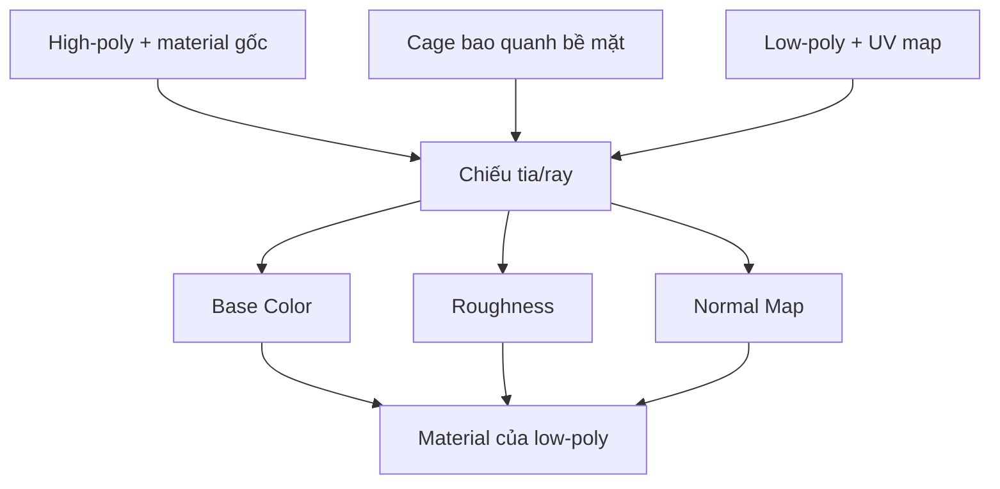

# Bài 057 — Bake texture và normal map từ high-poly sang low-poly

> **Phần 08 — Thực hành · Thời lượng: 17 phút 08 giây**  
> **Sản phẩm:** Bộ texture cho zombie low-poly gồm Base Color, Roughness và Normal Map; hình ảnh đã được lưu riêng và kết nối vào material.

## 1. Baking là gì và vì sao cần thiết?

**Texture baking** chuyển thông tin từ một bề mặt có nhiều chi tiết (high-poly) sang hình ảnh gắn với UV của mesh tối ưu hơn (low-poly). Nhờ vậy, nhân vật có thể sử dụng topology phù hợp hoạt hình mà vẫn giữ được màu sắc, độ nhám và cảm giác chi tiết bề mặt.



Cage xác định vùng chiếu ray khi chuyển dữ liệu từ high-poly sang low-poly. Nếu cage không bao phủ đúng hình học hoặc ray đi xuyên sai vùng, các vệt lỗi sẽ xuất hiện trong texture.

## 2. Mục tiêu và chuẩn bị

Bạn cần **high-poly** gồm thân và những phần tay gốc mang texture cần chuyển, **low-poly** đã được retopology và unwrap UV, cùng file `.blend` lưu dự phòng. Bài tập sử dụng Blender **Cycles** cho baking; ví dụ chuyển render device sang GPU nếu phần cứng hỗ trợ. Thiết lập mẫu thử trong quy trình là **256 samples**; đây là giá trị minh họa, không bắt buộc cho mọi loại bake.

Những bản đồ liên quan:

| Texture map | Chứa dữ liệu | Cách dùng sau bake |
|---|---|---|
| Base Color / Diffuse | Màu nền của vật liệu, không tính ánh sáng | Nối `Base Color`, thường dùng `sRGB` |
| Roughness | Mức độ nhám/bóng của bề mặt | Nối `Roughness`, để `Non-Color` |
| Normal | Hướng pháp tuyến giả lập để lưu chi tiết high-poly | Qua node `Normal Map`, để `Non-Color` |
| AO (mở rộng) | Thông tin che khuất môi trường | Có thể bake riêng nếu pipeline yêu cầu; không phải map được triển khai chi tiết trong bài thực hành này |

Material gốc có thể chứa kênh dữ liệu được đóng gói trong một texture (ví dụ roughness và metallic ở các kênh màu khác nhau). Trước khi bake, cần biết đúng kênh nào đang được dùng; không coi các kênh R/G/B là giống nhau.

## 3. Chuẩn bị cặp high-poly / low-poly

1. Dọn các phần bàn tay gốc bị trùng hoặc lỗi trên high-poly, giữ lại thông tin cần truyền.
2. Dùng `Ctrl + J` khi cần gom những object high-poly phục vụ bake; kiểm tra vị trí sau khi gộp.
3. Đặt tên rõ `zombie_high`, `zombie_low`; đảm bảo hai model chồng khít trong cùng hệ tọa độ.
4. Kiểm tra UV ở `zombie_low`. **Texture đích luôn được bake theo UV của low-poly**.
5. Kiểm tra normal và các vùng hai lưới cắt nhau tại cổ tay, hốc mắt, ngón tay.

**Phân biệt:** High-poly là đối tượng **nguồn**; low-poly là đối tượng **đích**. Bake sai thứ tự sẽ dẫn đến không có kết quả hoặc ghi vào đối tượng không mong muốn.

## 4. Tạo image và thiết lập Cycles

1. Mở **Shader Editor** trên material của low-poly, thêm node **Image Texture**.
2. Tạo ảnh mới cho Base Color, ví dụ `zombie_basecolor_4k`, kích thước **4096 × 4096**.
3. Bảo đảm node Image Texture dùng làm **đích bake** đang được chọn/active. Không nhất thiết phải nối node này vào shader trước khi bake.
4. Vào **Render Properties**, chọn **Cycles**; chọn GPU Compute nếu hệ thống hỗ trợ.
5. Vào mục **Bake**, bật **Selected to Active** khi muốn bake từ một hoặc nhiều mesh được chọn sang mesh active.
6. Với **Diffuse**, chỉ bật thành phần **Color**, tắt **Direct** và **Indirect** để lấy màu vật liệu không kèm ánh sáng của cảnh.

Trong Object Mode, **chọn high-poly trước, low-poly sau cùng** để low-poly là *active object*. Có thể kiểm tra viền lựa chọn của object active trước khi nhấn Bake.

## 5. Tạo cage và thiết lập ray

Cage là một lưới phụ thường tạo bằng cách nhân bản low-poly (`Shift + D`) và đặt tên `zombie_cage`. Vào Edit Mode, chọn tất cả (`A`), dùng `Alt + S` (**Shrink/Fatten**) để nới bề mặt cage ra ngoài. Mục tiêu là cage ôm được vùng high-poly cần lấy thông tin, kể cả các chi tiết ở mắt và cổ tay.

```text
Lớp ngoài:   zombie_cage  — vỏ tham chiếu ray
Lớp giữa:    zombie_high  — chứa chi tiết gốc
Lớp đích:    zombie_low   — UV và texture để bake
```

Bật **Cage** trong Bake và chỉ định object tương ứng nếu phiên bản Blender hỗ trợ tùy chọn này. Điều chỉnh **cage extrusion / max ray distance** phù hợp với khoảng cách giữa các bề mặt; ví dụ thực hành có thử giá trị extrusion khoảng **0,1** theo đơn vị scene, nhưng không nên dùng mù quáng vì phụ thuộc kích thước mô hình.

Kiểm tra vùng khuất: nếu cage không che trọn mắt hay ngón, chọn mặt cage và đẩy ra; nếu ray chiếu nhầm sang phần khác, giảm khoảng cách hoặc cải thiện hình học/cage.

## 6. Bake Base Color

1. Chọn ảnh đích `zombie_basecolor_4k` trên node Image Texture của low-poly.
2. Chọn `zombie_high` rồi chọn `zombie_low` sau cùng.
3. Trong Bake, chọn **Diffuse → Color only**, **Selected to Active**, cage/ray phù hợp.
4. Nhấn **Bake**; xem ảnh được ghi trong Image Editor.
5. Ẩn high-poly, gắn texture vừa bake lên low-poly để so sánh màu với mô hình gốc.
6. Chọn **Image → Save As** và lưu riêng vào thư mục `textures/`.

Không chỉ lưu file `.blend`: ảnh vừa bake hoặc ảnh đã chỉnh bằng Texture Paint có thể chưa được ghi ra ổ đĩa. Kiểm tra dấu trạng thái ảnh chưa lưu trong Blender.

## 7. Sửa lỗi màu bằng Texture Paint

Tại chỗ ghép tay, ảnh bake có thể lộ đường seam hoặc mảng màu từ vùng không mong muốn. Mở **Texture Paint**, chọn texture Base Color và dùng cọ **Soften/Smear** hoặc **Clone** để làm mượt/chuyển màu từ khu vực liền kề. Với Clone, cần chọn đúng nguồn mẫu trước khi tô; thao tác chọn nguồn phụ thuộc công cụ và phiên bản Blender.

Nên thực hiện nhiều nét với strength vừa phải thay vì một nét quá mạnh. Sau khi sửa, nhìn lại ở kích thước thật trong camera và **Save Image**.

## 8. Bake Roughness

1. Tạo **một Image Texture mới**, ví dụ `zombie_roughness_4k`, tránh ghi đè Base Color.
2. Xác định nguồn roughness của material high-poly. Nếu nằm trong texture packed, phải trích đúng kênh nguồn.
3. Thiết lập cách bake phù hợp với dữ liệu nguồn: trong nhiều shader, Roughness không phải một bake pass độc lập tương đương Diffuse; có thể **đưa giá trị roughness ra Emission rồi bake Emit** để nhận dữ liệu thuần. Đây là kỹ thuật triển khai nhằm giữ đúng ý nghĩa của map, không phải thao tác một nút Roughness chung cho mọi Blender.
4. Chọn high-poly → low-poly, node ảnh roughness active, chạy bake và lưu ra file.
5. Đặt Image Texture `Non-Color`, nối tới input `Roughness` của **Principled BSDF**.

Muốn điều chỉnh vùng sáng/bóng có thể dùng **ColorRamp** hoặc Texture Paint, nhưng nên giữ sự biến thiên hợp lý giữa vải, da, giày và các vật liệu khác.

## 9. Bake Normal Map

1. Tạo ảnh mới `zombie_normal_4k` và đặt Image Texture ở **Non-Color**.
2. Thêm node **Normal Map** kết nối dữ liệu ảnh đến ngõ **Normal** của Principled BSDF; trước khi bake, chọn đúng node ảnh đích.
3. Chọn Bake Type = **Normal**, sử dụng high-poly → low-poly và cage đã kiểm tra.
4. Nhấn **Bake**. Kết quả tangent-space normal thường có tông tím/xanh.
5. Lưu ảnh, ẩn high-poly và kiểm tra low-poly dưới nguồn sáng đổi hướng để thấy chi tiết nổi/lõm.

Normal map dễ phát sinh lỗi ở hốc mắt hoặc vùng các mặt chồng nhau. Không dùng cọ màu thông thường tùy tiện để "làm mịn" vector normal, vì có thể làm sai hướng pháp tuyến. Ưu tiên sửa cage, ray, UV hoặc bake lại; nếu cần sửa bằng paint thì phải hiểu dữ liệu vector.

## 10. Kiểm tra chất lượng, xử lý lỗi và lưu file

| Vấn đề | Kiểm tra trước tiên |
|---|---|
| Bake ra ảnh trống | Chọn node image đúng, high trước/low active sau, Selected to Active |
| Vệt màu ở cổ tay | Mesh nguồn trùng lặp, UV seam, ray chiếu nhầm |
| Mắt/miệng có vệt khó hiểu | Cage không phủ đủ, hai lớp hình học chồng, normals ngược |
| Normal cho hiệu ứng lồi/lõm sai | Color Space `Non-Color`, node Normal Map, sai bake space |
| Roughness trông quá bóng | Nguồn roughness sai kênh, bị đọc như màu hoặc ColorRamp quá gắt |
| Sửa ảnh xong rồi mất | Chưa lưu image ra file hoặc chưa pack asset |

Cấu trúc đầu ra gợi ý:

```text
zombie_project/
├── zombie_bake.blend
└── textures/
    ├── zombie_basecolor_4k.png
    ├── zombie_roughness_4k.png
    └── zombie_normal_4k.png
```

**Checkpoint cuối:** Ẩn high-poly hoàn toàn, chỉ để low-poly và texture đã bake; xoay ánh sáng để đánh giá phần cổ tay, mắt, mặt, áo và vùng có seam. Mọi Image Texture được lưu ở đường dẫn hợp lệ.

- [ ] `high` / `low` / `cage` đặt tên và chồng khít.
- [ ] UV low-poly hợp lệ; đã thử bake ở độ phân giải thấp nếu gặp lỗi.
- [ ] Base Color không chứa ánh sáng trực tiếp/gián tiếp ngoài ý muốn.
- [ ] Roughness và Normal dùng đúng Color Space.
- [ ] Đã lưu riêng cả ba file ảnh.
- [ ] Đã so sánh material sau bake với high-poly.

## 11. Câu hỏi ôn tập

**Câu 1.** Trong Selected to Active, object nào phải được chọn active cuối cùng?  
A. Low-poly nhận texture.  
B. Camera.  
C. Cage.  
D. Nguồn sáng.  
**Đáp án: A.** Low-poly là đích bake cần ghi lên UV của nó.

**Câu 2.** Vì sao cần tạo ảnh riêng cho Roughness?  
A. Để tăng số xương.  
B. Để giảm UV islands tự động.  
C. Để tránh ghi đè Base Color và giữ đúng dữ liệu từng map.  
D. Để xóa vật liệu gốc.  
**Đáp án: C.** Mỗi map chứa thông tin khác nhau.

**Câu 3.** Normal map nên được nối vào material thế nào?  
A. Thẳng vào Metallic ở chế độ sRGB.  
B. Qua node Normal Map với Image Texture Non-Color.  
C. Vào Base Color của World.  
D. Qua node Camera.  
**Đáp án: B.** Normal map lưu vector, cần được chuyển đổi đúng trước khi điều khiển normal shader.

**Câu 4.** Mục đích của cage trong baking là gì?  
A. Tăng frame rate.  
B. Đóng gói UV.  
C. Tạo shader tự động.  
D. Xác định vùng chiếu ray từ low-poly tới chi tiết nguồn.  
**Đáp án: D.** Cage giúp kiểm soát ray và giảm lấy nhầm dữ liệu.

**Câu 5.** Sau khi Texture Paint xong, thao tác quan trọng nào cần thực hiện?  
A. Lưu image/texture ra file, không chỉ dựa vào `.blend`.  
B. Xóa UV map.  
C. Chuyển sang Wireframe rồi tắt máy.  
D. Tăng kích thước cage.  
**Đáp án: A.** Dữ liệu hình ảnh chưa lưu có thể bị mất.

## 12. Tổng kết

Baking nối kết hai yêu cầu tưởng như mâu thuẫn: mesh gọn để rig và bề mặt giàu chi tiết để lên hình. Kết quả tốt phụ thuộc vào cặp high/low, UV, thứ tự chọn object, cage và cách lưu/diễn giải đúng từng loại texture.
