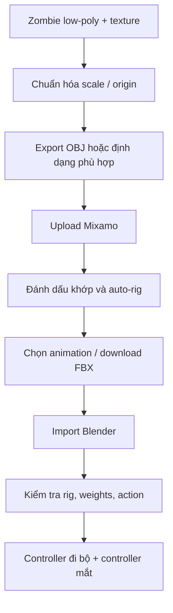

# Bài 058 — Rigging và tạo hoạt hình cho nhân vật bằng Mixamo

> **Phần 08 — Thực hành · Thời lượng: 12 phút 32 giây**  
> **Sản phẩm:** Zombie được auto-rig bằng Mixamo, có chuyển động đi bộ, điều khiển di chuyển và hướng nhìn, có thể sử dụng tiếp trong cảnh Blender.

## 1. Tổng quan

**Rigging** là việc gắn bộ khung xương (*armature*) và xác định ảnh hưởng của từng xương lên mesh (*skin weights*). **Animation** là việc thay đổi pose/vị trí theo thời gian. Mixamo giúp tự động tạo rig cho nhân vật dạng người và cung cấp thư viện chuyển động có sẵn. Dù tự động, kết quả vẫn phải được kiểm tra ở vai, cổ tay, chân, bàn tay và các vùng dễ xuyên lưới.

**Armature** quyết định cách mesh biến dạng. **Action** lưu animation của một tập dữ liệu; sau khi nhập, cần tổ chức và lưu Action rõ ràng để tiện phối hợp nhiều clip.

## 2. Mục tiêu và chuẩn bị

Sau bài này, bạn có thể đưa nhân vật chuẩn vào Mixamo, định vị các mốc rigging, chọn animation, xử lý scale khi import, kiểm tra weight paint và tạo controller điều khiển nhân vật trong Blender.

Chuẩn bị model zombie low-poly đã UV, bake texture, hai mắt độc lập nếu muốn hướng nhìn có kiểm soát. Nhân vật nên ở **T-pose**, chân/tay tách rõ và quay về hướng dễ nhận diện.

## 3. Chuẩn hóa nhân vật trước khi xuất

1. Đưa zombie về vị trí sàn với nhân vật nằm theo trục đứng của Blender và chân gần mặt phẳng chuẩn.
2. Kiểm tra **chiều cao** bằng một khối lập phương dùng làm thước đo. Ví dụ chọn chiều cao khoảng **1,61–1,70 m** để nhân vật cách điệu có tỷ lệ gần người thật; đây là giá trị minh họa cho shot.
3. Kiểm tra **origin** của thân nằm hợp lý; thực hiện `Ctrl + A` → **Apply Rotation/Scale** khi cần và biết rõ tác động tới dữ liệu liên quan.
4. Tách nhãn cầu bằng `P` → **Selection** hoặc **By Loose Parts** tùy topology. Đặt tên `eye_L`, `eye_R` và bảo đảm origin ở tâm nhãn cầu.
5. Lưu file làm việc trước khi export.

Trong ví dụ thực hành, nhân vật được export sang **OBJ** vì đường dẫn FBX đầu vào có lúc không được dịch vụ nhận như mong muốn. Định dạng xuất nên chọn theo khả năng công cụ ở thời điểm dùng; khi sử dụng OBJ, kiểm tra cả đường dẫn texture/material vì phần gán vật liệu có thể không chuyển trọn vẹn.

## 4. Auto-rig trong Mixamo

1. Mở Mixamo và **Upload Character**.
2. Chọn file nhân vật, kiểm tra tư thế và hướng mặt sau khi tải.
3. Định vị các marker theo yêu cầu của giao diện: **cằm (chin), cổ tay (wrists), khuỷu tay (elbows), vùng bẹn (groin), đầu gối (knees)**.
4. Nếu hình thể không đối xứng, cân nhắc tắt chế độ đối xứng khi đánh dấu marker.
5. Chạy auto-rig, đợi rig xuất hiện và kiểm tra các động tác thử.
6. Thử các clip chuyển động có sẵn. Với zombie, animation đi bộ kiểu zombie phù hợp phong cách hơn hoạt ảnh nhảy múa.

Kiểm tra ít nhất một pose tay giơ, một pose gập chân và đoạn đi bộ. Nếu bàn tay xuyên đầu hoặc cánh tay xuyên áo, phải sửa pose, weights hoặc cài đặt rig sau khi nhập Blender.

## 5. Chọn và tải animation

Chọn một clip **zombie walk**. Bài thực hành dùng kiểu **đi tại chỗ** (*in-place*) để chuyển động tiến về phía trước được điều khiển độc lập bằng một object trong Blender. Tải clip dưới dạng **FBX** rồi import vào Blender bằng **File → Import → FBX**.

Khi import, chú ý model có thể bị scale khác dự kiến do chuyển đổi đơn vị. Trong trường hợp bài giảng, asset nhập bị nhỏ khoảng **1/100** so với kích thước mong muốn. Đây là hiện tượng được quan sát trong ví dụ, **không phải quy tắc luôn đúng**. Đối chiếu kích thước thực, transform của armature và mesh trước khi hiệu chỉnh; tránh sửa scale bằng phím tắt khi chưa biết dữ liệu nào bị ảnh hưởng.

## 6. Khôi phục material và kiểm tra deformation

Material không phải lúc nào cũng giữ đúng sau hành trình export/import. Có thể lấy vật liệu từ bản zombie đã bake và gán lại cho phiên bản rigged. Trong Blender, lệnh **Link Materials** (`Ctrl + L` → Materials) hữu ích khi cấu trúc đối tượng tương thích; các mắt nên được kiểm tra riêng.

Để kiểm tra weights:

1. Chọn armature và nhân vật; mở **Pose Mode** và **Weight Paint** theo workflow thích hợp.
2. Bật **In Front** cho armature để dễ thấy xương bên trong mesh.
3. Chọn từng xương ở vai, cổ tay, đầu gối, gập/duỗi vài pose.
4. Quan sát vị trí kéo dãn, gãy khớp hoặc mesh xuyên nhau.
5. Nếu cần, chỉnh **Weight Paint**, vị trí xương hoặc giới hạn góc xoay.

Bản rig auto thường đủ tốt cho hoạt hình đơn giản, nhưng không thay thế hoàn toàn kiểm soát thủ công ở các vùng phức tạp.

## 7. Tạo điều khiển mắt bằng Empty và Track To

Tạo **Empty** phía trước mặt, đặt tên `CTRL_EyesTarget`. Trên từng mắt, thêm constraint **Track To** và trỏ tới Empty này. Chọn đúng trục hướng nhìn/trục lên theo orientation **thực tế sau import**, bởi trục gốc có thể đã thay đổi. Có thể sao chép constraint từ mắt đã thiết lập sang mắt còn lại rồi thử di chuyển Empty.

Đặt keyframe cho Empty tại vài thời điểm để zombie nhìn sang trái, phải hoặc nhìn vào camera. Không cần animate mắt độc lập bằng nhiều keyframe quay nếu chỉ muốn hai mắt cùng hướng về một điểm.

## 8. Tạo chuyển động đi bộ bằng controller

Một clip đi tại chỗ chỉ thay đổi dáng chân; để nhân vật **tiến về phía trước**, tạo controller tổng thể, chẳng hạn một **Empty dạng Circle** hoặc object điều khiển khác. Parent armature/nhân vật vào controller bằng `Ctrl + P` → **Object (Keep Transform)** để di chuyển toàn bộ hệ rig mà không mất tương quan vị trí ban đầu.

Quy trình mẫu:

1. Tại frame đầu, đặt controller ở vị trí xuất phát, nhấn `I` tạo keyframe vị trí.
2. Ở frame cuối (ví dụ **frame 100**), đưa controller tới đích và tạo keyframe mới.
3. Chọn keyframe trong Timeline hoặc Graph Editor, nhấn `T` → **Linear** nếu muốn tốc độ di chuyển gần như đều.
4. Phát lại và đối chiếu chu kỳ bước chân với quãng đường di chuyển.
5. Nếu chân bị **trượt**, điều chỉnh tốc độ controller, tốc độ chu kỳ đi bộ hoặc thời điểm tiếp xúc đất.

Có thể tạo vòng lặp bước chân bằng **Cycles modifier** trong Graph Editor hoặc thiết lập lặp của Action/NLA sau đó. Phân biệt **lặp dáng đi** với **di chuyển toàn thân** để dễ kiểm soát từng yếu tố.

## 9. Tinh chỉnh đầu và hướng nhìn

Animation Mixamo có thể khiến bàn tay xuyên qua đầu. Trong **Pose Mode/Graph Editor**, chỉnh keyframe của xương đầu để nâng hoặc nghiêng đầu, và xem lại qua toàn bộ chu kỳ. Dữ liệu xoay có thể lưu dạng **Quaternion** hoặc **Euler**; không nên chuyển đổi tùy tiện khi animation đã có keyframe. Chỉ dùng kiểu biểu diễn phù hợp nếu hiểu ảnh hưởng đến các đường cong.

Đối với hướng nhìn, hạn chế keyframe quá dày hoặc chuyển động ngẫu nhiên mạnh vì sẽ khiến mắt giật. Dùng ít mốc rõ ràng, thay đổi đúng thời điểm nhân vật chú ý đến vật thể.

## 10. Lỗi thường gặp và deliverable

| Triệu chứng | Hướng kiểm tra |
|---|---|
| Mixamo nhận sai hướng người | Tư thế T, trục trước, mặt nhìn, marker |
| Mesh nhập Blender quá nhỏ | Scale/import unit của FBX, armature, transform |
| Mất texture | Tái liên kết image và material từ bản đã bake |
| Tay xuyên đầu | Pose, skin weights, chuyển động gốc |
| Mắt quay sai | Origin và trục Track To |
| Đi bộ bị trượt chân | Tốc độ Action so với controller toàn cục |
| Action không còn sau khi xóa rig tạm | Kiểm tra và giữ Action bằng cách lưu/đánh dấu giữ dữ liệu trước |

**Deliverable:** file `zombie_rigged.blend` có armature, action đi bộ, controller chuyển động toàn cục và controller mắt; file xuất hoặc clip gốc được giữ riêng.

- [ ] Scale và orientation hợp lý khi import.
- [ ] Các xương biến dạng tương đối tốt ở khớp chính.
- [ ] Có Action với tên dễ nhận biết.
- [ ] Có thể di chuyển toàn thân độc lập với bước chân.
- [ ] Có thể điều khiển hướng nhìn mà mắt không lật sai.
- [ ] Đã lưu file trước khi chỉnh sâu weights/keyframes.

## 11. Câu hỏi ôn tập

**Câu 1.** Vì sao nhân vật thường được đưa về T-pose trước auto-rig?  
A. Để có sẵn Normal Map.  
B. Để xóa tất cả marker.  
C. Để tự tạo background.  
D. Để công cụ nhận diện tay/chân và vị trí khớp dễ hơn.  
**Đáp án: D.** Marker và cấu trúc chi dễ xác định khi nhân vật có tư thế rõ.

**Câu 2.** Khi animation đi bộ là in-place, làm sao để zombie đi xuyên qua scene?  
A. Tạo keyframe dịch chuyển cho controller toàn cục.  
B. Tăng metallic.  
C. Xóa armature.  
D. Dùng texture 8K.  
**Đáp án: A.** In-place animate dáng đi, còn controller quyết định vị trí trong scene.

**Câu 3.** Mắt không nhìn đúng Empty mục tiêu thường liên quan nhất đến yếu tố nào?  
A. Độ phân giải output.  
B. Số sample Cycles.  
C. Origin và Track/Up Axis của constraint.  
D. Bóng đổ.  
**Đáp án: C.** Constraint theo trục cục bộ và tâm xoay của mắt.

**Câu 4.** Vì sao phải kiểm tra Weight Paint sau auto-rig?  
A. Để tự thêm nhiều polygon.  
B. Để phát hiện mesh gãy hoặc xuyên nhau khi khớp chuyển động.  
C. Để thay thế UV.  
D. Để sửa màu World.  
**Đáp án: B.** Auto-rig không đảm bảo deformation chính xác ở mọi hình thể.

**Câu 5.** Chân trượt khi zombie đi, cách sửa phù hợp nhất là gì?  
A. Tăng số bóng đèn.  
B. Xóa toàn bộ texture.  
C. Thay đổi HDRI.  
D. Điều chỉnh tương quan giữa chu kỳ bước chân và tốc độ di chuyển toàn thân.  
**Đáp án: D.** Trượt chân xuất hiện khi vận tốc nhân vật và thời gian bước không khớp.

## 12. Tổng kết

Mixamo rút ngắn thời gian tạo khung xương và thử chuyển động. Để dùng được trong scene, cần kiểm tra tư thế, scale, weights, quản lý Action và phân tách điều khiển chuyển động toàn thân với hướng nhìn.
