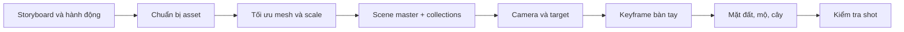

# Bài 059 — Lắp ráp cảnh quay hoạt hình trong Blender (Phần 1)

> **Phần 08 — Thực hành · Thời lượng: 16 phút 40 giây**  
> **Sản phẩm:** Shot số 1 của một nghĩa trang đêm: bàn tay zombie trồi lên cạnh bia mộ, camera chuyển động có mục tiêu rõ ràng, môi trường gồm mặt đất, mộ và cây.

## 1. Xây dựng cảnh theo kịch bản

Một scene hiệu quả cần kể được hành động, không chỉ chứa nhiều model đẹp. Kịch bản mẫu gồm: **nghĩa trang yên tĩnh → bàn tay zombie nhô khỏi đất → zombie xuất hiện và tiến về nhà thờ**. Shot đầu tập trung vào khoảnh khắc bàn tay trồi lên. Có thể tạo **storyboard** bằng phác thảo hoặc công cụ AI, nhưng phải kiểm tra góc máy và thời điểm hành động trong Blender.



Sơ đồ đặt **camera và timing** trước khi trang trí dày đặc; cách này giúp chỉ xây những phần môi trường mà camera thực sự nhìn thấy.

## 2. Mục tiêu và asset cần chuẩn bị

Bạn sẽ có thể nhập asset từ nhiều file Blender, tối ưu polygon, chuẩn hóa tỷ lệ, tạo camera theo dõi Empty và xây môi trường đủ để phục vụ một shot.

Asset trong cảnh mẫu gồm:

- Bàn tay zombie đã có animation/rig và controller.
- Bia mộ (điểm nhấn tiền cảnh), mô hình nhà thờ (bối cảnh câu chuyện).
- Mặt đất, đồi nền, cây rải theo vùng.
- Mặt trăng dạng ảnh gắn lên mặt phẳng/tròn (dùng khi hoàn thiện ánh sáng).

Nên đặt các đối tượng theo collection, chẳng hạn `CHARACTERS`, `ENVIRONMENT`, `CAMERAS`, `LIGHTS`, `FX`, `HELPERS`. Cấu trúc rõ giúp ẩn các phần không cần thiết khi làm việc.

## 3. Tối ưu asset và tỷ lệ

Các model kiến trúc/cây AI tạo có thể có rất nhiều mặt hoặc đỉnh trùng. Trước khi đưa vào scene:

1. Trên bản working của asset, vào Edit Mode và dùng **Merge by Distance** để loại đỉnh trùng không mong muốn.
2. Với đối tượng tĩnh, thử **Decimate Modifier**; ví dụ bài thực hành bắt đầu ở **Ratio ≈ 0,3** rồi tăng lại nếu thấy silhouette, cửa sổ hoặc hoa văn bị mất.
3. So sánh kết quả ở khoảng cách camera sẽ nhìn. Không chọn Ratio chỉ vì con số polygon giảm nhiều.
4. Tạo một Cube **cao 2 m** để hiệu chỉnh tỷ lệ bia mộ, cây và nhà thờ. Sau khi chuẩn hóa có thể ẩn/xóa cube tham chiếu.
5. Apply Rotation/Scale khi thích hợp để modifier và các đối tượng liên kết hành xử ổn định.

**Nguyên tắc:** Decimate phù hợp hơn với nhiều asset tĩnh; không nên áp dụng bừa lên vùng khớp của zombie đã rig.

## 4. Đưa bàn tay và rig vào cảnh

Từ file asset có sẵn, dùng **Append/Link** hoặc sao chép đối tượng/collection sang scene tổng. Đảm bảo copy kèm armature, controller và các dữ liệu cần thiết; nếu chỉ copy mesh mà thiếu rig, animation không hoạt động.

Có thể tạo một **Circle/Empty controller** đặt trùng gốc armature. Chọn armature rồi controller cuối cùng, dùng `Ctrl + P` → **Object (Keep Transform)** để controller điều khiển toàn bộ bàn tay. Đặt tên rõ như `CTRL_ZombieHand`.

Đặt bia mộ gần nơi bàn tay trồi lên. Kiểm tra bàn tay trong cả pose đầu và cuối: ngón phải nhìn thấy từ camera và không xuyên bia mộ một cách vô lý.

## 5. Thiết lập camera có điểm nhìn động

Tạo **Camera** và **Empty** tên `CAM_Target`. Trên camera thêm constraint **Track To**, Target = `CAM_Target`. Camera có thể di chuyển theo đường riêng, trong khi target giữ cho góc nhìn luôn hướng về vùng kể chuyện.

```text
Camera ──────> CAM_Target
                    │
               Bia mộ / Bàn tay

Di chuyển Camera: thay đổi góc và khoảng cách
Di chuyển Target: thay đổi nơi người xem chú ý
```

Trong bài thực hành, tiêu cự đầu shot khoảng **35 mm** để lấy đủ không gian nghĩa trang. Camera bay từ vị trí nhìn rộng về phía bia mộ/bàn tay trong khoảng **40 khung hình đầu** (giá trị mẫu, không phải giới hạn bắt buộc). Có thể tạo keyframe cho cả **Location** của camera, **Location** của target và **Focal Length** nếu muốn có cảm giác phối cảnh mạnh hơn khi tiến gần.

Nếu thay focal length cùng lúc với chuyển động camera, kiểm tra méo phối cảnh và độ lớn bàn tay: mục tiêu là dẫn mắt người xem, không làm đối tượng bị méo khó hiểu.

## 6. Đồng bộ chuyển động bàn tay với camera

Shot này đạt hiệu quả khi camera hướng về bia mộ đúng lúc bàn tay bắt đầu nhô lên.

1. Đưa timeline về frame đầu; đặt bàn tay dưới mặt đất và ghi keyframe cho controller (`I`).
2. Chọn thời điểm camera đã áp sát bia mộ; thêm keyframe để bàn tay trồi lên.
3. Chỉnh góc quay lòng bàn tay và ngón để tạo silhouette rõ trong camera; có thể nhấn mạnh móng vuốt nếu phù hợp phong cách.
4. Mở Graph Editor để chỉnh độ nhanh/chậm của hai đường chuyển động.
5. Phát lại nhiều lần từ camera: kiểm tra không có frame bàn tay trồi trước khi camera nhìn đến.

Trong ví dụ, shot được kiểm tra tới khoảng **frame 60** và hành động chính đã kết thúc gần frame 57. Đây là timeline của bài mẫu, có thể thay đổi nếu dựng shot dài hơn.

## 7. Làm mặt đất và môi trường nền

Tạo mặt đất bằng mesh có đủ phân đoạn để chỉnh hình. Dùng các biến dạng nhẹ để tạo đất gồ ghề, mô đất, rãnh quanh bàn tay; không làm địa hình cao bất thường đến mức che đối tượng chính. Có thể tạo thêm một mặt phẳng phía sau và nhô thành các đồi thấp để đóng nền.

Đặt bia mộ phụ thành các cụm với tỷ lệ và góc xoay không hoàn toàn giống nhau. Những vật ở xa chỉ cần đủ silhouette vì chúng không chiếm nhiều pixel trong shot. Bố trí để **không có bia mộ hoặc thân cây nào cắt ngang bàn tay tại điểm quan trọng**.

## 8. Rải cây theo vùng bằng hệ thống phân bố

Ví dụ sử dụng **Particle System** với loại **Hair** và render bằng **Object** để rải cây. Giao diện này phụ thuộc phiên bản Blender; nếu phiên bản không còn dùng cùng quy trình, có thể xây hệ thống phân bố tương đương bằng Geometry Nodes nhưng vẫn giữ nguyên logic: vùng phân bố → nguồn cây → ngẫu nhiên scale/rotation → số lượng.

Các bước theo bài mẫu:

1. Tạo mesh vùng đất và một **Vertex Group** được paint để giới hạn nơi cây mọc.
2. Chuẩn bị cây mẫu, đưa Origin gần gốc thân.
3. Chọn hệ phân bố dùng cây làm đối tượng đầu vào.
4. Điều chỉnh orientation để cây đứng thẳng; trong ví dụ có thử xoay **90° quanh trục Y** vì orientation asset chưa đúng, không phải giá trị cố định cho mọi cây.
5. Tăng tính ngẫu nhiên hướng xoay và kích thước; quan sát từ camera.
6. Ví dụ bài học thử số lượng khoảng **500** trước khi giảm vì cảnh quá dày: con số này chỉ để thử phân bố.
7. Nhân bản hệ phân bố cho vùng khác khi cần; tách liên kết nếu muốn chỉnh từng vùng độc lập.

Nếu cây che khuất chủ thể, giảm mật độ ở tiền cảnh hoặc paint lại vùng phân bố. Bóng cây sẽ được hoàn thiện sau khi có lighting.

## 9. Lưu scene theo phiên bản và kiểm tra

Lưu file scene chính theo tên gợi ý `shot_01_v001.blend`, không ghi đè tùy tiện lên bản asset. Khi link/append, kiểm tra các đường dẫn texture hoặc file `.blend` phụ có hợp lệ khi mở lại.

| Mốc kiểm tra | Điều cần đạt |
|---|---|
| Frame đầu | Bia mộ/địa điểm đọc được, bàn tay chưa lộ sớm |
| Giai đoạn camera tới gần | Người xem biết đang nhìn đâu |
| Bàn tay xuất hiện | Silhouette rõ, không xuyên đồ vật không chủ ý |
| Frame cuối | Bố cục vẫn cân bằng, không thiếu background |

- [ ] Assets đã tối ưu mà không làm mất hình quan trọng.
- [ ] Scale giữa mộ, tay, cây và nhà thờ hợp lý.
- [ ] Camera có target, tiêu cự và chuyển động kiểm soát được.
- [ ] Timing camera và bàn tay được đồng bộ.
- [ ] Collection tách rõ asset và helper.
- [ ] Mở lại file không báo thiếu asset/texture.

## 10. Câu hỏi ôn tập

**Câu 1.** Vì sao nên dựng camera/timing trước khi hoàn thiện môi trường?  
A. Để tránh tạo những phần cảnh ngoài khuôn hình không cần thiết.  
B. Vì camera tự tạo texture.  
C. Vì animation sẽ không cần rig.  
D. Vì Decimate chỉ hoạt động khi có camera.  
**Đáp án: A.** Camera cho biết khu vực nào thực sự cần chi tiết.

**Câu 2.** Mục đích của `CAM_Target` là gì?  
A. Bake normal map.  
B. Tạo ánh trăng.  
C. Là điểm để camera theo dõi, giúp điều khiển nơi người xem chú ý.  
D. Làm giảm số polygon.  
**Đáp án: C.** Track To tách mục tiêu nhìn khỏi vị trí camera.

**Câu 3.** Ratio Decimate nên được đánh giá theo tiêu chí nào?  
A. Chỉ nhìn số mặt giảm.  
B. Giữ silhouette và chi tiết quan trọng ở khoảng cách camera.  
C. Luôn đặt 0,01.  
D. Đảm bảo UV tự biến mất.  
**Đáp án: B.** Tối ưu phải duy trì chất lượng hình ảnh của shot.

**Câu 4.** Rải 500 cây khiến bàn tay bị che, nên làm gì trước tiên?  
A. Tăng roughness.  
B. Xóa camera.  
C. Đổi normal map.  
D. Giảm mật độ/paint lại vùng phân bố để giữ chủ thể rõ.  
**Đáp án: D.** Phân bố cây phải phục vụ bố cục, không che điểm nhấn.

**Câu 5.** Cách tổ chức file nào phù hợp nhất cho scene có nhiều asset?  
A. Lưu scene theo phiên bản, chia collection và kiểm tra liên kết asset.  
B. Xóa tất cả file asset sau import.  
C. Gộp mọi đối tượng thành một mesh.  
D. Không đặt tên controller.  
**Đáp án: A.** Quản lý scene rõ ràng giúp sửa shot an toàn.

## 11. Tổng kết

Shot hiệu quả được xây từ **kịch bản, camera, timing, chủ thể**, sau đó mới là môi trường và chi tiết. Dựng theo góc máy giúp tiết kiệm thời gian và cho phép kiểm soát câu chuyện bằng hình ảnh.
