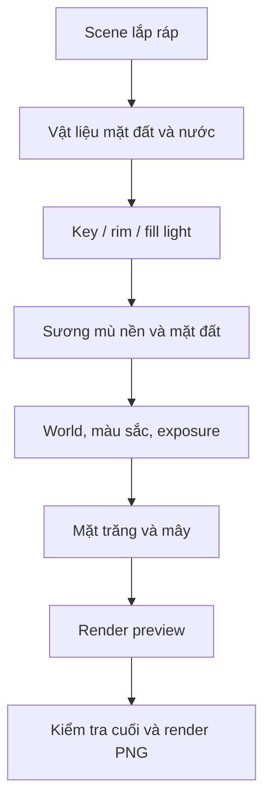
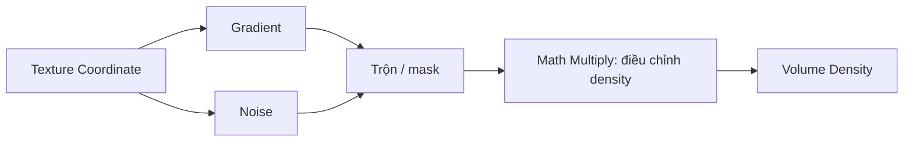

# Bài 060 — Hoàn thiện shot: ánh sáng, vật liệu, sương mù và render

> **Phần 08 — Thực hành · Thời lượng: 15 phút 43 giây**  
> **Sản phẩm:** Shot nghĩa trang đêm với ánh trăng lạnh, ánh sáng điểm nhấn ở bàn tay/bia mộ, mặt đất ẩm, sương mù nhiều lớp, mặt trăng và đám mây; có thiết lập render chuỗi ảnh.

## 1. Mục tiêu thị giác của shot

Trong một cảnh nghĩa trang ban đêm, ánh sáng không chỉ làm đồ vật hiện ra mà còn kể chuyện: **ánh trăng xanh lạnh** tạo không khí, **ánh sáng phụ tại bàn tay và bia mộ** dẫn mắt người xem, còn **sương mù** giúp tách tiền–trung–hậu cảnh. Tăng sương quá mạnh có thể phá silhouette và làm khung hình khó đọc; hiệu ứng cần phục vụ chủ thể.



Bài này ưu tiên **Cycles** và kiểm tra trực tiếp từ camera, vì hiệu ứng volume, bóng và phản xạ cần được đánh giá trong khung hình cuối.

## 2. Mục tiêu và cấu hình ban đầu

Sau bài này, bạn có thể tổ chức đèn, làm vật liệu đất ẩm, tạo volume fog có gradient/noise, cân chỉnh màu và thiết lập render sequence.

Mở scene shot đã dựng, lưu phiên bản mới rồi chọn **Cycles**. Ví dụ đặt **GPU Compute** nếu GPU tương thích và **256 samples** cho render chất lượng thử. Các thông số luôn cần điều chỉnh theo phần cứng, độ phân giải và mức nhiễu thực tế.

## 3. Tạo hệ thống ánh sáng có thứ bậc

Một shot cần có điểm nhấn rõ ràng. Với nghĩa trang đêm:

1. **Ánh sáng chính giả lập trăng:** dùng nguồn sáng từ phía sau hoặc trên cao, tông xanh lạnh để tạo bóng dài và viền silhouette trên bia mộ/cây.
2. **Ánh sáng viền (rim):** bố trí để đường viền bàn tay nổi bật so với nền tối; nếu cảnh quá tối, có thể thêm đèn phụ cường độ thấp.
3. **Đèn điểm nhấn:** dùng tông ấm/đỏ tiết chế gần bàn tay, nhấn chữ `RIP` trên mộ mà không làm toàn cảnh phẳng sáng.
4. Giảm độ gắt bóng bằng cách điều chỉnh kích thước đèn hoặc góc nguồn sáng, thay vì tăng vô hạn cường độ.

Trong ví dụ có thử điều chỉnh góc nguồn sáng đến khoảng **8** để bóng mềm hơn. Giá trị này phụ thuộc loại đèn và giao diện thiết lập; cần đánh giá qua render chứ không xem như công thức chung.

Nên gom các đèn vào collection `LIGHTS`; đặt tên như `L_Moon`, `L_Hand_Rim`, `L_Gravestone`.

## 4. Vật liệu mặt đất ẩm và vũng nước

Mặt đất được gán texture đất ẩm; bài học sử dụng thao tác nhanh `Ctrl + Shift + T` để nhập nhiều texture vào shader khi công cụ hỗ trợ. Cần có UV hoặc tọa độ mapping phù hợp; chỉnh **Mapping/Scale** đến khi cỡ hạt đất hợp với tỷ lệ mộ và bàn tay.

Đối với gồ ghề trên bề mặt, có thể dùng **Bump** hoặc **Displacement**. Nếu sử dụng displacement hình học, mesh cần đủ phân giải và cài đặt render tương thích. Trong ví dụ có thử giá trị độ cao/displacement khoảng **0,4** nhưng phải giảm nếu bề mặt nhìn quá lồi.

Tạo vũng nước bằng một mặt phẳng gần sát đất với shader phản chiếu. Dùng roughness/specular để tránh vũng nước trông như gương hoàn hảo và thêm **Bump/Noise** tạo gợn nhẹ. Vũng nước phải có hình dạng và kích thước hợp địa hình; không để bề mặt trôi nổi hoặc lộ mép quá thẳng.

## 5. Tạo sương mù thể tích

Sương mù trong shot gồm hai phần: **volume ở nền** để tạo chiều sâu và **lớp sương sát mặt đất** làm cảnh ẩm, lạnh.

### 5.1. Volume ở hậu cảnh

Tạo một vùng volume bao phủ phần background xuất hiện trong camera. Dùng shader thể tích, kiểm soát mật độ thấp vừa phải. Thiết lập hiển thị viewport ở dạng đơn giản như **Bounds** để không làm thao tác quá chậm.

Sương không nên phủ toàn bộ tay và bia mộ bằng mật độ như nhau: chủ thể sẽ bị mất tương phản. Ưu tiên giữ mép bàn tay sắc hơn và để background chìm dần.

### 5.2. Gradient và nhiễu

Kết hợp **Gradient Texture**, **Noise Texture**, **ColorRamp** và node toán học như **Multiply** để làm mật độ sương không đồng đều:



Gradient tạo thay đổi từ cao xuống thấp hoặc theo chiều sâu; Noise phá bề mặt sương phẳng và lặp. Dùng ColorRamp để kiểm soát nơi có sương dày. Không cần sương quá xanh lá khiến cảnh như khí độc, trừ khi đó là chủ ý nghệ thuật.

### 5.3. Lớp sương sát mặt đất

Nhân bản material/volume hoặc tạo vùng nhỏ độc lập. Đổi mật độ, màu và hướng để che phần nối đất ở những góc khó; chú ý tránh tạo đường ranh giới rõ. Khi preview chậm, giảm chất lượng/tăng kích thước bước volume ở chế độ xem thử, rồi khôi phục cho render cuối.

## 6. World, exposure và color management

Điều chỉnh World để có ánh sáng nền nhẹ thay vì màu đen tuyệt đối. Sau đó kiểm tra **View Transform / Look**, Exposure, Gamma, White Balance nếu phiên bản và cấu hình Blender hỗ trợ. Bài thực hành chọn tương phản mạnh hơn và hướng cân bằng trắng hơi lạnh.

Quy trình đánh giá hợp lý là: xem **chủ thể có đọc rõ không** → mức sáng của nền → màu của sương → bóng và viền sáng. Không tăng exposure đến mức biến cảnh đêm thành cảnh sáng; cũng không để sương ăn mất chi tiết bàn tay.

## 7. Tạo mặt trăng và mây

Đối với cảnh chỉ cần một góc máy, có thể dựng mặt trăng bằng một mặt phẳng hoặc mesh tròn đặt xa camera:

1. Tạo hình tròn, điền mặt (`F`) và unwrap (`U`) nếu cần.
2. Gắn **texture mặt trăng** và vật liệu có thành phần **Emission** để thấy rõ trên nền trời tối.
3. Căn UV để hình mặt trăng không bị lệch khỏi vùng hình học.
4. Đặt mặt trăng đủ xa và điều chỉnh kích thước biểu kiến trong camera để không lộ cảm giác là một tấm phẳng.
5. Thêm mây procedural bằng shader/asset có sẵn, kiểm soát chúng không che toàn bộ mặt trăng.

Nếu asset mây đến từ bên thứ ba, lưu thông tin nguồn và giấy phép kèm dự án.

## 8. Cấu hình và kiểm tra render cuối

Đặt **frame rate** theo mục tiêu dự án. Ví dụ bài học dùng **24 fps**; các lựa chọn **25 fps** và **30 fps** cũng được nhắc đến. Chọn một chuẩn thống nhất với các shot khác để tránh lệch thời gian khi dựng hậu kỳ.

Xuất **PNG sequence** là lựa chọn thuận tiện: từng frame độc lập, có thể tiếp tục render sau khi gián đoạn và chỉnh hậu kỳ linh hoạt. Tên thư mục và số thứ tự phải dễ truy vết. Ví dụ:

```text
shot_01/
├── shot_01_v002.blend
└── renders/
    ├── 0001.png
    ├── 0002.png
    └── ...
```

Trước khi render toàn bộ, thử vài frame ở đầu, giữa và cuối, nhất là những frame tay xuất hiện. Kiểm tra chi tiết sương, vật liệu, bóng và sự thay đổi bố cục.

## 9. Kiểm tra lỗi và checklist cuối

| Hiện tượng | Cách xử lý ưu tiên |
|---|---|
| Chủ thể chìm trong sương | Giảm density gần chủ thể, tăng rim/fill hợp lý |
| Mặt đất trông phẳng | Chỉnh mapping, bump/displacement, góc ánh sáng |
| Vũng nước quá bóng | Tăng roughness, thêm noise/bump và chỉnh hình dạng |
| Render chậm do volume | Giảm chất lượng preview, kiểm tra volume bounds, tối ưu samples |
| Mặt trăng giống hình phẳng | Đặt xa hơn, thay kích thước nhìn từ camera, chỉnh emission |
| Frame đầu/giữa khác sáng mạnh | Kiểm tra hướng đèn, vị trí camera và volume trên toàn timeline |
| PNG render không ở thư mục mong muốn | Kiểm tra Output Path và Frame Range |

- [ ] Đã cân bằng ánh trăng, đèn viền và đèn điểm nhấn.
- [ ] Bàn tay/bia mộ vẫn đọc được sau khi thêm volume.
- [ ] Vật liệu đất/nước hợp tỷ lệ.
- [ ] Không có helper hoặc đối tượng kỹ thuật lọt vào khung hình.
- [ ] Đã thử render một vài frame đại diện.
- [ ] Đã đặt frame rate, output folder, định dạng PNG và lưu file `.blend`.

## 10. Câu hỏi ôn tập

**Câu 1.** Tác dụng chính của rim light trong shot tối là gì?  
A. Thay toàn bộ texture.  
B. Xóa bóng trên đất.  
C. Làm nổi đường viền chủ thể khỏi nền.  
D. Làm biến mất sương.  
**Đáp án: C.** Rim light giúp silhouette của bàn tay đọc rõ trong cảnh tối.

**Câu 2.** Khi sương che gần hết bàn tay, nên ưu tiên cách nào?  
A. Giảm mật độ volume tại khu vực chủ thể.  
B. Nhân đôi toàn bộ sương.  
C. Xóa camera.  
D. Tăng roughness của cây.  
**Đáp án: A.** Fog chỉ có ích khi không che mất trọng tâm thị giác.

**Câu 3.** Gradient và Noise được kết hợp trong volume để làm gì?  
A. Thêm bone.  
B. Thay thế UV.  
C. Đổi frame rate.  
D. Tạo phân bố mật độ sương có hướng và không đều tự nhiên.  
**Đáp án: D.** Gradient kiểm soát chiều biến đổi, Noise thêm sự ngẫu nhiên.

**Câu 4.** Vì sao PNG sequence hữu ích cho shot render dài?  
A. Không cần camera.  
B. Có thể lưu/tái render từng frame và dùng trong hậu kỳ.  
C. Không tốn dung lượng.  
D. Tự chỉnh animation.  
**Đáp án: B.** Chuỗi ảnh tách biệt giúp quản lý và khôi phục tiến trình render.

**Câu 5.** Vũng nước phản chiếu quá hoàn hảo nên chỉnh yếu tố nào?  
A. Vị trí Origin của zombie.  
B. Số lượng xương.  
C. Roughness và gợn bề mặt thông qua Bump/Noise.  
D. Chế độ NLA.  
**Đáp án: C.** Độ nhám và vi chi tiết ảnh hưởng trực tiếp tới phản chiếu.

## 11. Tổng kết

Một shot render-ready phải cân bằng bố cục, ánh sáng, vật liệu, volume và color management. Hãy để ánh sáng hướng mắt về chủ thể trước khi thêm hiệu ứng trang trí, rồi kiểm tra chất lượng trên nhiều frame thay vì chỉ một ảnh đẹp.
