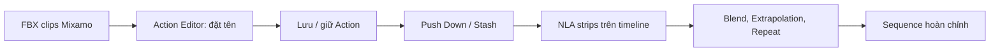

# Bài 061 — Phối hợp nhiều animation bằng NLA Editor trong Blender

> **Phần 08 — Thực hành · Thời lượng: 7 phút 43 giây**  
> **Sản phẩm:** Một chuỗi hành động liên tục **zombie trỗi dậy → đi bộ → dừng/idle** bằng NLA strips, có chuyển tiếp mềm và điều khiển dịch chuyển toàn cục.

## 1. Vì sao dùng Nonlinear Animation?

Một nhân vật có thể cần nhiều chuyển động độc lập: đứng yên, trỗi dậy, đi bộ, chạy hay tấn công. **Nonlinear Animation (NLA)** cho phép đặt các **Action** trên trục thời gian dưới dạng **strips** để cắt, lặp, điều chỉnh tốc độ, pha trộn và nối các hành động. Điều này giống dựng video ở mức ý tưởng, nhưng dữ liệu được trộn là **pose và biến đổi của xương/đối tượng**, không phải ảnh.



NLA khác một Action thông thường ở chỗ nó tổ chức **nhiều đoạn animation** trên cùng một timeline, với ưu tiên và chế độ trộn cần được kiểm soát.

## 2. Mục tiêu và chuẩn bị

Bạn sẽ biết cách nhập các animation Mixamo, giữ Action sau khi xóa object tạm, tạo NLA strips, chỉnh thời gian lặp/tốc độ, xử lý extrapolation và chuyển tiếp giữa các pose.

Chuẩn bị một zombie đã rig; các clip trong ví dụ gồm **rising/get up**, **walk** và **idle**. Nên lưu phiên bản `.blend` mới trước khi chỉnh NLA.

## 3. Nhập, nhận diện và giữ Action

1. Import các FBX có animation; mỗi file có thể mang theo armature và mesh riêng.
2. Trong **Dope Sheet → Action Editor**, chọn armature tương ứng để xem Action đang gán.
3. Đổi tên Action thành `Zombie_Rise`, `Zombie_Walk`, `Zombie_Idle` thay cho những tên mặc định khó nhớ.
4. Dùng thao tác **Fake User/giữ dữ liệu** hoặc cơ chế lưu/stash được Blender cung cấp để bảo vệ Action trước khi xóa những armature/mesh nhập tạm.
5. Kiểm tra trong **Outliner → Blender File → Actions** (hoặc nơi hiển thị data blocks tương ứng) rằng Action còn tồn tại.
6. Gán thử từng Action lên **armature zombie chính** để chắc chắn khớp tên xương và pose.

**Lưu ý quan trọng:** Việc xóa armature tạm có thể khiến Action không còn người dùng thực tế. Hãy kiểm tra cách giữ dữ liệu trước khi xóa; nếu dùng Actions từ các skeleton khác nhau, cần bảo đảm chúng tương thích hoặc được retarget đúng.

## 4. Tạo NLA strip và tổ chức track

Chọn armature chính, mở **NLA Editor**. Với Action đang active, dùng **Push Down** để tạo NLA strip. Với Action khác, thêm strip vào track theo timeline. Có thể tạo track mới rồi dùng **Add → Action Strip**, sau đó chọn Action muốn dùng.

Ví dụ bố cục logic:

```text
Thời gian       [Trỗi dậy]      [Đi bộ........] [Đứng yên]
NLA Rise      |==========|
NLA Walk                     |================|
NLA Idle                                        |=========|
Global Move             |---------------------------|
```

Đây là sơ đồ tương đối; các dải có thể chồng một phần ở vùng chuyển tiếp để blend. Đặt tên track như `ACT_Rise`, `ACT_Walk`, `ACT_Idle`, giúp dễ đọc khi scene có nhiều nhân vật.

## 5. Điều chỉnh thời lượng, tốc độ và lặp

Chọn một strip rồi nhấn `N` để mở **sidebar** trong NLA Editor. Các mục thường gồm **Start/End Frame, Scale, Repeat, Blend In/Out, Blend Mode, Extrapolation**. Có thể dùng `G` di chuyển strip; chuyển theo trục dọc sẽ thay track và theo trục ngang sẽ đổi thời điểm.

- **Start/End:** quyết định clip bắt đầu/kết thúc ở frame nào của scene.
- **Scale / Playback speed:** thay đổi thời gian phát của Action. Với đoạn trỗi dậy, rút ngắn dải có thể khiến nhân vật đứng dậy nhanh hơn.
- **Repeat:** lặp nhiều chu kỳ đi bộ nếu đoạn đi kéo dài.
- **Blend In/Out:** tăng/giảm mức ảnh hưởng của strip theo thời gian.

Ví dụ bài học có điều chỉnh tỉ lệ thời lượng đoạn rise khoảng **0,75** để nó diễn ra nhanh hơn. Tác động cụ thể phụ thuộc thuộc tính đang chỉnh; nên kiểm tra ở viewport sau mỗi lần thay đổi.

## 6. Xử lý Extrapolation và chuyển tiếp

Một lỗi thường gặp: đoạn **Rise** đã kết thúc nhưng pose cuối vẫn tiếp tục giữ, lấn át clip **Walk** ở track khác. Nguyên nhân có thể do **Extrapolation** đang giữ pose sau vùng ảnh hưởng. Thay đổi chế độ extrapolation để strip không tiếp tục chi phối ngoài thời lượng mong muốn; tùy giao diện Blender có các lựa chọn như **Nothing**, **Hold** hoặc biến thể khác.

Khi chuyển từ đứng dậy sang đi bộ, hai Action thường có pose đầu/cuối khác nhau, gây **nhảy pose**. Để sửa:

1. Sắp strip Rise và Walk để chuyển tiếp tại vùng nhân vật vừa đứng thẳng.
2. Cho phép chồng hợp lý và đặt **Blend In** trên Walk hoặc cấu hình chuyển tiếp phù hợp.
3. Kiểm tra Blend Mode; khi cần chuyển động kế tiếp thay thế chuyển động trước, chế độ **Replace** thường là điểm bắt đầu dễ kiểm soát.
4. Chạy preview từ vài frame trước đến vài frame sau chuyển tiếp; sửa keyframe đầu/cuối nếu vẫn giật.

**Blend In** không tự sửa được hai tư thế hoàn toàn mâu thuẫn (ví dụ một hành động đang nằm, hành động kia đang sải bước). Khi cần, hãy chỉnh Action hoặc thêm pose trung gian.

## 7. Tách chuyển động vị trí khỏi chu kỳ bước

Trong ví dụ, animation zombie có một **controller toàn cục** được keyframe để di chuyển trên mặt đất. Chuyển động controller không nhất thiết phải đẩy thành một NLA strip nếu chỉ có vài keyframe đơn giản. Giữ nó riêng giúp dễ đồng bộ với Action đi bộ.

Trong Timeline/Graph Editor, điều chỉnh keyframe vị trí của controller; dùng `T` → **Linear** khi cần vận tốc đều. Nếu zombie đi quá nhanh, kéo frame cuối ra xa hơn hoặc giảm quãng đường. Phát lại để phát hiện **foot sliding** và đồng bộ chuyển động với số chu kỳ bước của NLA Walk.

## 8. Thêm Idle và mở rộng chuỗi hành động

Thêm Action `Zombie_Idle` sau Walk, chỉnh Extrapolation để pose đi bộ không đè lên idle. Có thể blend nhẹ giữa hai Action để tránh zombie đứng khựng không tự nhiên. Tiếp tục áp dụng cùng nguyên tắc khi thêm chạy hoặc tấn công.

Với **nhiều zombie**, có thể tái sử dụng thư viện clip nhưng cần thay đổi thời điểm bắt đầu, tốc độ và hướng di chuyển để tránh mọi nhân vật thực hiện cùng nhịp. Đây là cách thuận tiện để xây một cảnh đám đông không quá phức tạp.

## 9. Gỡ lỗi và kiểm tra chất lượng

| Lỗi | Kiểm tra |
|---|---|
| Không thấy Action chạy | Chọn đúng armature, Action tương thích, strip có bị mute/solo? |
| Clip sau không xuất hiện | Extrapolation/track phía trên đang giữ pose? |
| Nhảy pose khi đổi clip | Blend In/Out, overlap và pose đầu/cuối |
| Nhân vật trượt chân | Tốc độ controller toàn cục so với Walk strip |
| Mất Action khi dọn file | Fake User, Stash, file đã Save? |
| Animation kết thúc quá sớm | Start/End/Scale/Repeat và frame range |

- [ ] Từng Action có tên rõ và được giữ an toàn.
- [ ] NLA strips được đặt theo timeline dự kiến.
- [ ] Extrapolation không giữ pose sai ngoài clip.
- [ ] Transition không làm nhảy pose.
- [ ] Controller vị trí di chuyển đồng bộ với chu kỳ chân.
- [ ] Đã lưu một phiên bản trước khi sửa NLA.

**Deliverable:** file `.blend` có một sequence Rise → Walk → Idle, cùng một bản preview kiểm tra chuyển tiếp.

## 10. Câu hỏi ôn tập

**Câu 1.** NLA Editor thích hợp nhất cho nhiệm vụ nào?  
A. Thay texture 4K.  
B. Tạo UV seam.  
C. Ghép, lặp và pha trộn nhiều Action thành chuỗi chuyển động.  
D. Thêm polygon vào mesh.  
**Đáp án: C.** NLA tổ chức các Action dưới dạng strips theo timeline.

**Câu 2.** Vì sao cần giữ Action trước khi xóa armature nhập tạm?  
A. Để tránh mất data block animation khi không còn người dùng.  
B. Để tăng số frame/giây.  
C. Để làm sáng cảnh.  
D. Để xóa vật liệu.  
**Đáp án: A.** Action không được giữ có thể bị loại khi file được lưu/đóng.

**Câu 3.** Walk không chạy sau khi Rise kết thúc, nguyên nhân nào đáng kiểm tra nhất?  
A. Kích thước texture.  
B. Camera lens.  
C. Độ dài normal.  
D. Extrapolation của Rise có thể đang giữ pose.  
**Đáp án: D.** Strip trước có thể tiếp tục ảnh hưởng sau vùng thời gian của nó.

**Câu 4.** Chuyển từ Rise sang Walk bị nhảy pose, nên làm gì?  
A. Tăng metallic.  
B. Chỉnh vị trí strip, Blend In/Out và pose đầu/cuối.  
C. Xóa toàn bộ keyframe của zombie.  
D. Chỉ tăng Samples.  
**Đáp án: B.** Chuyển tiếp cần cả logic thời gian lẫn pose tương thích.

**Câu 5.** Vì sao tách controller toàn cục khỏi Action đi tại chỗ?  
A. Để xóa xương chân.  
B. Để tăng UV area.  
C. Để chỉnh hướng/quãng đường di chuyển độc lập với chu kỳ bước.  
D. Để không cần lưu file.  
**Đáp án: C.** Tách hai lớp chuyển động giúp kiểm soát foot sliding.

## 11. Tổng kết

NLA cho phép biến một thư viện clip dựng sẵn thành trình tự hành động có chủ đích. Năm điểm phải kiểm tra là **Action nguồn, tên dữ liệu, thời gian strip, extrapolation và transition**.
