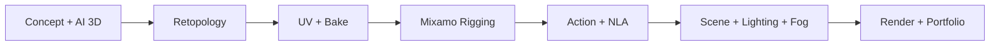

# Bài 062 — Tổng kết dự án hoạt hình 3D và định hướng phát triển

> **Phần 08 — Tổng kết · Thời lượng: 54 giây**  
> **Kết quả:** Một pipeline từ AI-generated model đến nhân vật rigged và shot có hoạt hình, ánh sáng, sương mù, render.

## 1. Kết quả cần đạt của dự án

Hoàn thành dự án không chỉ là có một clip trông đẹp. Cần có **nhân vật đủ sạch để tái sử dụng**, **animation được tổ chức**, **scene có cấu trúc rõ**, và **file xuất có thể kiểm tra hoặc render lại**.



Mỗi bước tạo đầu vào cho bước tiếp theo. Khi một bước chưa ổn, cần sửa ở đúng nơi thay vì dùng ánh sáng hoặc hiệu ứng để che toàn bộ vấn đề.

## 2. Đánh giá sản phẩm cuối

| Hạng mục | Câu hỏi đánh giá |
|---|---|
| Model & topology | Mesh có đủ sạch ở các khớp? Các lỗi AI rõ rệt đã sửa? |
| UV & texture | UV hợp lệ; Base Color, Roughness, Normal lưu và kết nối đúng? |
| Rig & weights | Nhân vật cử động không bị gãy khớp/xuyên lưới khó chịu? |
| Animation | Action có tên, NLA chuyển tiếp mềm, ít foot sliding? |
| Scene | Chủ thể và camera đọc rõ; file không thiếu asset? |
| Render | Lighting/fog không che trọng tâm; có ảnh kiểm tra và output hoàn chỉnh? |

## 3. Đóng gói sản phẩm portfolio

Một gói dự án gọn nên có:

```text
zombie_portfolio/
├── project/                 # scene Blender đã lưu phiên bản
├── assets/                  # nhân vật, rig, các đối tượng môi trường
├── textures/                # ảnh map dùng trong project
├── renders/                 # chuỗi PNG hoặc video đã xuất
└── notes.md                 # mục tiêu, quy trình, điểm cần cải thiện
```

Giữ ít nhất một bản final `.blend` và output render; kiểm tra đường dẫn asset khi mở lại. Trong `notes.md`, ghi lại lỗi từng gặp và cách giải quyết để dùng làm kinh nghiệm cho dự án sau.

## 4. Lộ trình học tiếp

**Rigging và animation chuyên sâu:** tìm hiểu thêm Weight Paint, constraints, phương pháp điều khiển chuyển động mềm (spline IK, overlap, wave motion), đặc biệt hữu ích với sinh vật như cá hoặc nhân vật phi nhân dạng.

**Look development:** xây thư viện material, luyện compositing, color management, và tối ưu Cycles/volume.

**Production workflow:** chuẩn hóa naming, versioning, link/append asset, quản lý Action và checklist render để làm việc ổn định trong dự án dài.

## 5. Bài tập kết thúc

Tự mở rộng kịch bản nghĩa trang thành shot tiếp theo: zombie đứng dậy và bắt đầu tiến về nhà thờ. Tái sử dụng nhân vật và animation đã có nhưng thay đổi góc camera, nhịp chuyển động và hệ thống ánh sáng để tạo điểm nhấn mới. Bài tập được xem là hoàn thành khi shot mới có file Blender riêng, liên kết asset đầy đủ và ít nhất một bản preview render.

- [ ] Đã lưu final `.blend` và output render.
- [ ] Đã ghi các lỗi/điểm cần cải thiện.
- [ ] Đã đánh giá topology, UV, maps và rig.
- [ ] Đã kiểm tra các đoạn nối NLA và bố cục camera.
- [ ] Đã xác định dự án tiếp theo để luyện tập.

## 6. Câu hỏi ôn tập

**Câu 1.** Lỗi gãy khớp khi nhân vật đi bộ nên kiểm tra đầu tiên ở đâu?  
A. Chỉ ở Color Management.  
B. Rig, weights và topology quanh khớp.  
C. Ở texture mặt trăng.  
D. Ở tên file PNG.  
**Đáp án: B.** Biến dạng liên quan trực tiếp tới lưới và ảnh hưởng xương.

**Câu 2.** Vì sao cần giữ final `.blend` ngoài file render?  
A. Để tránh sử dụng texture.  
B. Để bỏ qua stage UV.  
C. Để giảm tất cả polygon.  
D. Để có thể mở lại, sửa hoặc render shot.  
**Đáp án: D.** Render là kết quả hiển thị, còn `.blend` giữ cấu trúc sản xuất.

**Câu 3.** Đầu ra portfolio nào thể hiện tốt nhất quy trình sản xuất?  
A. File project, asset/texture hợp lệ, render và ghi chú kiểm tra.  
B. Chỉ một ảnh chụp viewport.  
C. Chỉ một tên Action.  
D. Chỉ concept chưa dựng.  
**Đáp án: A.** Một sản phẩm có thể tái mở và kiểm chứng thể hiện rõ kỹ năng pipeline.

## 7. Tổng kết

Bước tiếp theo là biến những kỹ thuật riêng lẻ thành quy trình làm việc lặp lại được: **dựng nhanh nhưng kiểm soát chất lượng, tổ chức asset tốt và render có thể tái tạo**.
