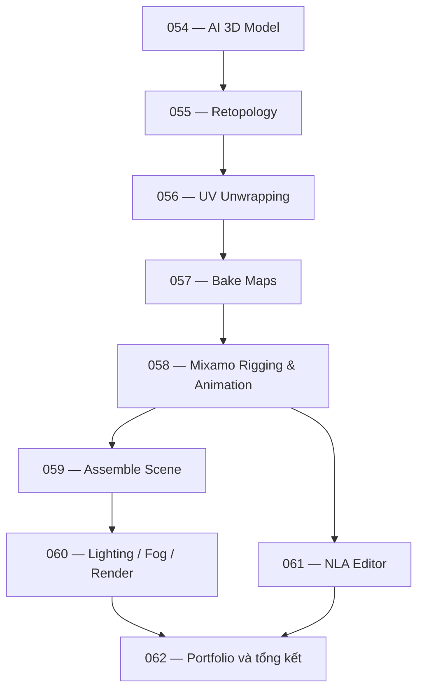

# Phần 08 — Thực hành: Từ AI 3D đến shot hoạt hình Blender

**9 bài · Tổng thời lượng theo bộ tài liệu: 1 giờ 34 phút**  
**Dự án xuyên suốt:** Thiết kế zombie hoạt hình, tối ưu mesh, UV và bake map, rig bằng Mixamo, dựng shot nghĩa trang đêm và phối hợp nhiều hoạt ảnh bằng NLA Editor.

## 1. Mục tiêu toàn phần

Sau phần thực hành, bạn có thể:

- Đưa một mô hình 3D tạo bằng AI vào pipeline Blender và đánh giá kỹ thuật của nó.
- Tạo low-poly bằng retopology, trải UV và chuyển texture/chi tiết qua baking.
- Sử dụng Mixamo để auto-rig, nhập chuyển động và kiểm tra deformation.
- Dựng shot có camera, môi trường, vật liệu, ánh sáng và volume fog.
- Kết hợp hành động bằng Action/NLA Editor và thiết lập render Cycles.

## 2. Bản đồ pipeline



Nhánh **NLA** quản lý chuỗi chuyển động của nhân vật; nhánh **scene/render** tạo hình ảnh cuối. Khi dựng cảnh hoàn chỉnh, hai nhánh cần được kiểm tra đồng thời.

## 3. Danh sách bài học

| Bài | Tên bài tiếng Việt | Thời lượng | Tài liệu |
|---:|---|---:|---|
| 054 | Tạo mô hình 3D bằng AI | 6:17 | [Bài 054](054%20-%20Tao%20mo%20hinh%203D%20bang%20AI.md) |
| 055 | Retopology: tái cấu trúc lưới | 7:36 | [Bài 055](055%20-%20Tai%20cau%20truc%20luoi%20Retopology.md) |
| 056 | Trải UV cho nhân vật | 9:50 | [Bài 056](056%20-%20Trai%20UV%20nhan%20vat.md) |
| 057 | Bake texture và normal map | 17:08 | [Bài 057](057%20-%20Bake%20texture%20va%20normal%20map.md) |
| 058 | Rigging và Animation với Mixamo | 12:32 | [Bài 058](058%20-%20Rigging%20va%20Animation%20voi%20Mixamo.md) |
| 059 | Lắp ráp cảnh quay — Phần 1 | 16:40 | [Bài 059](059%20-%20Lap%20rap%20canh%20quay%20phan%201.md) |
| 060 | Hoàn thiện ánh sáng, fog và render | 15:43 | [Bài 060](060%20-%20Hoan%20thien%20anh%20sang%20suong%20mu%20va%20render.md) |
| 061 | Phối hợp animation bằng NLA Editor | 7:43 | [Bài 061](061%20-%20Phoi%20hop%20animation%20bang%20NLA%20Editor.md) |
| 062 | Tổng kết và hướng phát triển | 0:54 | [Bài 062](062%20-%20Tong%20ket%20va%20huong%20phat%20trien.md) |

## 4. Cách học khuyến nghị

**Chặng 1 — Chuẩn bị nhân vật (054–057):** hoàn thành asset gốc và bản working, mesh low-poly, UV và bộ map đã lưu riêng. Chưa chuyển sang rig nếu phần bàn tay hoặc khớp vẫn có lỗi lớn.

**Chặng 2 — Rig và animation (058, 061):** đưa zombie qua Mixamo, kiểm tra weight/scale, tạo controller và tổ chức Actions. Dựng tối thiểu chuỗi Rise → Walk → Idle.

**Chặng 3 — Sản xuất shot (059–060):** dựng cảnh nghĩa trang, điều khiển camera, đồng bộ tay zombie trồi lên, tạo ánh sáng đêm và volume fog; kết xuất preview trước khi render đầy đủ.

## 5. Checklist bàn giao cuối phần

- [ ] Model AI đã được kiểm tra silhouette, scale, normal, topology và giấy phép sử dụng.
- [ ] Low-poly có edge flow đủ tốt; high-poly được giữ để đối chiếu và bake.
- [ ] UV islands đủ margin, không bị stretch nghiêm trọng.
- [ ] Base Color, Roughness, Normal Map kết nối đúng và lưu ra file.
- [ ] Nhân vật rigged có Action được đặt tên rõ ràng và kiểm tra deformation.
- [ ] NLA strips có chuyển tiếp đúng frame, không giật pose đáng kể.
- [ ] Camera/lighting/fog hỗ trợ điểm nhấn thị giác.
- [ ] Render thử ở nhiều frame và lưu final `.blend` + output.

## 6. Cấu trúc dự án gợi ý

```text
practice_08_zombie/
├── references/
├── assets/
│   ├── zombie_raw/
│   ├── zombie_lowpoly/
│   ├── rigged/
│   └── environment/
├── textures/
├── shots/
│   ├── shot_01_v001.blend
│   └── shot_02_v001.blend
├── renders/
└── notes.md
```

**Lưu ý kỹ thuật:** Tên menu, tùy chọn import, add-on retopology và hệ thống phân bố cây có thể khác nhau theo phiên bản Blender. Các giá trị trong bài như 4K, 256 samples, 35 mm, 24 fps hoặc Ratio 0,3 là **thông số trong ví dụ thực hành**, không phải chuẩn áp dụng cho mọi sản phẩm.
