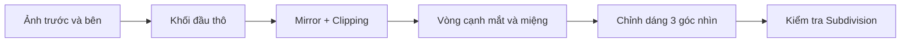

# Bài 01 — Thiết kế, dựng tham chiếu và mô hình hóa đầu nhân vật trong Blender

## 1. Tổng quan

Dựng đầu nhân vật cách điệu là bài toán kết hợp **thiết kế hình khối**, **đối chiếu hình chiếu**, và **xây dựng topology có thể biến dạng khi diễn hoạt**. Mô hình cần giữ được diện mạo từ bản thiết kế nhưng vẫn có những vòng cạnh hợp lý quanh mắt, miệng và vùng hàm.

**Sản phẩm:** một đầu nhân vật 3D đối xứng ở trạng thái trung tính, có mắt, mũi, môi, tai và khoang miệng cơ bản; lưu được dưới dạng `.blend`.

## 2. Mục tiêu học tập

Sau bài học, người học có thể:

- Chuẩn bị bản vẽ tham chiếu phía trước và bên cho nhân vật cách điệu.
- Thiết lập kích thước, chế độ quan sát, ảnh tham chiếu và phím tắt trong Blender.
- Dựng hình đầu từ khối cơ sở, sử dụng `Mirror`, `Subdivision Surface` và các công cụ chỉnh mesh.
- Tạo các vòng cạnh quanh mắt và miệng để hỗ trợ biểu cảm.
- Kiểm tra mặt cắt, đối xứng, mật độ polygon và lỗi hình học trước khi dựng cơ thể.

## 3. Chuẩn bị thiết kế và tư liệu tham chiếu

### 3.1. Xác định ngôn ngữ hình khối

Trước khi dựng hình, hãy ghi lại đặc điểm nhận diện của nhân vật: đầu tròn hay góc cạnh, tỷ lệ mắt so với mặt, hàm hẹp hay rộng, sống mũi cao hay thấp, môi mỏng hay đầy và độ nghiêng của tai. Một nhân vật cách điệu có thể có đầu lớn và mắt to, nhưng thiết kế vẫn phải nhất quán khi nhìn nghiêng.

Có thể sử dụng ý tưởng tự vẽ hoặc hình ảnh tham khảo có quyền sử dụng phù hợp. Không sao chép tác phẩm của người khác để phân phối công khai khi chưa được phép.

### 3.2. Chọn góc nhìn thích hợp

Chuẩn bị tối thiểu hình **trước** và **bên**, có thể thêm hình **sau** và ảnh cận cảnh mắt, mũi, môi. Hình gần phép chiếu trực giao (ít méo phối cảnh) thuận lợi hơn ảnh selfie góc rộng. Khi chụp ảnh làm mẫu, ống kính tiêu cự tương đối dài, khoảng cách chụp phù hợp và máy ảnh ngang tầm khuôn mặt sẽ giảm méo hình.

Căn thẳng các mốc: đỉnh đầu, đường mắt, chân mũi, mép môi, đáy cằm; cắt ảnh tham chiếu sát đối tượng để dễ cân tỷ lệ. Không cần cưỡng ép hai ảnh khớp hoàn toàn nếu bản vẽ có sai lệch phối cảnh: ưu tiên đặc điểm quan trọng và kiểm tra thêm bằng góc nhìn 3/4.

## 4. Thiết lập Blender

### 4.1. Giao diện và hệ tọa độ

- `Numpad 1`: nhìn trước; `Numpad 3`: nhìn bên; `Numpad 7`: nhìn trên; `Numpad 5`: đổi Perspective/Orthographic.
- `Tab`: chuyển `Object Mode`/`Edit Mode`; `1`, `2`, `3` trong Edit Mode: Vertex/Edge/Face Selection.
- `G`, `R`, `S`: di chuyển, xoay, co giãn; thêm `X`, `Y`, `Z` để khóa trục; `E` để `Extrude`.
- `Ctrl + R`: `Loop Cut`; `Alt + Z`: bật/tắt `X-Ray`; `H`, `Alt + H`: ẩn/hiện; `Shift + H`: cô lập phần được chọn trong chế độ phù hợp.
- `GG`: trượt đỉnh/cạnh theo bề mặt lân cận; `O`: bật/tắt Proportional Editing.

**Lưu ý về phiên bản:** phần thao tác được giảng trên Blender khoảng 3.5. Tên bảng điều khiển hoặc bố cục có thể đổi trong các phiên bản mới. Phím `Shift + Z` mà giảng viên dùng để bật/tắt wireframe là **phím tùy biến**, không phải mặc định. Nếu muốn thiết lập tương tự, mở `Edit > Preferences > Keymap`, xử lý xung đột phím trước rồi gán lệnh cho tùy chọn wireframe trong `Viewport Overlays`.

### 4.2. Tỷ lệ và ảnh tham chiếu

Tạo một khối chuẩn chiều cao nhân vật rồi đo trong mục `Item > Dimensions`. Ví dụ của bài giảng dùng chiều cao xấp xỉ **63,7 inch (1,62 m)** cho nhân vật nữ cách điệu; đây là một lựa chọn thiết kế, không phải quy chuẩn chung. Có thể dùng `Scene Properties > Units` để làm việc với mét.

Ở góc nhìn trước, dùng `Shift + A > Image > Reference` để chèn bản vẽ chính diện; lặp lại ở góc nhìn bên. Căn tâm nhân vật vào trục giữa và điều chỉnh độ trong suốt / hiển thị ảnh để hình không che lưới. Tạo `Collection` riêng cho ảnh và khóa chọn nhầm khi cần.

## 5. Xây dựng mesh nền và đối xứng

### 5.1. Từ khối sơ bộ đến bề mặt điều khiển

Bắt đầu với khối đơn giản hoặc một phần cầu có số phân đoạn vừa phải. Tập trung ba chiều: **chiều rộng trán – gò má – hàm**, **độ sâu mặt**, và **độ nghiêng từ trán đến cằm**. Không thêm hàng nghìn polygon chỉ để khớp những chi tiết nhỏ.

Tạo nửa đầu theo mặt phẳng giữa, xóa phần thừa rồi thêm `Mirror Modifier` theo trục X. Bật `Clipping` để đỉnh giữa không xuyên qua trục đối xứng và `Merge` để hai nửa hàn với nhau. Thêm `Subdivision Surface` để xem bề mặt mượt, nhưng giữ lưới điều khiển thưa, chủ yếu là mặt **quad**.

Sơ đồ thể hiện cách làm **từ tỷ lệ lớn đến topology chi tiết**, thay vì bắt đầu với mắt và môi quá sớm.

### 5.2. Vòng cạnh và chất lượng bề mặt

Vòng cạnh nên ôm các vùng có chuyển động hoặc đổi độ cong: hốc mắt, mép môi, rãnh mũi–má và đường hàm. Sử dụng `Loop Cut`, `Extrude`, `Inset` và dịch đỉnh để tạo các vòng tương đối đều. Các mặt quá dài, hình sao ở khu vực biến dạng và nếp gấp khó kiểm soát thường gây nhăn khi bật `Subdivision Surface`.

Dùng góc nhìn trước để kiểm tra hình bóng, góc bên để kiểm tra độ nổi, góc 3/4 để xem tính tự nhiên. Khi cần sửa một vùng diện tích lớn, bật `Proportional Editing` và điều chỉnh bán kính ảnh hưởng bằng bánh xe chuột. Dùng `GG` để điều chỉnh đường chạy cạnh mà không phá hình khối quá mạnh.

## 6. Mô hình hóa mắt, mũi, miệng và tai

### 6.1. Hốc mắt và mí mắt

Dựng nhãn cầu làm vật thể tham chiếu, sau đó phân bố vòng cạnh hình bầu dục quanh hốc mắt. Vòng trong cùng tạo đường mí; các vòng phía ngoài tạo độ dày mí, nếp gấp và vùng chuyển tiếp lên trán, má. Kiểm tra độ khép mí so với mặt cầu của mắt, tránh để da xuyên qua nhãn cầu.

Đừng mô hình hóa mắt chỉ bằng cách khoét một lỗ vuông rồi ép thành hình hạnh nhân: cách đó dễ sinh cực topology ở vị trí nhạy cảm khi chớp mắt.

### 6.2. Mũi

Bắt đầu từ sống mũi và gốc mũi, đẩy hình khối ra khỏi mặt bằng `Extrude`. Tạo đầu mũi, cánh mũi và hai lỗ mũi dựa trên các vòng cạnh liên tục; kiểm tra góc bên để xác định chiều sâu. Với nhân vật cách điệu, giảm số cạnh nhưng vẫn phải giữ đường chuyển từ cánh mũi xuống má mềm và không có hốc giả do bóng đổ bất thường.

### 6.3. Miệng và khoang miệng

Tạo một vòng cạnh khép kín chạy theo viền môi; thêm các vòng hỗ trợ cho môi trên, môi dưới và khóe miệng. Extrude các vòng vào bên trong để hình thành khoang miệng, thay vì chỉ tô một đường tối trên mặt. Cần giữ môi trên và dưới tách nhau đủ để tạo biểu cảm mở miệng và hạn chế polygon giao nhau khi biến dạng.

### 6.4. Tai, cổ và các phần bên trong

Tạo vùng gắn tai có đủ mặt để nối từ thái dương xuống hàm; đùn và định hình vành tai, dái tai, hốc tai bằng lượng chi tiết phù hợp với phong cách. Đầu phải có đường biên cổ sạch để thuận lợi khi nối sang thân. Nếu thêm răng, lưỡi hoặc mắt riêng, đặt tên đối tượng rõ ràng để tránh lẫn với mesh mặt.

## 7. Tinh chỉnh bằng Sculpt Mode

Sau khi các phần chính đã cân đối, sử dụng công cụ điêu khắc với lực vừa phải để làm mềm gò má, hốc mắt, hàm và nếp chuyển tiếp. Tắt/giảm mức Subdivision khi việc chọn điểm trở nên khó khăn. `Sculpt Mode` bổ trợ cho chỉnh mesh, không thay thế việc tổ chức topology.

**Kiểm tra cuối:** đầu có cân đối cả ba hướng; có khoảng trống và độ dày hợp lý quanh mắt/môi; mặt không bị lật; `Mirror` không có đường nứt giữa; không xuất hiện đỉnh treo hoặc những dải cạnh kéo giãn nghiêm trọng.

## 8. Bài thực hành

1. Tạo bộ tham chiếu mặt trước, mặt bên và ba ảnh chi tiết khuôn mặt.
2. Dựng khối đầu đối xứng với `Mirror`, sau đó hoàn thiện mắt, mũi, miệng, tai.
3. Kiểm tra `Subdivision Surface` ở mức thấp và cao, sửa ít nhất ba vùng có nếp gấp bất thường.
4. Lưu `01_head_blockout.blend` và ảnh chụp viewport ở góc trước, bên, 3/4.

**Điều kiện đạt:** silhouette nhận diện được; topology quanh hai mắt và miệng liên tục; không có đường hở ở trục giữa.

## 9. Câu hỏi ôn tập

### Câu 1
Vì sao ảnh chụp góc rộng ở cự ly gần không lý tưởng làm bản vẽ tham chiếu trực giao?

A. Vì không thể nhập JPEG vào Blender.  
B. Vì ảnh luôn bị tối.  
C. Vì phối cảnh làm sai tỷ lệ khuôn mặt.  
D. Vì Blender không hỗ trợ ảnh chân dung.

**Đáp án:** C. **Giải thích:** Méo phối cảnh khiến trán, mũi hoặc cằm lệch tỷ lệ giữa hai hình chiếu.

### Câu 2
Tùy chọn nào giữ các đỉnh giữa của hai nửa đầu không vượt qua mặt phẳng đối xứng?

A. `Clipping` của `Mirror`.  
B. `Decimate`.  
C. `Solidify`.  
D. `Bevel`.

**Đáp án:** A. **Giải thích:** `Clipping` khóa các đỉnh đã chạm mặt phẳng gương khi chỉnh sửa.

### Câu 3
Vùng nào đặc biệt cần topology dạng vòng cho biểu cảm?

A. Phía sau gáy.  
B. Đỉnh đầu dưới tóc.  
C. Chóp tai.  
D. Mí mắt và khóe miệng.

**Đáp án:** D. **Giải thích:** Đây là các vùng biến dạng mạnh khi chớp mắt, nói và cười.

### Câu 4
Thao tác `GG` trong Edit Mode thường dùng để làm gì?

A. Gộp mọi mesh.  
B. Trượt thành phần theo cạnh/bề mặt liên quan.  
C. Xóa modifier.  
D. Phóng to viewport.

**Đáp án:** B. **Giải thích:** Trượt điểm/cạnh giúp thay đổi topology với mức xê dịch hình khối ít hơn.

### Câu 5
Nên kiểm tra bề mặt mặt nhân vật như thế nào?

A. Chỉ nhìn trước.  
B. Chỉ xem chế độ wireframe.  
C. Xem trước, bên và góc 3/4 với Subdivision.  
D. Chỉ bật material preview.

**Đáp án:** C. **Giải thích:** Một hình chiếu đơn lẻ không thể bộc lộ độ sâu và lỗi chuyển tiếp bề mặt.

## 10. Tổng kết

Dựng đầu tốt bắt đầu từ tham chiếu đúng, tỷ lệ lớn chính xác và một lưới điều khiển đơn giản. Khi silhouette ổn định, các vòng topology quanh mắt, miệng và tai mới được triển khai; sau đó mới đến điêu khắc tinh chỉnh.
