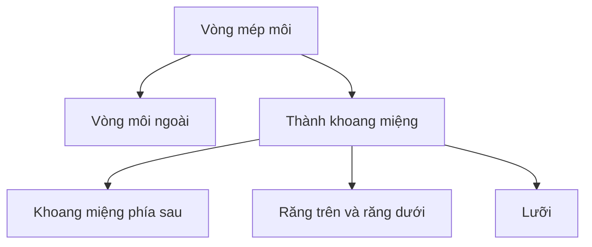

# Bài 02 — Topology khuôn mặt: mắt, mũi, môi, răng và tinh chỉnh đầu nhân vật

## 1. Tổng quan

Một đầu nhân vật có hình dáng đẹp chưa chắc đã phù hợp diễn hoạt. Chất lượng phụ thuộc vào cách các dải polygon chạy quanh **mắt, mũi, miệng**, vị trí các điểm chuyển hướng topology và độ dày của phần bên trong. Bài thực hành này đào sâu các bước dựng khuôn mặt và bổ sung răng, lưỡi để chuẩn bị cho cử động miệng.

## 2. Mục tiêu học tập

- Phân tích luồng cạnh cần thiết cho mặt nhân vật biểu cảm.
- Dựng và tinh chỉnh các vòng mí mắt, khóe mắt, nếp gấp dưới mắt.
- Thiết kế vùng mũi, nhân trung và miệng có độ sâu hợp lý.
- Tạo khoang miệng, răng và lưỡi ở mức phù hợp với render hoặc hoạt hình.
- Phát hiện polygon bị kéo giãn, lồi lõm, tự giao cắt và lỗi đối xứng.

## 3. Thiết lập hình khối cơ sở

Từ hai ảnh phẳng trước và bên, cân tỷ lệ với một khối đo chiều cao nhân vật (ví dụ 1,6 m). Nhập ảnh bằng `Add > Image > Reference`, khóa vị trí và chuyển sang góc nhìn `Orthographic`. Nhân vật cách điệu thường dùng trán lớn, mắt rộng và miệng nhỏ; hãy giữ ý tưởng thiết kế thay vì áp tỷ lệ giải phẫu cứng nhắc.

Dựng khối đầu từ các vòng cạnh ít phân đoạn, bỏ một nửa mesh và bật `Mirror`. Khi dùng `Subdivision Surface`, đừng tăng độ chia chỉ để che khuyết điểm; kiểm soát vị trí các cạnh trước tiên. Hình nền phải được điều chỉnh thường xuyên ở hình chiếu trước, bên, và 3/4.

## 4. Xây dựng luồng cạnh quanh mắt

### 4.1. Tổ chức vòng mắt

Tạo vòng khép kín theo hình mí: mí trên cong rộng hơn, mí dưới mềm hơn, hai điểm nối ở khóe mắt. Từ vòng trong, mở rộng 2–3 vòng phụ thuộc vào độ chi tiết mong muốn để chuyển tiếp ra trán, má và sống mũi. Dùng quả cầu nhãn cầu riêng để đối chiếu độ cong.

Vòng cạnh thứ nhất quyết định đường tiếp xúc nhãn cầu; các vòng tiếp theo điều khiển độ dày mí và nếp gấp. Sắp xếp vòng để khi nhắm mắt, phần trên có thể đi xuống mà không làm méo khóe mắt quá mạnh. Điều này đặc biệt cần thiết nếu sẽ tạo `Shape Keys`.

### 4.2. Điều chỉnh bọng mắt và hốc mắt

Ở góc nhìn bên, kiểm tra độ lồi của hốc mắt; phần da ngay dưới mắt hơi chuyển mềm sang gò má. Tránh tạo bọng mắt chỉ bằng một đường rãnh sâu. Nếu bóng đổ gắt, xem lại hướng mặt, khoảng cách vòng cạnh và độ đồng đều của polygon trước khi chỉnh shader.

## 5. Dựng mũi và đường nét trung tâm

Từ giữa trán xuống giữa hai mắt, phân bố cạnh tạo sống mũi. Tại đầu mũi, đưa bề mặt nhô theo trục chiều sâu, tạo khối chóp và hai cánh mũi. Dùng các vòng cạnh chạy về hai bên má để giảm tập trung nhiều cạnh tại đầu mũi. Khi tạo lỗ mũi, kiểm tra mặt nhìn từ dưới lên để tránh lỗ bị bịt kín hoặc đảo pháp tuyến.

**Mẹo:** chỉnh mũi bằng silhouette nhìn bên trước, sau đó tinh chỉnh chiều rộng cánh mũi từ phía trước. Một mũi nhìn đúng từ trước nhưng quá nhô hay quá bẹt từ bên sẽ làm khuôn mặt thiếu nhất quán.

## 6. Dựng môi và khoang miệng có thể hoạt hình

### 6.1. Đường viền môi

Lấy đường mép miệng làm vòng khép kín, sau đó tạo những vòng đồng tâm hợp lý cho môi trên và môi dưới. Chú ý hình chữ M nhẹ của môi trên và độ đầy ở giữa môi dưới, nhưng giữ nét cách điệu phù hợp với thiết kế. Đẩy các vòng ra trước vừa đủ để tạo hình môi. Môi không nên xuyên chồng lên nhau khi ở trạng thái nghỉ.

### 6.2. Cấu trúc bên trong

Chọn vòng bên trong môi rồi `Extrude` lùi vào để hình thành thành khoang miệng. Đóng phần cuối bằng topology đơn giản ở vùng không nhìn thấy, để tránh hiện lỗ đen từ góc 3/4. Tạo bề mặt bên trong có màu phù hợp sau này để khi miệng mở, người xem không nhìn thẳng xuyên qua đầu.

Răng và lưỡi là các mesh độc lập. Cần đặt chúng trong không gian khoang miệng chứ không gộp vô điều kiện vào topology da mặt.

## 7. Răng, nướu, lưỡi và nhãn cầu

Răng cửa thường có bề mặt trước tương đối phẳng, hàng răng cong theo cung hàm. Với một nhân vật cách điệu, có thể dựng các nhóm răng đơn giản, bo cạnh vừa phải. Đặt răng trên và dưới sao cho khi đóng miệng không lộ phần giao nhau bất hợp lý. Tạo lưỡi từ khối dẹt tròn, có đủ độ dày và đặt gốc lưỡi sâu trong khoang miệng.

Các nhãn cầu nên được đặt đối xứng và ở độ sâu phù hợp so với hốc mắt. Kết hợp quan sát phía trước, phía bên và từ trên xuống để xác nhận mắt không lệch vị trí. Khi có vật thể riêng cho đồng tử/giác mạc, đặt tên rõ ràng và tránh để phần trước mắt nhô quá xa qua mí.

## 8. Kiểm soát topology và chỉnh hình

Một mesh hợp lý chủ yếu là `quads`, nhưng không có nghĩa mọi điểm có đúng bốn cạnh. Điểm cực có thể tồn tại ở vùng ít biến dạng; tránh đặt cực lớn ngay giữa mí hoặc khóe môi. Nếu bề mặt gợn không mong muốn, hãy xem sự thay đổi diện tích các quad, các cạnh quá sát nhau và `Subdivision Surface`.

Thao tác thường dùng: `Ctrl + R` thêm vòng cạnh, `E` tạo khối, `G` di chuyển, `S` co giãn, `GG` trượt, `O` chỉnh tỷ lệ, `Alt + Z` xuyên nhìn và `F` đóng mặt phù hợp. `F` chỉ nên dùng khi việc đóng mặt không tạo một n-gon lớn ở khu vực cần biến dạng.

## 9. Thực hành có kiểm tra

1. Dùng đầu nhân vật cơ bản; lưu bản sao làm checkpoint trước khi chỉnh topology.
2. Hoàn thiện ít nhất một vòng mí trong và hai vòng bao quanh, kiểm tra tương tác với nhãn cầu.
3. Tạo phần mũi với đầu mũi, cánh mũi và hai lỗ mũi; sửa chuyển tiếp vào gò má.
4. Tạo môi và khoang miệng có chiều sâu; lắp hai hàng răng và một lưỡi độc lập.
5. Kiểm tra bằng cách chỉnh thử vài đỉnh mí và khóe môi ở tư thế cười/hé miệng, sau đó hoàn tác về trạng thái trung tính.

**Bàn giao:** `02_head_face_topology.blend` cùng ảnh chụp cận cảnh wireframe ở mắt, mũi và miệng.

## 10. Câu hỏi ôn tập

### Câu 1
Vì sao cần nhiều vòng cạnh quanh mí mắt?

A. Để file chắc chắn xuất sang PDF.  
B. Để tạo vùng biến dạng và chuyển tiếp độ cong có kiểm soát.  
C. Để thay thế nhãn cầu.  
D. Để không cần UV.

**Đáp án:** B. **Giải thích:** Vòng cạnh tạo cấu trúc giúp mí mắt khép/mở tự nhiên và giữ bề mặt mượt.

### Câu 2
Điểm cực topology nên ưu tiên đặt ở đâu?

A. Ngay giữa mép môi.  
B. Ngay đường chớp mắt.  
C. Ngay khóe miệng.  
D. Vùng tương đối ít biến dạng.

**Đáp án:** D. **Giải thích:** Cực ở nơi biến dạng mạnh dễ tạo nếp nhăn và hiện tượng kéo rút mặt.

### Câu 3
Cách tạo khoang miệng đúng mục tiêu diễn hoạt là gì?

A. Extrude vòng trong môi vào sâu và tạo thành trong.  
B. Chỉ vẽ một hình đen trên mặt.  
C. Gộp hai hàng răng vào cùng mặt da.  
D. Xóa toàn bộ phần đầu phía sau.

**Đáp án:** A. **Giải thích:** Khoang miệng cần có thể tích và tường trong để mở miệng mà không nhìn xuyên mesh.

### Câu 4
Khi bóng đổ bất thường trên gò má, nên kiểm tra trước điều gì?

A. Độ sáng màn hình.  
B. Tên của đối tượng.  
C. Vị trí đỉnh, hướng mặt và độ đồng đều polygon.  
D. Kích cỡ bàn phím.

**Đáp án:** C. **Giải thích:** Lỗi hình học có thể tạo bóng gắt dù vật liệu đúng.

### Câu 5
Vì sao răng và lưỡi thường để thành đối tượng riêng?

A. Vì Blender không cho gộp mesh.  
B. Để quản lý hình học, vật liệu và chuyển động độc lập.  
C. Để không cần chiếu sáng.  
D. Vì chỉ có hình cầu mới làm răng được.

**Đáp án:** B. **Giải thích:** Các bộ phận trong miệng có cấu trúc và chức năng khác với bề mặt da.

## 11. Tổng kết

Luồng cạnh quanh mắt và miệng quyết định tính hữu dụng của đầu nhân vật nhiều hơn số lượng polygon. Từng bộ phận phải được kiểm tra trong không gian ba chiều, đồng thời bảo toàn các khoang, các lớp bề mặt và vị trí của vật thể bên trong.
