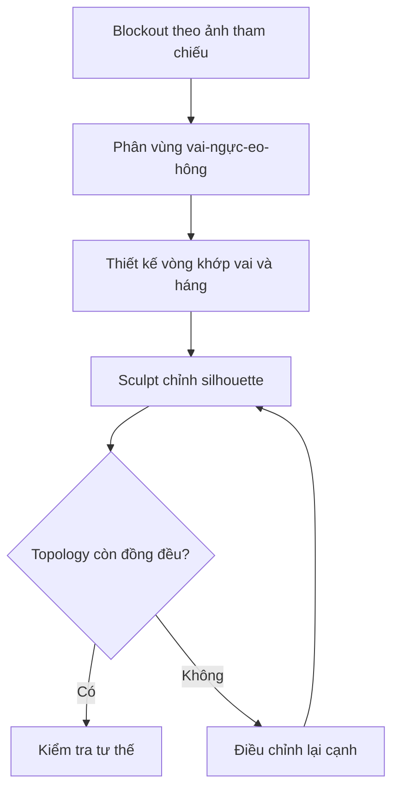

# Bài 03 — Dựng thân người, vai, ngực, hông và topology cho nhân vật 3D

## 1. Tổng quan

Từ một mesh đầu đã được dựng, cơ thể cần được phát triển theo luồng cạnh hợp lý tại cổ, vai, nách, ngực, bụng, hông và gốc chân. Thách thức là giữ đúng silhouette nhân vật từ ảnh tham chiếu nhưng không tạo cạnh quá gấp hoặc chồng lấn ở những khớp sẽ cử động.

## 2. Mục tiêu học tập

- Phát triển mesh cổ và thân từ vòng cạnh dưới đầu.
- Chia vùng vai, cánh tay, ngực và nách bằng topology phù hợp.
- Định hình khối xương chậu và đùi bằng cả chỉnh mesh và Sculpt Mode.
- Chuyển giữa thao tác cơ học và thao tác nghệ thuật để tinh chỉnh tỷ lệ.
- Nhận diện điểm vướng khi rig và diễn hoạt cơ thể.

## 3. Chuẩn bị và cách dựng khối

Bật tham chiếu phía trước và bên, kiểm tra đầu đã đặt đúng tỷ lệ. Trong `Edit Mode`, chọn vòng cạnh cổ dưới đầu, `E` để extrude xuống; dùng `S X` và `S Y` điều khiển chiều ngang và chiều dày. Chỉnh `Transform Pivot Point` khi muốn co giãn quanh tâm thế giới hoặc `3D Cursor` thay vì quanh vùng đang chọn. Lúc đầu chỉ cần hình khối đơn giản: cổ → vai → lồng ngực → eo → hông.

**Nguyên tắc blockout:** điều chỉnh khối tổng quát bằng các vòng cạnh ít trước, sau đó mới thêm đường cắt cần thiết. Những lần co giãn lớn ở giai đoạn sau khi đã có nhiều polygon dễ gây méo.

## 4. Dựng phần trên cơ thể

### 4.1. Vai và nối cánh tay

Thêm `Loop Cut` ở vị trí trên vai và gần điểm đầu nách. Hãy hình dung cơ delta (deltoid) phủ từ vai xuống phần trên cánh tay, còn cơ ngực chuyển vào vùng nách. Cần hình thành một vòng nối quanh lỗ tay áo/tay, để phần cánh tay tách rõ khỏi thân nhưng vẫn có dải polygon liên tục đi vào ngực và lưng.

Nếu lồng ngực và tay giao nhau, đẩy các đỉnh quanh nách vào phía thân để tạo đủ không gian. Kiểm tra vùng dưới cánh tay ở tư thế nghỉ và ở tư thế giơ tay thử. Cạnh nách quá sát nhau có thể gây gấp, trong khi thiếu cạnh làm nách bị kéo giãn khi nâng tay.

### 4.2. Khối ngực, lưng và bụng

Tạo bề mặt thân theo từng tầng ngang. Xác định vùng lồng ngực, bờ sườn, eo và đường hông; kiểm tra chuyển tiếp giữa ba hướng nhìn. Đối với nhân vật cách điệu, độ phồng và độ mềm của silhouette quan trọng hơn việc dựng đúng từng bó cơ. Cơ ngực cần hòa vào phần vai, vùng lưng trên phải có độ dày hợp lý khi nhìn bên và không được quá phẳng.

Cấu trúc vòng cạnh tại eo cần cho phép thân uốn hoặc xoay; không nên để polygon dài nối thẳng từ nách xuống tận hông mà không có vòng trung gian.

## 5. Dựng xương chậu, mông và gốc đùi

### 5.1. Tổ chức luồng cạnh vùng hông

Thân người không phải một ống tròn đơn giản. Ở vùng hông, phần cạnh trước và sau có độ cong khác nhau. Dùng góc nhìn bên để hình thành khối bụng dưới và mông; dùng góc trước để định hình hai bên xương chậu. Đặc biệt ở gốc đùi, cần có vòng cạnh chạy quanh vùng nối chân và khoảng trống phù hợp giữa hai chân.

Khi chưa có tham chiếu sau lưng, xoay viewport để kiểm tra cảm giác giải phẫu, dùng ảnh phụ nếu có. Tránh sao chép hình chữ S gắt giữa eo và mông: chuyển tiếp nên mềm, phụ thuộc phong cách nhân vật.

### 5.2. Tạo hình gốc chân

Có thể tạo vòng lỗ chân bằng cách phân bố lại cạnh tại đáy xương chậu rồi extrude xuống phần đùi. Đếm số cạnh của vòng trước khi nối; nếu hai phía không tương thích, cần thêm/bớt cạnh có kiểm soát thay vì bịt bằng một n-gon lớn. Đưa các vòng xuống đùi, giữ hình trụ thuôn tự nhiên và đủ mặt để chân gập được tại háng.

## 6. Sculpt Mode để hoàn thiện silhouette

Sau khi topology đã tương đối ổn, chuyển sang `Sculpt Mode` dùng các cọ di chuyển và làm mượt để tinh chỉnh bụng, eo, gò hông, mông và vùng giao cánh tay. Sculpt nên làm việc trên khối tổng thể, không tạo chi tiết cơ bắp hoặc nếp nhăn quá sớm. Những lần sửa lớn có thể cần trở về `Edit Mode` để phân bố lại edge loops.

Sculpt là vòng lặp tinh chỉnh sau khi bố cục cạnh đã được làm đúng, không phải bước thay thế retopology.

## 7. Công cụ và lưu ý kỹ thuật

| Công cụ | Vai trò | Cảnh giác |
| --- | --- | --- |
| `E` / `E Z` | Extrude các vòng theo hướng trục | Không tạo nhiều cạnh sát nhau vô ích |
| `Ctrl + R` | Thêm vòng cạnh | Phải theo luồng quads liền mạch |
| `G` / `S` | Thay đổi tỷ lệ từng vùng | Luôn kiểm tra cả trước và bên |
| `F` | Đóng mặt | Tránh n-gon ở khớp chuyển động |
| `Shift + S` | Thao tác snap với con trỏ | Chọn đúng pivot trước khi co giãn |
| `Subdivision Surface` | Xem bề mặt mượt | Không che được topology lỗi |

Các cạnh tại vai, nách và gốc đùi cần được thử bằng di chuyển thử geometry (hoặc rig tạm). Nếu một khớp không thể quay mà không xuyên mesh, sửa ngay từ đầu sẽ rẻ hơn sửa sau khi đã vẽ texture.

## 8. Thực hành

1. Tạo thân từ vòng cổ của đầu; chốt các mốc vai, ngực, eo, hông.
2. Mở một vòng sạch quanh mỗi cánh tay và hai gốc chân; nối các mặt xung quanh bằng quads.
3. Tinh chỉnh bề mặt từ trước, bên, sau và 3/4.
4. Dùng Sculpt Move/Smooth sửa khối, sau đó trở về Edit Mode chỉnh những cạnh bị dồn.
5. Lưu `03_body_topology.blend` và 4 ảnh chụp những vùng dễ biến dạng.

**Đánh giá:** có hình dáng thân rõ ràng; nách và háng không tự cắt; số cạnh ở hai nửa cân đối; khi bật Subdivision không xuất hiện lỗ hoặc khối bị sụp.

## 9. Câu hỏi ôn tập

### Câu 1
Vì sao phải thêm vòng cạnh quanh khớp vai?

A. Để chỉ tăng số polygon.  
B. Để không cần tạo tay.  
C. Để kiểm soát sự uốn và chuyển tiếp khi cánh tay cử động.  
D. Để gắn đèn.

**Đáp án:** C. **Giải thích:** Luồng cạnh quanh khớp giúp biến dạng có vùng chuyển tiếp thay vì kéo dãn một mặt lớn.

### Câu 2
Khi đổi độ rộng thân từ ảnh trước, cần làm gì tiếp?

A. Kiểm tra chiều sâu ở góc nhìn bên.  
B. Xóa toàn bộ tham chiếu.  
C. Chỉ thay chất liệu.  
D. Bỏ hẳn Subdivision.

**Đáp án:** A. **Giải thích:** Một thay đổi theo X không cho biết cơ thể đã đủ dày theo Y hay chưa.

### Câu 3
Tại vùng nách, lỗi nào làm khó rig nhất?

A. Tên mesh ngắn.  
B. Ảnh tham chiếu PNG.  
C. Dùng màu xám.  
D. Lồng ngực và cánh tay chồng lấn với topology không có khoảng biến dạng.

**Đáp án:** D. **Giải thích:** Mesh sẽ xuyên và gấp khi tay nâng lên.

### Câu 4
Vì sao nên sculpt sau blockout và topology sơ bộ?

A. Vì sculpt chỉ hoạt động trên mesh không quad.  
B. Vì cần ổn định tỷ lệ và luồng cạnh trước khi tinh chỉnh chi tiết.  
C. Vì sculpt tạo rig tự động.  
D. Vì UV phải có trước sculpt.

**Đáp án:** B. **Giải thích:** Điêu khắc hữu ích nhất khi nền hình học và các khớp đã tương đối chính xác.

### Câu 5
Một n-gon lớn ở vùng háng có thể gây điều gì?

A. Tăng chất lượng màu sắc.  
B. Tự sinh thêm chân.  
C. Kết quả subdivision hoặc biến dạng khó dự đoán.  
D. Làm ảnh tham chiếu sắc hơn.

**Đáp án:** C. **Giải thích:** Chia và biến dạng n-gon lớn tại khớp thường tạo mặt gấp, vặn hoặc nhăn.

## 10. Tổng kết

Thân nhân vật nên được dựng từ khối lớn, thêm luồng cạnh chức năng ở các khớp rồi tinh chỉnh silhouette. Kết hợp đúng `Edit Mode` và `Sculpt Mode` mang lại hình dáng tự nhiên mà vẫn thuận lợi cho rig.
