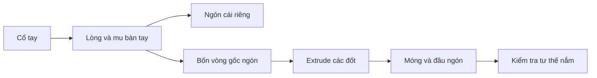

# Bài 04 — Dựng bàn tay, ngón tay, móng và hoàn thiện chân nhân vật

## 1. Tổng quan

Bàn tay là bộ phận khó dựng vì có nhiều khớp nhỏ, tỷ lệ dễ sai và các ngón phải giữ được hình khối khi gập. Phương pháp hiệu quả là chia bàn tay thành **lòng bàn tay → gốc ngón cái → các lỗ ngón → từng ngón → móng**. Phần cuối mở rộng sang chỉnh gốc chân, đùi và các bề mặt cần thống nhất với cơ thể.

## 2. Mục tiêu học tập

- Dựng bàn tay dựa trên tham chiếu lòng, mu bàn tay và hai cạnh bên.
- Dùng `Extrude`, `Loop Cut`, `Inset` và kỹ thuật tạo các lỗ ngón tay có topology sạch.
- Tạo ngón cái, các đốt ngón, móng và vùng gập khớp.
- Đánh giá độ dày, độ cong, tỷ lệ và khả năng deform của bàn tay.
- Sửa nối chân, giảm giao cắt và hoàn thiện hình khối cho cơ thể.

## 3. Thiết lập bản vẽ và bố cục bàn tay

Chuẩn bị tham chiếu bàn tay ở mặt trước, mặt sau, lòng bàn tay và cạnh bên. Tài liệu hướng dẫn dùng sơ đồ màu để phân biệt: **đỏ** = phần được extrude, **hồng** = thêm loop cut, **vàng** = di chuyển điểm để tạo dáng. Sơ đồ màu không bắt buộc; điều quan trọng là người học hình dung trước luồng cạnh sẽ đi đâu.

Nếu bản thiết kế cho bàn tay nghiêng, có thể tạm dựng bàn tay theo hướng thẳng đứng, dễ đối chiếu tỷ lệ, rồi xoay về đúng vị trí. Dùng `3D Cursor` làm tâm khi cần xoay hoặc scale nhóm đỉnh theo một mốc khớp.

## 4. Dựng lòng bàn tay

Bắt đầu từ vùng cổ tay, chọn vòng cạnh hoặc một mảng mặt đã sẵn trên cẳng tay, extrude để tạo cổ tay và mu bàn tay. Chia thành nhiều vòng theo chiều dài; tạo một vòng tại gốc ngón cái và một vòng ngang gần khớp bàn–ngón. Quan sát cạnh bên để xác định độ dày: mu bàn tay và lòng bàn tay không phải hai mặt phẳng hoàn toàn song song.

Thêm vòng chạy dọc để chia khu vực gốc ngón cái với phần bốn ngón còn lại. Vùng nối ngón cái cần có thêm mặt để nó có thể dang ra, không nên lấy trực tiếp một mặt hình chữ nhật duy nhất rồi kéo dài thành ngón.

## 5. Tạo ngón cái và bốn ngón còn lại

### 5.1. Ngón cái

Extrude từ vùng bên lòng bàn tay đã chuẩn bị. Giữ ngón cái có hướng khác các ngón còn lại và vị trí gốc nhô khỏi lòng bàn tay. Thêm vòng cho khớp gốc và khớp đầu; điều chỉnh chiều dài, đường kính và góc nghiêng ở cả ba chiều. Ngón cái quá thẳng hoặc quá to làm tay mất tính tự nhiên.

### 5.2. Tạo các lỗ ngón

Trên cạnh trên của bàn tay, tổ chức các hàng mặt để tạo cửa ra cho bốn ngón. Chia cạnh và loại bỏ các mặt đóng cần thiết để có **bốn vòng khép kín** tương ứng bốn gốc ngón, đồng thời giữ các mặt nối giữa kẽ ngón. Không nên dựng bốn hình trụ rời rồi chỉ đặt chạm lòng bàn tay nếu mục tiêu là mesh da liền khối cho rig.

### 5.3. Extrude các ngón

Từ từng vòng cạnh gốc, extrude từng đốt và scale dần để tạo tiết diện mềm. Dùng vòng hỗ trợ ở các khớp để khi gập, hình dạng có thể thay đổi mà không mất thể tích quá mức. Chú ý ngón giữa dài nhất thông thường; ngón út ngắn hơn, ngón trỏ và áp út tùy thiết kế; cả dãy ngón có cung cong chứ không thẳng hàng tuyệt đối.

## 6. Móng tay và bề mặt đầu ngón

Có thể tạo phần móng bằng các mặt tách/nhân từ bề mặt đầu ngón, sau đó scale và đưa sát phần da. Móng nên hơi cong theo tiết diện ngón, không lơ lửng hay chui quá sâu vào thịt. Nếu móng là mesh độc lập, tên và vật liệu phải quản lý riêng.

Dùng `Local Transform Orientation` khi co giãn đối tượng đã xoay, tránh vô tình scale sai trục thế giới. Khi nhân bản cấu trúc ngón hoặc modifier, cần kiểm tra lại hình dạng và `Apply Scale` nếu modifier hoạt động bất thường.

## 7. Hoàn thiện và kiểm tra tay chân

Kiểm tra cạnh vùng kẽ ngón, đường gấp quanh khớp, độ rộng cổ tay và chuyển tiếp từ mu bàn tay sang cẳng tay. Với chân, quay lại các vùng hông–đùi và mắt cá; phân bố lại loop cut khi những vòng quá dồn, loại các mặt chồng và chỉnh silhouette ở phía trước lẫn bên.

**Các lỗi hay gặp:** kẽ ngón bị bít bởi mặt thừa; đầu ngón quá vuông; móng dính xuyên bề mặt; ngón dài đều như nhau; bàn tay phẳng như tấm bảng; số mặt quanh gốc ngón không đủ cho biến dạng.

## 8. Thực hành

1. Dựng lòng bàn tay và ngón cái từ phần cổ tay đã có.
2. Tạo bốn lỗ ngón có vòng cạnh khép kín, sau đó extrude bốn ngón.
3. Bổ sung vùng khớp và móng tay; gập thử bằng cách xoay chọn các cụm đỉnh, sau đó hoàn tác.
4. So sánh với ảnh tham chiếu ở ba góc, sửa các ngón xuyên nhau hoặc lệch độ dài.
5. Kiểm tra một lượt vùng hông, đùi và gốc chân ở bản thân hiện có.

**Bàn giao:** `04_hands_legs.blend`, ảnh wireframe bàn tay và ảnh bàn tay ở góc nhìn 3/4.

## 9. Câu hỏi ôn tập

### Câu 1
Vì sao cần vòng cạnh phụ quanh khớp ngón tay?

A. Để hỗ trợ gập và duy trì thể tích.  
B. Để thay thế rig.  
C. Để bỏ bề mặt lòng bàn tay.  
D. Để texture tự sinh.

**Đáp án:** A. **Giải thích:** Vòng phụ giúp phân bổ sự biến dạng tại khớp thay vì kéo một dải mặt dài.

### Câu 2
Bước quan trọng trước khi extrude bốn ngón là gì?

A. Bake toàn bộ môi trường.  
B. Thêm camera.  
C. Tạo các vòng lỗ gốc ngón và xử lý kẽ ngón.  
D. Bỏ ảnh tham chiếu.

**Đáp án:** C. **Giải thích:** Vòng gốc ngón đúng giúp nối ngón liền và tránh mặt chồng.

### Câu 3
Khi ngón cái trông thiếu tự nhiên, yếu tố nào nên kiểm tra trước?

A. Màu nền viewport.  
B. Hướng mọc, kích thước và vị trí gốc.  
C. Tên Collection.  
D. Số khung hình trên Timeline.

**Đáp án:** B. **Giải thích:** Ngón cái có hướng và gốc đặc thù so với bốn ngón còn lại.

### Câu 4
Tại sao cần xem bàn tay ở mặt bên?

A. Để ẩn mọi ngón.  
B. Để dùng chế độ render Cycles.  
C. Để thay đổi tên mesh.  
D. Để kiểm tra độ dày của lòng bàn tay và các ngón.

**Đáp án:** D. **Giải thích:** Hình trước không thể cho biết lòng bàn tay có bị dẹt hay không.

### Câu 5
Khi sao chép modifier giữa các ngón đã scale và xoay, cần cảnh giác điều gì?

A. Transform cục bộ và scale chưa được áp dụng có thể làm kết quả khác nhau.  
B. Blender xóa tất cả vật liệu.  
C. Mesh tự biến thành camera.  
D. Phím tắt không hoạt động với đối tượng được sao chép.

**Đáp án:** A. **Giải thích:** Tham số hình học của modifier có thể phụ thuộc vào trạng thái transform từng đối tượng.

## 10. Tổng kết

Bàn tay cần được xây dựng theo luồng cạnh gắn liền với các khớp, đặc biệt ở ngón cái và kẽ ngón. Chất lượng cuối cùng là sự kết hợp giữa tỷ lệ đúng, topology có khả năng biến dạng và bề mặt mịn vừa đủ.
