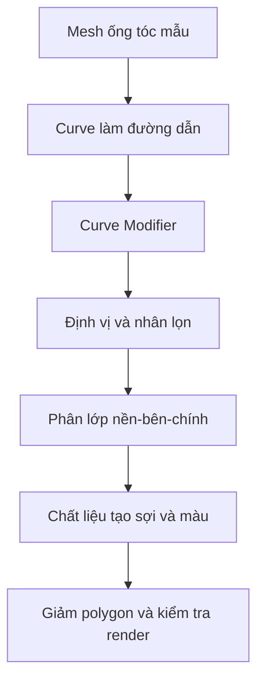

# Bài 05 — Tạo tóc nhẹ cho nhân vật 3D bằng Hair Tube, Curve và vật liệu thủ tục

## 1. Tổng quan

Tóc nhân vật cách điệu có thể tiêu tốn rất nhiều polygon nếu dựng từng sợi. Một hướng làm nhẹ hơn là tạo các **dải hoặc ống tóc (hair tubes)**, uốn chúng bằng `Curve Modifier` rồi dùng chất liệu có rãnh, màu và độ trong suốt để tạo cảm giác nhiều sợi. Tóc được chia thành các lớp để phủ kín da đầu và tạo silhouette tự nhiên.

## 2. Mục tiêu học tập

- Phân biệt tóc mesh, tóc dạng card/tube và tóc mô phỏng từng sợi.
- Dựng các lớp phủ tóc phía sau, hai bên và lớp tóc chính.
- Tạo mesh hair tube có tiết diện và topology có thể uốn theo đường cong.
- Kiểm soát hướng tóc, tỷ lệ, độ dày, độ phân đoạn và số polygon.
- Thiết kế vật liệu thủ tục tạo vệt sáng, sắc độ và độ trong suốt.

## 3. Phân lớp tóc và chuẩn bị da đầu

Dựng tóc thành ba lớp chức năng:

1. **Lớp phủ nền (underlayer):** che phần gáy và sau đầu, ngăn xuất hiện mảng hói khi tóc chuyển động hoặc camera nhìn từ dưới.
2. **Lớp sát da đầu (scalp cap / side layer):** che đường chân tóc, thái dương và hai bên tai.
3. **Lớp chính (main strands):** tạo kiểu tóc, hướng rẽ ngôi, lọn lớn và silhouette; được đầu tư chi tiết nhiều nhất.

Trước khi dựng tóc, kiểm tra đầu đã hoàn thiện tỷ lệ. Có thể nhân bản bề mặt da đầu làm lớp nền, bỏ mặt không cần thiết và tăng khoảng cách rất nhỏ để tránh z-fighting. Đặt các đối tượng tóc vào `Collection` riêng và khóa chọn mesh đầu để tránh sửa nhầm.

## 4. Xây dựng một Hair Tube mẫu

### 4.1. Thiết kế tiết diện

Tạo một dải mesh mỏng có vài hàng đỉnh dọc theo chiều dài. Tiết diện có thể hơi cong hoặc phồng nhẹ để nhận phản sáng. Mục tiêu không phải hình trụ tròn nhiều mặt; tiết diện càng nhiều cạnh thì lọn tóc càng nặng. `Subdivision Surface` nên dùng có chủ đích, sau khi kiểm tra silhouette ở khoảng cách camera thực tế.

### 4.2. Tạo đường dẫn bằng Curve

Tạo một đối tượng Curve làm đường dẫn uốn lọn. Dùng `Curve Modifier` trên mesh tóc, chọn Curve làm target, rồi điều chỉnh hướng `Deform Axis` cho đúng trục dài của hair tube. Tóc có thể uốn theo đầu, cong vào vùng má, vai hoặc gáy bằng cách dịch các control points của Curve.

Nếu đối tượng có Rotation/Scale chưa được áp dụng, hướng biến dạng có thể lệch. Sử dụng `Ctrl + A > Apply Rotation/Scale` khi phù hợp, nhưng cần hiểu hậu quả trước khi áp vào những đối tượng đang có modifier.

Sơ đồ nhấn mạnh việc tạo **một nguyên mẫu tóc dùng lại nhiều lần** thay vì dựng thủ công mỗi lọn từ đầu.

## 5. Định vị và tạo kiểu tóc

Bắt đầu với những lọn lớn đi từ đỉnh đầu đến gáy; xoay và uốn Curve để phủ phần sau đầu. Tiếp tục tạo các lọn quanh thái dương, tai và đường chân tóc. Lớp tóc chính được sắp xếp theo hướng dòng chảy của kiểu tóc: rẽ ngôi, cong theo má hoặc đổ xuống vai.

Ở điểm xuất phát, lọn tóc nên sát da đầu; phần giữa tạo thể tích, phần ngọn thu nhỏ tự nhiên. Các lọn có thể chồng một phần nhưng đừng đặt cùng bề mặt vì dễ nhấp nháy khi render. Khi camera nhìn từ dưới hoặc quay đầu, hãy kiểm tra các khoảng trống để bổ sung lớp nền.

**Tối ưu:** tận dụng một số hair tubes có kích thước khác nhau, thay Curve và hướng uốn. Đừng nhân hàng trăm lọn nhỏ nếu vài lọn lớn đã đủ tạo silhouette. Nếu cần chi tiết, bổ sung bằng texture thay vì geometry.

## 6. Vật liệu thủ tục cho tóc

### 6.1. Sắc độ và rãnh tóc

Vật liệu có thể sử dụng các node như `Texture Coordinate`, `Mapping`, `Noise Texture`, `Wave Texture`, `ColorRamp`, `Bump` và `Principled BSDF`. Tọa độ nên đi theo chiều dài lọn để rãnh trông như chạy dọc sợi. Dùng `ColorRamp` để phân bố vùng sáng và tối, tạo chênh lệch nhẹ giữa các lọn.

Các hiệu ứng này làm tóc giàu chi tiết khi render, nhưng không tự động trở thành texture khi xuất sang phần mềm khác. Nếu cần chuyển sang Unity hoặc engine khác, phải bake các thông tin thiết yếu thành ảnh ở bài sau.

### 6.2. Alpha và độ trong suốt

Với hair cards dạng dải, bản đồ alpha giúp viền tóc trông mềm và thưa hơn. Phần không nhìn thấy sẽ được điều khiển bằng alpha; muốn xuất sang engine phải chọn đúng loại blending/alpha clipping và kiểm tra chiều mặt. Không nhầm **giá trị alpha** với màu đen của Albedo: chúng phục vụ hai mục đích khác nhau.

### 6.3. Kiểm tra ánh sáng

Chuyển qua chế độ vật liệu hoặc render để quan sát highlight trên những lọn cong. Điều chỉnh độ thô của chất liệu để tóc không bóng như kim loại. Với nhiều lọn chồng, vật liệu quá trong có thể gây lỗi sắp xếp mặt trong engine realtime; có thể cân nhắc alpha clipping cho một số lớp tùy mục tiêu hình ảnh.

## 7. Quản lý và tối ưu dự án

| Thành phần | Ưu tiên | Dấu hiệu cần sửa |
| --- | --- | --- |
| Scalp cap | Che da đầu | Lộ mảng hói ở sau gáy |
| Lọn chính | Silhouette, chuyển động | Quá nhiều lọn nhỏ gây rối |
| Curve | Kiểm soát hình dáng | Lọn xuyên vào đầu hoặc vai |
| Tiết diện tube | Nhẹ nhưng đủ cong | Số cạnh vượt nhu cầu |
| Alpha | Làm mềm viền tóc | Bị mất mảng khi render |
| Material | Rãnh và phản xạ | Highlight quá mạnh hoặc sai hướng |

Đặt tên như `Hair_Back_01`, `Hair_Side_L_02`, `Hair_Main_03`, lưu một phiên bản còn modifier trước khi áp dụng. Nếu phải chuyển sang mesh để xuất, luôn tạo bản sao dự phòng vì việc `Apply` có thể làm mất khả năng chỉnh Curve dễ dàng.

## 8. Thực hành

1. Tạo scalp cap đơn giản, tránh để nó lộ ra khỏi lớp tóc chính.
2. Dựng một hair tube mẫu; gắn Curve và thử ba dạng cong khác nhau.
3. Tạo ba lớp tóc có ít nhất một lọn chính, một lọn bên và lớp phủ phía sau.
4. Tạo vật liệu có biến thiên màu và vệt sợi theo chiều dài tóc.
5. Chụp bốn góc nhìn và so sánh độ chi tiết/số polygon trước và sau khi tinh gọn.

**Bàn giao:** `05_hair_curves.blend`, một bộ ảnh render tóc và ghi chú số lượng lọn/face trước khi tối ưu.

## 9. Câu hỏi ôn tập

### Câu 1
Tại sao cần lớp tóc phủ gáy?

A. Để che lỗ trống khi nhìn sau hoặc phía dưới đầu.  
B. Để tạo răng.  
C. Để xóa da đầu.  
D. Để thay ánh sáng.

**Đáp án:** A. **Giải thích:** Khi lọn chính dịch chuyển hoặc nhìn từ góc khác, lớp nền giúp tránh thấy da đầu trống.

### Câu 2
`Curve Modifier` thường được dùng trong phương pháp này để làm gì?

A. Đổi vật liệu thành kim loại.  
B. Chia UV tự động.  
C. Uốn mesh tóc theo một đường dẫn.  
D. Thêm xương rig tự động.

**Đáp án:** C. **Giải thích:** Deformation theo Curve giúp tạo lọn cong mà không phải chỉnh từng đỉnh của toàn bộ mesh.

### Câu 3
Cách tối ưu tóc hợp lý nhất là gì?

A. Tăng Subdivision của toàn bộ lọn vô hạn.  
B. Bắt buộc tạo từng sợi bằng mesh riêng.  
C. Loại hết lớp tóc nền.  
D. Giữ silhouette bằng lọn lớn, bổ sung chi tiết bằng texture.

**Đáp án:** D. **Giải thích:** Chi tiết hình học nên dành cho phần tác động đến dáng nhìn, còn chi tiết nhỏ có thể mã hóa trong texture.

### Câu 4
Vì sao tóc có thể bị uốn sai khi dùng Curve?

A. Vì máy tính không có microphone.  
B. Vì hướng trục biến dạng hoặc transform của mesh/Curve không phù hợp.  
C. Vì thiếu camera perspective.  
D. Vì độ phân giải ảnh tham chiếu cao.

**Đáp án:** B. **Giải thích:** `Deform Axis` và trạng thái transform quyết định hướng mesh chạy dọc Curve.

### Câu 5
Muốn mang vật liệu tóc procedural sang Unity ổn định, cách nào phù hợp?

A. Bake dữ liệu quan trọng thành texture rồi thiết lập shader tương ứng trong Unity.  
B. Chỉ đổi tên file `.blend` thành `.png`.  
C. Chỉ tăng render samples.  
D. Không cần xử lý gì.

**Đáp án:** A. **Giải thích:** Engine không mặc nhiên hiểu mạng node thủ tục của Blender.

## 10. Tổng kết

Tóc nhẹ đạt hiệu quả khi cấu trúc ba lớp che kín đầu, số hair tubes được chọn lọc và vật liệu bổ sung chi tiết thay vì lạm dụng polygon. Quy trình có thể tiếp tục bằng baking và xuất sang engine sau khi kiểm soát biến dạng Curve.
