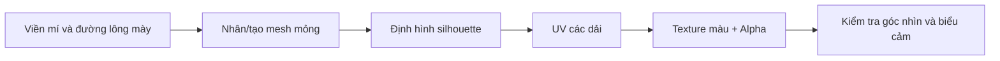

# Bài 06 — Tạo lông mi và lông mày nhẹ bằng mesh mỏng và texture

## 1. Tổng quan

Lông mi và lông mày góp phần quyết định biểu cảm. Để giữ nhân vật nhẹ, có thể sử dụng các dải mesh mỏng bám theo mắt và trán, sau đó dùng texture với alpha tạo cảm giác nhiều sợi nhỏ. Bài thực hành này cũng hướng dẫn chỉnh nhẹ vùng hàm/gò má để cân bằng khuôn mặt sau khi đã có tóc.

## 2. Mục tiêu học tập

- Tinh chỉnh dáng hàm, gò má bằng công cụ di chuyển và làm mượt phù hợp.
- Tạo dải lông mi từ các cạnh/mặt xung quanh mí mắt.
- Trải UV và gắn texture để lông mi có phần đầu mảnh, phần đuôi rộng phù hợp.
- Tạo lông mày từ mesh mỏng, kiểm soát độ cong, mật độ và độ trong suốt.
- Kiểm tra tính đồng nhất hai bên và vị trí khi biểu cảm khuôn mặt thay đổi.

## 3. Điều chỉnh hình khối khuôn mặt trước khi tạo phụ kiện

Khi đã đặt tóc, đôi lúc tỷ lệ mặt trở nên khác cảm giác ban đầu: hàm có thể hơi rộng, gò má quá sắc hoặc vùng dưới mắt đổ bóng mạnh. Quay về mesh đầu, chỉnh hình bằng `Sculpt Mode` hoặc `Edit Mode`. Tránh di chuyển mặt xuyên qua nhãn cầu hoặc làm đường mí bị gãy. Nếu bật `Subdivision Surface` khiến khó chọn điểm, giảm hoặc tắt preview trong khi chỉnh.

## 4. Tạo dải lông mi

### 4.1. Lấy hình học quanh mắt

Trong Edit Mode, chọn một dải mặt hoặc cạnh theo viền mí trên, `Shift + D` để nhân bản rồi `P > Selection` nếu muốn tách thành đối tượng riêng. Đặt tên `Eyelash_L`/`Eyelash_R`. Điều chỉnh dải cong theo mắt, để phần mi mọc chếch ra khỏi bề mặt mí, không đứng vuông góc cứng nhắc.

### 4.2. Tạo silhouette lông mi

Ở góc nhìn trước và bên, kéo các điểm của dải sao cho phần lông mi **ngắn gần khóe trong và dài hơn ở phía ngoài**. Có thể uốn nhẹ lên/down theo thiết kế nhân vật; tránh kiểu mi có chiều dài bằng nhau trên toàn bộ đường mí. Nếu dùng `Mirror`, kiểm tra hướng normal và alpha ở mắt bên kia.

### 4.3. UV và texture alpha

Trải dải mi thành vùng UV đơn giản, đặt hướng sao cho đầu chân mi và ngọn mi trùng với hướng họa tiết. Tạo/chọn ảnh có các vệt lông mi và nền trong suốt; cắm vào màu và kênh alpha của vật liệu. Dùng `Material Preview` để nhìn độ mềm, chỉnh nếu mi quá đậm hoặc quá đen. Muốn xuất game, phải bake/lưu ảnh và thiết lập alpha đúng ở engine đích.

## 5. Tạo lông mày bằng dải mesh

Tạo mesh theo đường cung lông mày, thường có phần đầu tương đối đầy và phần đuôi thon lại. Có thể dựng nhiều dải nhỏ chồng ở khoảng cách rất nhẹ để có lớp sợi, song cần cân nhắc polygon và lỗi z-fighting. Đặt UV để các vệt sợi đi từ gốc lông mày chếch ra theo hướng mọc. Kết hợp nhiều sắc độ gần nhau giúp lông mày tự nhiên hơn một mảng màu đều.

Cả mi và mày đều cần được **đối chiếu silhouette trước**, sau đó mới xử lý texture.

## 6. Kiểm tra kết cấu và vật liệu

Nếu texture bị đảo chiều, xem lại hướng UV và trục của dải mesh. Nếu lông mày có viền sắc như tấm giấy, cần kiểm tra bản alpha, độ mỏng của mặt, bóng đổ và chế độ vật liệu. Nếu mảng dải mất ở góc nghiêng, kiểm tra `Backface Culling`, pháp tuyến và chế độ alpha.

Không nên hàn cứng lông mày vào đầu nếu sẽ điều khiển biểu cảm mặt qua bone hoặc shape key: dù có thể gắn theo da, cần đảm bảo đối tượng đi theo chuyển động chân mày bằng parenting hoặc kỹ thuật deformation phù hợp ở giai đoạn rig.

## 7. Thực hành

1. Chỉnh lại vùng gò má và hàm ở mức tối thiểu để không làm lệch mắt.
2. Tạo lông mi từ cạnh quanh mí trên; uốn đậm về phía đuôi mắt.
3. Tạo lông mày với silhouette riêng, áp texture alpha.
4. So sánh hai bên trong góc nhìn trước và góc 3/4; thử kéo nhẹ vùng mí/lông mày để tìm lỗi xuyên hình.
5. Lưu `06_eyelashes_eyebrows.blend` và các ảnh cận cảnh.

## 8. Lỗi thường gặp

| Biểu hiện | Nguyên nhân có thể | Cách kiểm tra |
| --- | --- | --- |
| Mi như gai cứng | Dải phẳng và đồng đều | Chỉnh độ cong, chiều dài, texture |
| Mi bị rơi khỏi mắt | Mesh chưa bám vào mí | So sánh ở góc nghiêng |
| Mày thành mảng đen | Alpha và sắc độ chưa tốt | Xem ảnh alpha và material |
| Một bên mất texture | Pháp tuyến, UV hoặc culling | Kiểm tra mặt sau và Mirror |
| Mày xuyên tóc | Thiếu không gian giữa hai lớp | Kiểm tra 3/4 và phía bên |

## 9. Câu hỏi ôn tập

### Câu 1
Tại sao lông mi thường dài dần về phía ngoài mắt?

A. Vì Blender yêu cầu.  
B. Vì tất cả ảnh texture đều thiết kế như thế.  
C. Để tạo silhouette nhấn mạnh hình dáng và hướng mắt.  
D. Để không cần UV.

**Đáp án:** C. **Giải thích:** Sự thay đổi chiều dài giúp mi không giống hàng gai đồng đều và tạo nhịp điệu hình khối.

### Câu 2
Một cách nhanh để tạo mesh lông mi bám sát mí là gì?

A. Nhân dải mặt ở vùng mí rồi tách đối tượng và chỉnh hình.  
B. Tạo camera mới.  
C. Xóa nhãn cầu.  
D. Chỉ vẽ vào nền World.

**Đáp án:** A. **Giải thích:** Dải lấy từ mí đã có hình cong gần đúng và phù hợp vị trí đặt.

### Câu 3
Texture alpha đóng vai trò gì?

A. Tăng số bone.  
B. Tạo hình học dày hơn.  
C. Chuyển vật liệu thành kim loại.  
D. Điều khiển vùng trong suốt của dải mesh.

**Đáp án:** D. **Giải thích:** Alpha cho phép dùng ít hình học để thể hiện viền và khe giữa các sợi.

### Câu 4
Nếu mi biến mất khi quay camera, nên kiểm tra gì?

A. Thời gian keyframe.  
B. Hướng normal, culling và alpha.  
C. Số đèn trong scene.  
D. Kích thước cửa sổ Outliner.

**Đáp án:** B. **Giải thích:** Mesh mỏng có thể không hiện mặt sau hoặc bị cắt bởi thiết lập trong suốt.

### Câu 5
Để lông mày đi theo biểu cảm, điều quan trọng là gì?

A. Chỉ đặt mesh trong Collection chung.  
B. Tăng render samples.  
C. Gắn lông mày với biến dạng thích hợp của đầu/rig.  
D. Xóa UV.

**Đáp án:** C. **Giải thích:** Một đối tượng độc lập cần được điều khiển cùng với da trán khi tạo biểu cảm.

## 10. Tổng kết

Lông mi và lông mày là các phụ kiện có hình khối và vật liệu riêng. Kết quả tốt phụ thuộc silhouette tinh tế, dải mesh đặt đúng vị trí, UV theo hướng sợi và alpha được kiểm tra ở nhiều góc nhìn.
