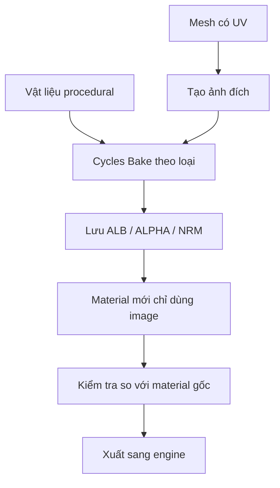

# Bài 07 — Baking vật liệu tóc, lông mày và lông mi thành texture

## 1. Tổng quan

Vật liệu thủ tục có thể trông đẹp trong Blender nhưng không mặc nhiên hiển thị như vậy trong Unity hoặc phần mềm 3D khác. **Baking** là quá trình tạo ảnh texture từ kết quả tính toán vật liệu hoặc từ hình học để chuẩn bị cho trao đổi tài sản 3D. Bài thực hành xây dựng bộ ảnh **Albedo/Base Color, Alpha và Normal** cho tóc, mi và mày.

## 2. Mục tiêu học tập

- Phân biệt bake màu, normal và mask alpha.
- Tạo Collection tách riêng đối tượng cần bake, tránh nhận bóng của vật khác ngoài ý muốn.
- Chuẩn bị UV và các `Image Texture` đích có độ phân giải phù hợp.
- Thực hiện bake màu qua Cycles và kiểm tra ảnh kết quả.
- Xử lý Normal Map đúng loại dữ liệu và đảm bảo ảnh đã được lưu ra đĩa.

## 3. Nguyên lý Baking

Một shader thủ tục sinh kết quả từ các node, ánh sáng và thông số. Khi xuất sang engine khác, hệ node đó thường không tương thích trực tiếp. Baking chuyển phần cần giữ thành ảnh 2D theo UV của mesh. Các texture cần tách chức năng:

| Loại ảnh | Lưu gì? | Color Space khi sử dụng |
| --- | --- | --- |
| Albedo/Base Color | Màu bề mặt không kèm chiếu sáng không mong muốn | sRGB (thông thường) |
| Alpha/Opacity | Độ phủ hoặc trong suốt | Non-Color khi dùng như mask dữ liệu |
| Normal | Hướng pháp tuyến bề mặt biểu kiến | Non-Color |

Cần phân biệt **bake procedural material** và **bake high-poly sang low-poly**. Cả hai dựa trên ánh xạ lên UV nhưng khác nguồn dữ liệu; bài này tập trung vào chất liệu tóc/mi/mày.

## 4. Chuẩn bị scene bake

Tạo `Collection` có tên `Bake`; đưa một đối tượng đại diện, chẳng hạn một dải lông mày, vào đó. Ẩn hoặc loại các đối tượng không cần tham gia tính toán. Phân biệt `Hide in Viewport` với việc tắt khả năng xuất hiện trong render: một vật có thể bị giấu trong viewport nhưng vẫn tác động đến bake/render nếu không xử lý đúng.

Chọn render engine `Cycles` trong `Render Properties`; với những phép bake yêu cầu Cycles, chọn đúng chế độ của phiên bản Blender đang dùng. Đưa đối tượng có UV vào trạng thái kiểm tra, không để texture đích đang được tái dùng sai ở shader gây vòng lặp bất hợp lý.

## 5. Tạo các ảnh đích

Mở `Shader Editor`, thêm node `Image Texture` đích cho từng map. Trong bài giảng, bộ ảnh lông mày có ví dụ **2048 × 2048** cho Albedo, Alpha và Normal. Có thể chọn kích thước khác theo mục tiêu engine và khoảng cách camera; 2K là ví dụ thực hành, không phải yêu cầu bắt buộc cho mọi bộ phận nhỏ.

Đặt tên rõ: `Eyebrow_ALB`, `Eyebrow_ALPHA`, `Eyebrow_NRM`. UV phải tồn tại trước khi bake. Khi tiến hành bake một map, **chọn đúng node Image Texture đang giữ ảnh đích** trên material của đối tượng active. Node này không nhất thiết phải nối trực tiếp vào shader trong quá trình bake, nhưng phải được chọn làm đích nếu phương thức bake đòi hỏi như vậy.

## 6. Bake màu, alpha và normal

### 6.1. Bake Albedo

Với màu bề mặt, cần tránh bake ánh sáng hoặc bóng đổ vào Albedo khi không muốn. Tùy setup và phiên bản, có thể dùng `Diffuse` với các thành phần đóng góp được cấu hình để lấy màu, hoặc đưa màu cần bake qua `Emission`/`Emit` khi phù hợp. Kiểm tra kết quả trên ảnh: màu phải nhất quán và không có bóng không mong đợi.

### 6.2. Bake Alpha

Alpha thường là một dữ liệu mask: phần tóc/mi được giữ có giá trị cao, phần nền bị loại có giá trị thấp. Không giả định mọi cấu hình Bake đều có tùy chọn trực tiếp xuất alpha giống nhau. Có thể chuyển thông tin mask thành kết quả bake dạng emission/grayscale rồi sử dụng nó ở đầu vào alpha của vật liệu đích. Kiểm tra đường viền để tránh mảng tối hoặc viền trắng do ảnh nền.

### 6.3. Bake Normal

Nếu chất liệu tóc có hiệu ứng Bump/Normal, cần đưa dữ liệu sang một ảnh normal thích hợp và kiểm tra rằng bản bake thể hiện hướng bề mặt cần thiết. Các loại normal bake có thể phụ thuộc cấu hình và nguồn high-poly/low-poly; không mặc nhiên coi bake một shader bump giống bake normal từ lưới high-poly. Khi sử dụng ảnh normal, đặt **Non-Color** và giải mã bằng node `Normal Map` trước khi nối vào `Principled BSDF > Normal`.

## 7. Kiểm tra kết quả và tối ưu

Sau bake, thay thế tạm mạng node thủ tục bằng texture vừa tạo rồi so sánh ở cùng góc nhìn và ánh sáng. Nếu ảnh bị rỗng hoặc đen, kiểm tra node đích active, UV, engine và đối tượng đang chọn. Nếu texture mờ, cân nhắc diện tích UV, độ phân giải, margin và tỷ lệ xuất. Nếu alpha làm viền tối, xem lại cách phối màu/alpha và thiết lập blending.

Trước khi xuất sang Unity, có thể áp dụng `Curve Modifier` cho một bản sao tóc để thu được mesh cố định; kiểm tra loại bỏ các modifier không tương thích, đồng thời giữ file nguồn có thể chỉnh sửa. Baking **không tự động tạo rig**, chỉ chuẩn bị chất liệu.

## 8. Thực hành

1. Tạo một Collection `Bake` và chọn một dải lông mày/tóc để thử.
2. UV dải, tạo bộ ảnh 2K `ALB`, `ALPHA`, `NRM`.
3. Bake riêng từng loại, lưu ảnh PNG ra đĩa thông qua `Image > Save As`.
4. Tạo material chỉ dùng ảnh và so sánh với vật liệu thủ tục.
5. Lặp lại cho nhóm tóc và lông mi; ghi lại chỗ nào chênh lệch chất lượng.

**Bàn giao:** `07_bake_materials.blend` và thư mục ảnh PNG. Không coi thao tác `Save .blend` là đã lưu riêng mọi Image Texture được tạo trong RAM.

## 9. Câu hỏi ôn tập

### Câu 1
Tại sao cần bake vật liệu procedural trước khi chuyển sang Unity?

A. Vì Unity chỉ hỗ trợ ảnh JPEG.  
B. Vì tất cả model phải có ánh sáng tĩnh.  
C. Vì Unity không đọc được geometry.  
D. Vì mạng node Blender không nhất thiết tương thích với shader của Unity.

**Đáp án:** D. **Giải thích:** Ảnh texture là dữ liệu trung gian dễ trao đổi giữa công cụ và engine.

### Câu 2
Với normal texture, lựa chọn color space nào phù hợp?

A. Non-Color.  
B. sRGB với tăng gamma.  
C. Filmic.  
D. Linear EXR bắt buộc.

**Đáp án:** A. **Giải thích:** Normal lưu vector dữ liệu, không phải màu cần biến đổi theo gamma sRGB.

### Câu 3
Nếu Bake tạo ảnh đen toàn bộ, cần kiểm tra gì trước?

A. Số frame trong timeline.  
B. Vị trí camera.  
C. Node `Image Texture` đích, UV và cấu hình Bake.  
D. Độ dài tên file.

**Đáp án:** C. **Giải thích:** Kết quả bake thường lỗi khi sai ảnh đích hoặc nguồn dữ liệu chưa được cấu hình.

### Câu 4
Vì sao phải lưu ảnh bake ra tệp riêng?

A. Vì OBJ tự động chứa mọi texture.  
B. Vì ảnh mới tạo có thể vẫn chỉ nằm trong bộ nhớ Blender.  
C. Vì file `.blend` không lưu geometry.  
D. Vì Image Texture không dùng được với PNG.

**Đáp án:** B. **Giải thích:** Việc lưu project không thay thế thao tác xuất/lưu ảnh external khi cần file texture để chuyển giao.

### Câu 5
Albedo dùng cho game nên tránh nội dung nào nếu muốn ánh sáng động tự nhiên?

A. Màu da của nhân vật.  
B. Màu tóc cơ sở.  
C. Màu tàn nhang.  
D. Bóng đổ từ các vật thể không liên quan bị bake cố định vào màu.

**Đáp án:** D. **Giải thích:** Bóng tĩnh không mong muốn trong Albedo sẽ bị cộng thêm với ánh sáng động của engine.

## 10. Tổng kết

Baking tốt cần UV rõ ràng, ảnh đích được chọn đúng, quản lý Collection và phép bake tương ứng loại dữ liệu. Bước xác nhận cuối cùng là dựng lại vật liệu chỉ từ ảnh và lưu toàn bộ file texture trước khi xuất sang engine.
