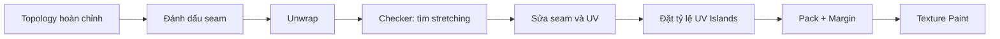

# Bài 08 — UV Unwrapping toàn thân, khuôn mặt và các chi tiết của nhân vật

## 1. Tổng quan

`UV Unwrapping` biến bề mặt 3D thành các vùng phẳng 2D (`UV Islands`) để đặt màu và họa tiết. Mục tiêu không chỉ là nhét mọi mặt vào hình vuông UV: phải **giảm kéo giãn**, **đặt seam hợp lý** và **ưu tiên độ phân giải cho vùng người xem nhìn gần**, đặc biệt là khuôn mặt.

## 2. Mục tiêu học tập

- Giải thích quan hệ giữa mesh 3D, seam, UV island và texture 2D.
- Cắt seam ở tay, chân, thân, đầu và các vật thể nhỏ.
- Dùng `Unwrap`, `Pack Islands`, `UV > Average Islands Scale` và các công cụ chỉnh UV phù hợp.
- Kiểm tra kéo giãn bằng checker texture.
- Dành texel density cao hơn cho vùng mặt khi yêu cầu hình ảnh cho phép.

## 3. Chuẩn bị không gian làm việc UV

Chọn mesh đã có topology tương đối ổn định, bật `UV Editing`. Có thể chia giao diện thành ba vùng: `3D Viewport` để chọn mặt, `UV Editor` để xem các island và `Shader Editor` để bật vật liệu thử. Ẩn các đối tượng không liên quan, chuyển sang `Edit Mode` và bật hiển thị seam. Các vùng da và chi tiết bên trong nên được đặt tên và sắp xếp rõ ràng để xử lý từng phần.

## 4. Chọn seam theo hình khối

### 4.1. Thân và tay

Với cánh tay, chọn seam từ cổ tay đi dọc **mặt trong cánh tay** lên nách — nơi đường cắt ít lộ. Có thể tạo vòng quanh cổ tay khi cần tách bàn tay thành island riêng. Trên thân, đưa seam về lưng hoặc vị trí khó thấy, tránh chia một mảng mặt lớn bằng đường zigzag gây khó vẽ. Sử dụng `Edge > Mark Seam` sau khi chọn các cạnh cần cắt.

### 4.2. Chân, bàn chân và hông

Cắt dọc mặt trong hoặc mặt sau chân tùy thiết kế, thêm vòng quanh cổ chân nếu cần tách bàn chân. Vùng hông cần cẩn thận vì bề mặt cong mạnh và liên kết giữa hai chân; xem UV có bị kéo dài qua đùi hay không. Đối với lòng bàn chân, tạo seam ở cạnh ít thấy để phần đế tách dễ dàng.

### 4.3. Đầu và tai

Đầu thường có seam sau gáy hoặc vùng được tóc che, có thể tách tai thành island nếu cần giảm distortion. Khuôn mặt là vùng ưu tiên nên tránh cắt ngang trán, má, mí và môi khi không cần. Khi chỉ có một bản texture, có thể cho island mặt lớn hơn island vùng đầu bị tóc che.

### 4.4. Nhãn cầu, răng và lưỡi

Các vật thể có thể được UV riêng hoặc gom vào atlas tùy mục tiêu. Với nhãn cầu, seam có thể đặt ở phía sau ít thấy. Với răng và lưỡi, ưu tiên bố cục dễ tô và ít méo hơn việc dùng đầy đủ diện tích texture bằng mọi giá.

## 5. Unwrap và kiểm tra biến dạng

Chọn các mặt cần thao tác, chạy `U > Unwrap`. Blender sử dụng seam để tạo island; nếu kết quả bị nối không hợp lý, tìm seam bị thiếu hoặc vòng hở. Một vùng quá dài có thể cần seam khác hoặc chỉnh điểm trong UV Editor. Khi thao tác UV, cần phân biệt **biến đổi UV** với **biến đổi mesh**: scale trong UV Editor thay đổi độ lớn họa tiết, không thay hình dạng vật thể 3D.

### 5.1. Checker texture

Tạo/áp texture ô vuông caro để xem hình vuông có bị kéo thành hình chữ nhật, méo xoắn hoặc thay đổi kích thước quá nhiều không. Kiểm tra ở vai, nách, háng, mặt trong đùi, sau tai và quanh miệng. Có thể dùng tùy chọn hiển thị độ kéo giãn trong UV Editor tùy phiên bản Blender.

### 5.2. Tỷ lệ island và texel density

`Average Islands Scale` giúp đưa các đảo về mật độ tương đối nhất quán. Tuy nhiên, nếu camera tập trung vào mặt, có thể chủ ý tăng kích thước island mặt. Điều quan trọng là sự ưu tiên có kiểm soát, không phải mọi vùng đều phải đồng đều tuyệt đối.

## 6. Sắp xếp và đóng gói

Sau khi hoàn thiện seam và giảm distortion, xoay/di chuyển các island để tận dụng không gian UV. Dùng `Pack Islands` với khoảng đệm (`Margin`) phù hợp để tránh màu tràn khi lọc texture hoặc khi dùng mipmaps. Không cho các UV island chồng lên nhau nếu chúng cần màu riêng; chỉ chồng khi chủ động dùng chung vùng texture (ví dụ hai bộ phận đối xứng hoàn toàn, không cần họa tiết khác nhau).

## 7. Lỗi thường gặp và cách sửa

| Triệu chứng | Nguyên nhân thường gặp | Giải pháp |
| --- | --- | --- |
| Bàn tay biến dạng trên UV | Seam kẽ ngón chưa phù hợp | Chia lại vùng ngón và lòng bàn tay |
| Mặt bị méo | Seam/unwrap vùng đầu không tối ưu | Giảm độ kéo giãn, ưu tiên island mặt |
| Texture ngược trên nhãn cầu | UV bị lật hoặc sai hướng | Xoay/lật island đúng hướng |
| Màu loang qua rìa đảo | Margin quá thấp | Tăng padding và kiểm tra khi mipmap |
| UV ngoài 0–1 | Chưa pack hoặc cố ý dùng tile | Kiểm tra mục tiêu atlas/UDIM |

## 8. Thực hành

1. Tạo seam cho thân, hai tay, hai chân, đầu và tai.
2. Unwrap từng vùng rồi áp checker texture, đánh dấu 3 nơi kéo giãn rõ nhất.
3. Sửa seam hoặc điều chỉnh UV tại các vùng đó; so sánh trước/sau.
4. UV riêng cho nhãn cầu, răng, lưỡi; quyết định các island có dùng chung atlas hay không.
5. Pack các island và lưu `08_uv_unwrap.blend` cùng ảnh UV Layout.

**Điều kiện đạt:** không có island không mong muốn nằm ngoài vùng texture; seam ẩn hợp lý; checker không bị kéo giãn nghiêm trọng ở vùng mặt.

## 9. Câu hỏi ôn tập

### Câu 1
Seam được dùng để làm gì?

A. Chuyển camera sang Orthographic.  
B. Đánh dấu nơi mesh có thể được cắt để trải phẳng UV.  
C. Bật rig tự động.  
D. Đổi ánh sáng của World.

**Đáp án:** B. **Giải thích:** Seam xác định ranh giới để thuật toán Unwrap chia bề mặt thành các đảo.

### Câu 2
Tại sao chọn seam phía trong tay thay vì ngay giữa mặt ngoài?

A. Vì phần trong tay không có polygon.  
B. Vì Blender chỉ cho phép seam ở mặt trong.  
C. Vì không cần UV cho phần ngoài.  
D. Vì seam ít lộ hơn trong các góc nhìn thông thường.

**Đáp án:** D. **Giải thích:** Đặt seam ở vị trí khuất giúp dễ che đường nối khi vẽ texture.

### Câu 3
Công cụ checker texture giúp phát hiện điều gì?

A. UV bị kéo giãn hoặc tỷ lệ không đồng đều.  
B. Thiếu camera.  
C. Đèn chiếu quá mạnh.  
D. Bone bị thiếu.

**Đáp án:** A. **Giải thích:** Ô caro méo cho thấy tọa độ UV đang trải không tương xứng với bề mặt 3D.

### Câu 4
Lý do đặt island mặt lớn hơn vùng gáy bị tóc che là gì?

A. Để tăng polygon mặt.  
B. Để xóa seam tai.  
C. Để dành nhiều texel hơn cho vùng người xem chú ý.  
D. Để Blender tự tạo biểu cảm.

**Đáp án:** C. **Giải thích:** UV chiếm nhiều diện tích ảnh hơn có thể cho độ chi tiết texture cao hơn.

### Câu 5
Margin trong Pack Islands dùng để làm gì?

A. Tăng tốc CPU.  
B. Tạo khoảng đệm giảm tràn màu giữa đảo.  
C. Đổi đơn vị mét sang cm.  
D. Tạo liên kết với Armature.

**Đáp án:** B. **Giải thích:** Lọc ảnh và mipmaps có thể lấy mẫu vượt ranh giới UV island nếu không có khoảng đệm.

## 10. Tổng kết

UV tốt dựa trên seam đúng vị trí, ít kéo giãn và phân bổ diện tích thông minh. Chỉ nên chuyển sang Texture Paint khi đã kiểm tra UV bằng checker và bảo đảm các island được đóng gói phù hợp.
