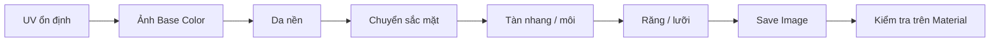

# Bài 09 — Texture Painting: màu da, gương mặt, răng và lưỡi

## 1. Tổng quan

Một mô hình UV hoàn chỉnh vẫn thiếu sức sống nếu chỉ có một màu đồng nhất. `Texture Paint` cho phép vẽ trực tiếp lên bề mặt 3D và lưu thành ảnh theo UV. Bài học tập trung vào bản **Base Color/Albedo**: độ chuyển màu da, má, mũi, vùng mắt, tàn nhang, môi, răng và lưỡi.

## 2. Mục tiêu học tập

- Chuẩn bị mesh, UV và image texture cho Texture Paint.
- Sử dụng lớp màu nền và các lớp chi tiết có độ đậm phù hợp.
- Tạm đổi hình dạng mi mắt/miệng bằng Shape Keys khi cần tiếp cận vùng khó vẽ.
- Dùng mask/brush texture để thêm tàn nhang và chi tiết mà không làm thô vật liệu.
- Lưu đúng ảnh Albedo và kiểm tra màu ở các nguồn sáng khác nhau.

## 3. Chuẩn bị hình học để vẽ

Đặt nhân vật ở tư thế dễ tiếp cận; cánh tay/chân không nên áp sát khiến khó tô những vùng phía trong. Nếu mi mắt che khu vực cần sơn, có thể tạo một `Shape Key` tạm thời từ trạng thái cơ sở (`Basis`) để khép hoặc mở mi thuận tiện, chỉnh khi làm việc rồi trả giá trị về 0. Không sửa trực tiếp Basis chỉ để phục vụ thao tác vẽ nếu điều đó phá dáng nhân vật.

Chuẩn bị UV đã kiểm tra distortion, một ảnh Base Color mới, sau đó liên kết `Image Texture` với `Principled BSDF > Base Color`. Mở workspace `Texture Paint`, xác nhận **đúng object, đúng material và đúng ảnh đang active** trước khi tô.

## 4. Xây dựng màu da cơ sở

Đầu tiên tạo màu nền tương đối đồng nhất. Sau đó thêm biến thiên màu mềm:

- Vùng trán, má và cằm có chuyển độ ấm nhẹ.
- Mũi, tai và đầu ngón tay có thể ấm màu hơn, tùy phong cách.
- Dưới mắt, hốc mắt và vùng quanh môi có thể tối hoặc đổi sắc độ rất nhẹ.
- Vùng chuyển từ mặt xuống cổ phải liên tục, không để ranh giới màu cứng tại seam.

Không đặt mọi thay đổi bằng màu quá bão hòa; khi để ánh sáng động, chi tiết quá đậm dễ làm da giống trang điểm dày. Kiểm tra cả ở ánh sáng trung tính để phân biệt lỗi texture và lỗi chiếu sáng.

## 5. Vẽ tàn nhang, mày và đường nét khuôn mặt

### 5.1. Sử dụng brush texture hoặc mask

Để vẽ tàn nhang tự nhiên, dùng một brush texture dạng chấm và điều chỉnh `Strength`, `Radius`, khoảng cách và sự biến thiên nếu công cụ hỗ trợ. Vẽ ít vùng đầu mũi và má, tránh pattern lặp đều. Thay đổi nhẹ kích thước và sắc độ giúp chi tiết không giống dấu chấm copy-paste.

### 5.2. Chỉnh chuyển màu trên mặt

Dùng cọ mềm để nhấn vùng má, khóe mắt và mép môi. Với nhân vật cách điệu, các mảng lớn thường hiệu quả hơn hàng trăm chi tiết nhỏ. Giữ sự nhất quán giữa hai bên nhưng có thể thêm bất đối xứng tinh tế nếu thiết kế yêu cầu.

## 6. Texture môi, răng và lưỡi

Tô môi theo một tông khác da nhưng cần chuyển mềm quanh đường viền; không biến vùng mép thành đường sắc quá cứng nếu phong cách không yêu cầu. Đối với răng, giữ nền hơi ngà thay vì trắng tuyệt đối và tạo vùng chuyển nhẹ ở chân răng. Tránh bake bóng tối mạnh cố định vào Albedo vì ánh sáng scene sẽ tiếp tục tạo bóng.

Lưỡi nên có màu ấm và tối hơn ở phần sâu trong miệng. Kiểm tra UV của răng và lưỡi để tránh họa tiết răng trên texture không đúng vị trí geometry. Nếu dùng atlas chung cho răng/lưỡi, các island phải tách nhau đủ margin.

## 7. Quản lý và lưu texture

Sau khi vẽ, **lưu ảnh** qua trình chỉnh sửa ảnh (`Image > Save` hoặc `Save As`) để tránh chỉ lưu `.blend` mà không có file ảnh ngoài. Nên đặt tên `Character_BaseColor.png`, `Teeth_BaseColor.png`, `Tongue_BaseColor.png`. Nếu cần ảnh có alpha, xác định rõ mục đích — da thông thường không cần vùng trong suốt.

## 8. Lỗi thường gặp

| Hiện tượng | Kiểm tra |
| --- | --- |
| Không tô được lên vật | Active object/material/paint slot/image |
| Màu bị méo khi xoay camera | UV stretching hoặc seam |
| Màu da không đều kỳ lạ | Nhiều texture/material khác nhau hoặc ảnh sai |
| Tàn nhang quá cứng | Brush hardness và strength |
| Mất nét sau khi mở lại | Ảnh chưa lưu ngoài hoặc chưa pack đúng cách |
| Hai vùng cơ thể lệch màu | Seams, brush và color management |

## 9. Thực hành

1. Thiết lập ảnh Base Color trên mesh da có UV.
2. Tô da nền; thêm chuyển màu ở mặt, mũi, tai và tay.
3. Vẽ tàn nhang hoặc chi tiết trang điểm nhẹ bằng brush mask.
4. Tô môi, răng, lưỡi bằng ảnh phù hợp và kiểm tra trong khoang miệng.
5. Trả Shape Key tạm về trạng thái trung tính, lưu tất cả ảnh PNG và file `.blend`.

**Bàn giao:** `09_texture_paint.blend`, bộ Base Color PNG và ít nhất hai ảnh render ánh sáng khác nhau.

## 10. Câu hỏi ôn tập

### Câu 1
Vì sao cần kiểm tra active image trước khi Texture Paint?

A. Vì Blender chỉ cho phép một đối tượng.  
B. Vì camera sẽ tự đổi vị trí.  
C. Vì có thể đang tô nhầm texture hoặc không ghi được màu.  
D. Vì UV phải là hình tròn.

**Đáp án:** C. **Giải thích:** Paint target được xác định bởi ảnh/slot và vật liệu đang active.

### Câu 2
`Shape Key` tạm thời giúp ích ra sao khi vẽ vùng mí?

A. Cho phép đổi tạm hình dạng mà vẫn giữ được trạng thái gốc.  
B. Xóa toàn bộ topology.  
C. Tự động UV lại mesh.  
D. Tự tạo normal map.

**Đáp án:** A. **Giải thích:** Có thể chuyển sang tư thế dễ tô rồi đưa giá trị shape key về 0.

### Câu 3
Khi vẽ tàn nhang, phương pháp nào phù hợp hơn?

A. Dùng một màu đen đậm cho toàn mặt.  
B. Chỉ tăng số polygon.  
C. Vẽ tàn nhang đều như một lưới hình học.  
D. Dùng brush mask, thay đổi kích thước/độ đậm nhẹ.

**Đáp án:** D. **Giải thích:** Điều chỉnh mask và cọ cho kết quả ít cơ học hơn.

### Câu 4
Tại sao không nên tô bóng quá mạnh vào Albedo của răng?

A. Vì răng không có shader.  
B. Vì ánh sáng scene có thể tạo thêm bóng, khiến răng quá tối.  
C. Vì không thể tạo UV cho răng.  
D. Vì màu trắng bị cấm.

**Đáp án:** B. **Giải thích:** Albedo chủ yếu mô tả màu vật thể, không nên chứa mọi bóng từ chiếu sáng.

### Câu 5
Điều gì cần làm sau khi tô trong Blender?

A. Xóa ảnh trong Image Editor.  
B. Tắt toàn bộ UV.  
C. Lưu ảnh texture thành file, sau đó lưu project.  
D. Chỉ xuất OBJ.

**Đáp án:** C. **Giải thích:** Ảnh có thể tồn tại trong bộ nhớ và cần được lưu riêng để dùng sau này.

## 11. Tổng kết

Texture Paint tốt dựa trên UV sạch, mục tiêu vẽ được chọn đúng và màu sắc được xây từ lớn đến nhỏ. Màu da, môi, răng và lưỡi cần phối hợp thống nhất, được xuất thành ảnh thực để tránh thất lạc khi chuyển phần mềm.
