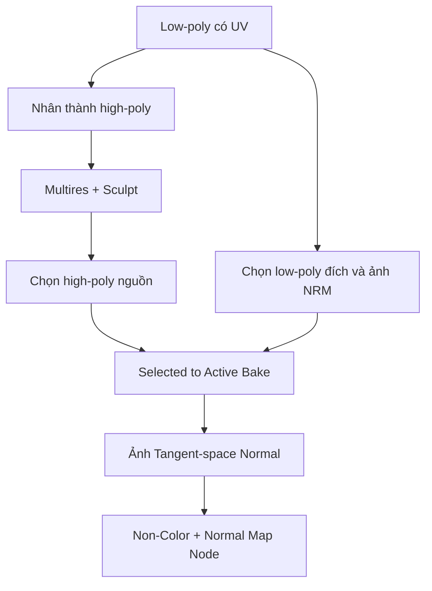

# Bài 10 — Sculpt chi tiết khuôn mặt và bake Normal Map từ high-poly sang low-poly

## 1. Tổng quan

Một nhân vật có thể mang các nếp môi, hạt da, vết nhăn nhẹ và chi tiết điêu khắc tinh tế mà không cần giữ hàng triệu polygon khi render thời gian thực. Quy trình **high-poly → low-poly → Normal Map** chuyển biến thiên pháp tuyến của bản điêu khắc sang ảnh texture dùng với mesh nhẹ.

## 2. Mục tiêu học tập

- Phân biệt mesh low-poly dùng để diễn hoạt và mesh high-poly dùng để điêu khắc.
- Tạo bản high-poly qua `Multiresolution` và cọ Sculpt.
- Thiết kế chi tiết môi, vùng mặt ở mức độ phù hợp với phong cách.
- Bake Normal Map theo UV của mesh nhẹ, kiểm tra các vùng màu và lỗi projection.
- Tạo vật liệu sử dụng Normal Map và đánh giá ở nhiều điều kiện ánh sáng.

## 3. Chuẩn bị high-poly và low-poly

Lưu trước bản nhân vật có UV dưới tên rõ ràng. Dùng một bản sao mesh hoặc vùng khuôn mặt làm **high-poly**; giữ phiên bản **low-poly** không thay đổi topology/UV. Nếu chỉ cần chi tiết khuôn mặt, có thể tách phần mặt để thực hành, nhưng khi bake cần đảm bảo target và source tương ứng về không gian.

Dùng `Multiresolution Modifier` để chia mesh tăng dần. Số mức phù hợp phụ thuộc máy và kích thước mô hình: đừng coi mức 7 được nhắc như một giá trị áp dụng cho tất cả. Với máy hạn chế VRAM/RAM, giảm số mức và chỉ điêu khắc vùng nhìn gần.

## 4. Sculpt chi tiết

### 4.1. Nếp môi

Có thể sử dụng stencil/brush texture để tạo các đường nếp dọc môi. Điều chỉnh hướng và kích thước stencil theo môi thực tế, cọ có sức mạnh nhỏ rồi tăng dần. Giữ biên dạng môi tổng thể ổn định; chi tiết cần nằm trong phạm vi độ dày bề mặt, không biến môi thành hàng rãnh sâu bất thường.

### 4.2. Vi cấu trúc da

Dùng họa tiết nhẹ để tạo cảm giác bề mặt da; kết hợp cọ đều và vùng ngẫu nhiên có kiểm soát. Tần suất và cường độ không nên đồng nhất trên mọi nơi. Da cách điệu vẫn có thể gần như mịn; chỉ thêm vi cấu trúc nếu nó hỗ trợ phong cách hoặc close-up.

### 4.3. Kiểm tra bề mặt high-poly

Xem ở chế độ ánh sáng xiên để lộ chi tiết. Nếu bị nứt, đứt gãy hoặc nhiễu quá mạnh, giảm cường độ và làm mềm; normal map không thể chữa mesh high-poly bị lỗi. Lưu file nguồn sculpt riêng hoặc một bản `.blend` chứa high-poly vì bạn có thể phải bake lại.

## 5. Thiết lập Bake Normal

Kiểm tra low-poly có UV và normals chính xác. Tạo ảnh normal mới, gán vào `Image Texture` đích và chọn node này. Với bake từ high-poly sang low-poly trong Cycles, bật tùy chọn `Selected to Active` nếu sử dụng phương thức đó: chọn **nguồn high-poly trước** rồi chọn **đích low-poly active cuối cùng**. Thiết lập `Extrusion`, `Ray Distance` hoặc `Cage` tùy bản Blender và độ chênh lệch bề mặt.

Đừng sao chép thông số ray distance từ mô hình khác mà không kiểm tra tỷ lệ. Nếu phạm vi chiếu quá thấp, bỏ sót chi tiết; quá cao, tia có thể lấy nhầm vùng khác (ví dụ môi trên sang môi dưới).

## 6. Kiểm tra và sửa Normal Map

Normal map tangent-space thường có nền xanh tím khi không có chi tiết. Nếu xuất hiện những vùng quá lạ, đường gãy tại UV seam hoặc vệt lấy nhầm bề mặt, xem lại cage, khoảng ray, khoảng cách các phần mặt và UV. Trong `Shader Editor`, ảnh normal phải ở `Non-Color`, kết nối qua node `Normal Map` rồi vào `Principled BSDF > Normal`.

Với những lỗi nhỏ có thể chỉnh trực tiếp ảnh bake bằng công cụ phù hợp, nhưng nên sửa high-poly và bake lại nếu lỗi đến từ hình học hoặc phép chiếu. Sau khi hài lòng, lưu ảnh PNG và kiểm tra vật liệu dưới nhiều hướng đèn.

## 7. Câu hỏi ôn tập

### Câu 1
Normal Map chủ yếu lưu thông tin gì?

A. Hướng pháp tuyến biểu kiến của bề mặt.  
B. Tọa độ bone trong rig.  
C. Màu albedo của da.  
D. Giá trị alpha của tóc.

**Đáp án:** A. **Giải thích:** Normal map làm thay đổi phản ứng ánh sáng mà không tăng hình học thực.

### Câu 2
Trong `Selected to Active`, thứ tự chọn nào phù hợp?

A. Low-poly trước, high-poly active cuối.  
B. Chỉ chọn camera.  
C. High-poly nguồn trước, low-poly đích active cuối.  
D. Không cần chọn đối tượng.

**Đáp án:** C. **Giải thích:** Blender chiếu thông tin từ source đã chọn lên target active.

### Câu 3
Nếu ray distance quá cao, điều gì có thể xảy ra?

A. UV biến mất vĩnh viễn.  
B. Tia bake lấy nhầm bề mặt ở vị trí gần.  
C. Scene đổi đơn vị tự động.  
D. Texture chỉ còn một màu trắng.

**Đáp án:** B. **Giải thích:** Khoảng chiếu quá rộng có thể khiến bake lấy thông tin ở bề mặt lân cận không mong muốn.

### Câu 4
Vì sao phải giữ bản low-poly có UV ổn định?

A. Để bật camera.  
B. Để ép model thành 2D.  
C. Để khỏi cần lưu file.  
D. Để map chi tiết high-poly vào đúng ảnh dùng cho mô hình nhẹ.

**Đáp án:** D. **Giải thích:** UV và hình học target quyết định kết quả chiếu chi tiết cuối cùng.

### Câu 5
Cách kết nối texture Normal đúng là gì?

A. Non-Color Image Texture → Normal Map node → BSDF Normal.  
B. Image Texture → World Color.  
C. Image Texture → Material Output Displacement bắt buộc.  
D. Chỉ nối Alpha vào Base Color.

**Đáp án:** A. **Giải thích:** Normal Map node giải mã màu vector thành hướng pháp tuyến cho shader.

## 8. Bài thực hành

1. Dùng một mesh đầu low-poly đã UV; tạo bản high-poly để sculpt.
2. Sculpt các nếp môi và một lớp vi cấu trúc nhỏ tại má.
3. Bake Normal Map thử, phân tích ít nhất hai loại lỗi nếu xuất hiện.
4. Kết nối normal vào vật liệu skin, so sánh hai trạng thái bật/tắt normal dưới đèn xiên.
5. Lưu `10_normal_bake.blend`, `Skin_Normal.png` và ảnh kết quả.

## 9. Tổng kết

Chi tiết được điêu khắc trên high-poly trước khi bake sang low-poly. Thành công phụ thuộc ảnh UV tốt, nguồn và đích đặt chính xác, khoảng cách chiếu phù hợp và kiểm tra normal trong shader với chế độ dữ liệu chính xác.
