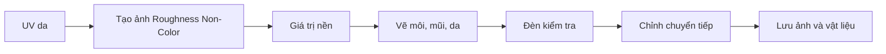

# Bài 11 — Vẽ Roughness Map tạo độ nhám, bóng da và môi

## 1. Tổng quan

Vật liệu da không chỉ có màu. Dưới ánh sáng, vùng môi thường phản xạ bóng hơn vùng má, còn da có độ bóng tinh tế theo từng phần. `Roughness Map` điều khiển độ rộng và độ sắc của phản xạ trên bề mặt: roughness thấp phản xạ sắc hơn; roughness cao phản xạ tán rộng và mờ hơn.

## 2. Mục tiêu học tập

- Phân biệt Roughness với Albedo và Normal.
- Tạo ảnh dữ liệu grayscale, cấu hình `Non-Color` và nối vào `Principled BSDF > Roughness`.
- Vẽ vùng da có mức nhám khác nhau và tăng bóng ở môi.
- Dùng bố cục ánh sáng thích hợp để quan sát roughness khi đang vẽ.
- Kiểm tra roughness sau khi lưu, tránh quá bóng hoặc quá lì.

## 3. Nguyên lý của Roughness

Roughness là tham số trong vật liệu PBR điều khiển độ nhám vi mô. Với giá trị gần 0, phản xạ tương đối sắc; với giá trị gần 1, phản xạ mờ và trải rộng. Độ bóng thực tế còn phụ thuộc nguồn sáng, IOR/specular và các tham số vật liệu khác.

| Vùng | Hướng thiết kế thường gặp | Quan sát mong muốn |
| --- | --- | --- |
| Má/trán | Nhám tương đối | Highlight rộng, nhẹ |
| Mũi | Có thể bóng nhẹ hơn | Bắt một chút ánh sáng |
| Môi | Ít nhám hơn da | Highlight gọn và rõ hơn |
| Da quanh mắt | Chuyển mềm | Không tạo đường biên sắc |

Không có giá trị roughness cố định cho mọi phong cách; nên thử dưới cùng bộ ánh sáng và ở khoảng cách camera thực tế.

## 4. Thiết lập texture Roughness

Tạo ảnh grayscale mới qua `Image Texture` (ví dụ của bài sử dụng **4096 × 4096**, tức 4K) và đặt tên `Skin_Roughness`. Cấu hình `Color Space: Non-Color`, nối từ `Color` của Image Texture vào `Roughness` trên Principled BSDF. Nếu texture chưa có giá trị khác nhau, tô một giá trị nền nhám trung bình bằng công cụ Fill, sau đó mới vẽ phân vùng.

Khi paint, chắc chắn target đang là ảnh roughness thay vì Base Color hoặc Normal; nhìn trước material ở chế độ render để thấy khác biệt. Nếu cần thử nhanh, chỉnh trực tiếp thanh Roughness trong node trước khi chuyển sang tạo map nhiều vùng.

## 5. Thiết lập ánh sáng để đánh giá

Dùng một nguồn sáng mềm hoặc HDRI phù hợp để tạo highlight có thể quan sát. Nếu mọi thứ quá sáng và không thấy độ bóng, điều chỉnh cường độ/độ lớn đèn hoặc góc nhìn thay vì chỉ tăng contrast roughness. Có thể thêm đèn chiếu xiên để quan sát vùng môi và chóp mũi.

## 6. Vẽ độ nhám có kiểm soát

Bắt đầu từ độ nhám nền trên toàn da, sau đó tô các vùng giảm nhám ở môi, đầu mũi và vài vùng da phù hợp. Chuyển tiếp mép bằng cọ mềm, giảm `Strength` để tránh tạo những mảng hình tròn đột ngột. Dùng chế độ solo hoặc visualizing grayscale để kiểm tra map có các vùng hợp lý, không có đốm gắt hoặc seam dễ thấy.

**Cần tránh:** môi bóng như kim loại; da bóng nhẫy đồng đều; roughness quá đen khiến toàn bộ cơ thể trở thành gương; roughness bị xử lý như màu sRGB làm sai giá trị độ nhám.

## 7. Quy trình hoàn chỉnh

Lưu ảnh PNG dưới tên `Skin_Roughness.png`, lưu `.blend` và kiểm tra lại sau khi mở dự án hoặc liên kết ảnh ở một file khác.

## 8. Câu hỏi ôn tập

### Câu 1
Roughness thấp thường tạo đặc điểm phản xạ nào?

A. Phản xạ hoàn toàn biến mất.  
B. Bề mặt phát sáng.  
C. Chỉ thay màu nền.  
D. Highlight sắc hơn, ít tán rộng hơn.

**Đáp án:** D. **Giải thích:** Bề mặt vi mô nhẵn hơn sẽ phản xạ tập trung hơn.

### Câu 2
Vì sao roughness texture thường dùng Non-Color?

A. Vì không được phép lưu ảnh PNG.  
B. Vì đây là dữ liệu số, không phải màu cần gamma sRGB.  
C. Vì cần tạo alpha.  
D. Vì không có UV.

**Đáp án:** B. **Giải thích:** Việc biến đổi màu có thể làm sai giá trị độ nhám dùng trong shader.

### Câu 3
Muốn môi trông bóng hơn vùng má, nên làm gì?

A. Giảm roughness khu vực môi một cách có kiểm soát.  
B. Tăng số polygon toàn thân.  
C. Xóa Base Color.  
D. Đổi mô hình sang camera.

**Đáp án:** A. **Giải thích:** Roughness thấp tạo phản xạ tập trung và rõ hơn.

### Câu 4
Vì sao phải xem roughness dưới ánh sáng thích hợp?

A. Vì roughness chỉ hoạt động trong wireframe.  
B. Vì ảnh UV sẽ thay đổi khi có đèn.  
C. Vì độ nhám biểu lộ chủ yếu qua cách bề mặt phản chiếu ánh sáng.  
D. Vì mọi ánh sáng phải bake vào Albedo.

**Đáp án:** C. **Giải thích:** Với thiếu highlight, ta khó đánh giá độ nhám bằng mắt.

### Câu 5
Kết quả nào cho thấy roughness bị vẽ quá cực đoan?

A. Da và môi có phân vùng phản xạ nhẹ.  
B. Ảnh được lưu đúng đường dẫn.  
C. Có UV dành cho mặt.  
D. Da trông như gương bóng hoặc mảng nhám cắt ranh giới đột ngột.

**Đáp án:** D. **Giải thích:** Mức độ tương phản roughness quá cao làm chất liệu mất tự nhiên.

## 9. Bài thực hành

1. Tạo ảnh roughness grayscale, cấu hình Non-Color, gắn đúng shader.
2. Tô nền cho toàn da rồi giảm nhám ở môi và một phần mũi.
3. Đặt một đèn xiên mềm, so sánh kết quả trước/sau.
4. Kiểm tra đường chuyển ở vùng môi và vết seam đầu/cổ.
5. Lưu `11_skin_roughness.blend`, `Skin_Roughness.png` và ảnh so sánh.

## 10. Tổng kết

Roughness bổ sung khả năng kiểm soát phản xạ mà Base Color không thể đảm nhiệm. Điểm quan trọng là dùng dữ liệu Non-Color, xử lý chuyển tiếp mượt và luôn quan sát dưới ánh sáng kiểm tra thực tế.
