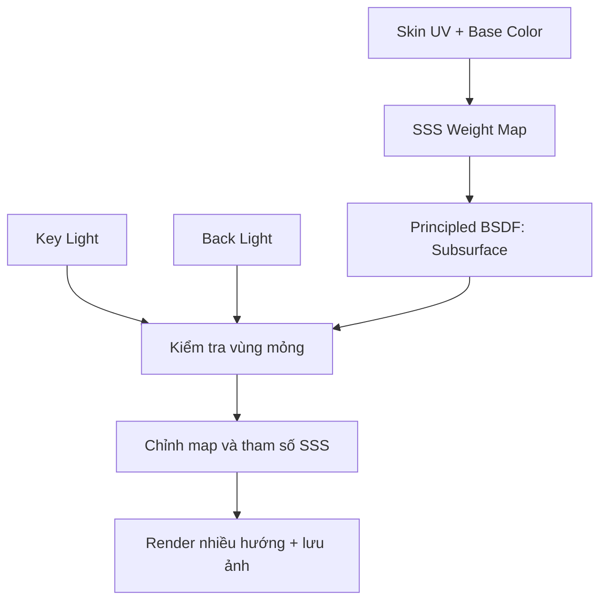

# Bài 12 — Subsurface Scattering: hoàn thiện hiệu ứng ánh sáng xuyên da

## 1. Tổng quan

Da không phải bề mặt hoàn toàn đục. Một phần ánh sáng đi vào lớp vật chất, bị tán xạ rồi trở ra, tạo cảm giác mềm và đôi lúc làm vùng tai, mũi hoặc ngón tay ửng lên khi có ánh sáng ngược. Hiệu ứng này gọi là **Subsurface Scattering (SSS)**. Bài thực hành xây dựng một bản mask/weight cho da, dùng ánh sáng kiểm tra để cân bằng màu và mức độ tán xạ.

## 2. Mục tiêu học tập

- Giải thích sự khác nhau giữa SSS và độ trong suốt trực tiếp (`Alpha Transparency`).
- Tạo ảnh dữ liệu grayscale kiểm soát vùng có tán xạ mạnh hoặc yếu.
- Đưa ảnh vào đúng tham số SSS của vật liệu trong phiên bản Blender đang sử dụng.
- Thiết lập ánh sáng ngược và keyframe đèn để kiểm tra nhiều hướng chiếu.
- Tránh hiệu ứng da quá sáp, quá đỏ hoặc nhìn xuyên như vật liệu trong suốt.

## 3. Nguyên lý SSS

SSS mô phỏng ánh sáng đi vào và lan truyền bên dưới bề mặt trước khi thoát ra. Nó **không đồng nghĩa với Alpha**: Alpha có thể làm vật thể nhìn xuyên qua hoàn toàn, còn SSS vẫn mô tả vật liệu có thể tích quang học. Hiệu quả phụ thuộc độ dày hình học, màu tán xạ, tham số bán kính và thiết lập shader/render engine.

Tại vùng mỏng như tai, mũi và đầu ngón tay, có thể nhấn tác động tán xạ; ở khối da dày, mức độ có thể nhẹ hơn. Bài thực hành trong nguồn sử dụng một bản grayscale chủ yếu tối và tăng sáng cục bộ ở những vùng muốn nhấn SSS.

## 4. Chuẩn bị vật liệu và SSS Map

Tạo một ảnh mới (ví dụ `Skin_SSS_Weight.png`), dùng `Non-Color` nếu bản đồ chứa giá trị dữ liệu. Tô giá trị nền yếu trước và tăng sáng bằng brush mềm ở các vùng mũi, tai, đầu ngón tay. Các giá trị cụ thể trong nguồn được thử trực tiếp khi quan sát; không xem chúng là quy tắc vật lý áp dụng cho tất cả mô hình.

**Khác biệt phiên bản:** Blender 3.5 và những phiên bản mới có giao diện `Principled BSDF` khác nhau. Trong các phiên bản hiện đại, tham số `Subsurface Weight`, `Radius`, `Scale` hoặc tên socket có thể khác với phần mềm ở lúc ghi hình. Hãy tìm nhóm **Subsurface** của shader và nối mask đúng vào thông số trọng số, đồng thời kiểm tra ảnh hưởng trực tiếp trong viewport; không gán nhầm vào `Transmission` hoặc `Alpha`.

## 5. Thiết lập ánh sáng và kiểm chứng

### 5.1. Ánh sáng chính và ánh sáng viền

Sắp đặt ánh sáng chính (key light) để nhìn hình khối bình thường và một đèn ngược (rim/back light) để soi vùng tai, đầu ngón và cánh mũi. Tạm giảm ánh sáng World nếu phản xạ quá mạnh làm che hiệu ứng. Đừng dựa chỉ vào một ảnh render vì SSS có thể rõ ở một hướng nhưng gần như vô hình ở hướng khác.

### 5.2. Điều khiển đèn bằng Empty và Keyframe

Tạo `Empty` ở tâm phù hợp, parent một nhóm đèn vào Empty bằng `Ctrl + P` (`Object`/Keep Transform theo trạng thái phù hợp). Khi xoay Empty quanh trục Z, toàn bộ đèn thay đổi hướng tương đối với nhân vật. Có thể keyframe Rotation ở frame đầu và frame sau, sau đó phát timeline để quan sát tác động SSS từ nhiều phía.

## 6. Vẽ và cân chỉnh vùng tán xạ

Bắt đầu từ nền rất nhẹ; dần thêm ở tai, mũi, đầu ngón và vùng da mỏng tùy phong cách. Sử dụng cọ mềm để tránh tạo ranh giới cứng. Nếu da bị đỏ rực, trông như sáp hoặc mất cảm giác có thể tích, giảm trọng số/bán kính và xem lại ánh sáng, đồng thời so sánh kết quả khi tắt SSS để xác định tác động thật của nó.

Cùng một SSS Weight Map có thể không cho hiệu quả giống nhau giữa Cycles, Eevee và engine game. Khi chuyển sang Unity, cần sử dụng shader hỗ trợ skin/SSS hoặc phương án giả lập tương đương. Không kỳ vọng việc xuất FBX/glTF sẽ tự chuyển nguyên hệ node và hiệu ứng vật liệu Blender sang Unity.

## 7. Checklist hoàn thiện vật liệu da

| Kiểm tra | Kết quả mong muốn |
| --- | --- |
| Base Color | Da và môi có màu nền nhất quán |
| Normal Map | Chi tiết da không bị đảo hướng, không có seam xấu |
| Roughness | Da hơi nhám, môi bóng hơn vừa phải |
| SSS Weight | Tai/mũi/ngón có nhấn nhẹ, không quá sáp |
| UV | Không stretching rõ ràng ở mặt |
| Ánh sáng | Hiệu ứng ổn định dưới ít nhất hai hướng chiếu |
| Dữ liệu | Ảnh đã lưu độc lập, tên file và đường dẫn rõ ràng |

## 8. Bài thực hành

1. Tạo ảnh SSS Weight, kết nối với vật liệu da của nhân vật.
2. Tô nền nhẹ, tăng cục bộ ở hai tai, mũi và ngón tay.
3. Dùng một đèn chính và một đèn viền để so sánh khi SSS bật/tắt.
4. Parent đèn vào Empty và thử quay quanh nhân vật bằng keyframe.
5. Lưu `12_skin_sss.blend`, `Skin_SSS_Weight.png` và bộ ảnh render ít nhất ba góc chiếu.

**Điều kiện đạt:** có thể chỉ ra hiệu ứng SSS khi bật/tắt; không có vùng trông như vật liệu trong suốt hoàn toàn; bộ texture tồn tại trên đĩa.

## 9. Câu hỏi ôn tập

### Câu 1
SSS khác Alpha Transparency ở điểm nào?

A. SSS làm vật thể không còn hình học.  
B. SSS mô tả ánh sáng tán xạ bên dưới bề mặt, không chỉ làm vật thể nhìn xuyên.  
C. SSS chỉ đổi màu World.  
D. SSS là một hệ rig.

**Đáp án:** B. **Giải thích:** Da vẫn có thể tích quang học trong khi ánh sáng lan truyền và thoát ra qua bề mặt.

### Câu 2
Vùng nào thường hữu ích để tăng hiệu ứng SSS nhẹ?

A. Tai, mũi và đầu ngón tay.  
B. Tất cả da với cường độ cực đại.  
C. Chỉ răng giả kim loại.  
D. Không một vùng nào.

**Đáp án:** A. **Giải thích:** Vùng mỏng có thể biểu hiện tán xạ rõ hơn khi có ánh sáng phù hợp.

### Câu 3
Vì sao cần đèn phía sau nhân vật?

A. Để bake texture UV.  
B. Để xóa bóng.  
C. Để thay đổi topology.  
D. Để quan sát ánh sáng đi qua vùng da mỏng tốt hơn.

**Đáp án:** D. **Giải thích:** Đèn ngược làm tác động xuyên/tán xạ ở các phần mỏng dễ nhận thấy.

### Câu 4
Một cách kiểm tra SSS đáng tin là gì?

A. Chỉ xem màu của texture.  
B. Chỉ bật Wireframe.  
C. So sánh bật/tắt SSS dưới cùng ánh sáng ở nhiều hướng.  
D. Chỉ xem tên Node.

**Đáp án:** C. **Giải thích:** So sánh có kiểm soát giúp tách hiệu ứng SSS khỏi thay đổi do chiếu sáng.

### Câu 5
Khi đưa vật liệu từ Blender sang Unity, điều nào đúng?

A. Toàn bộ shader node sẽ luôn chạy nguyên vẹn.  
B. Cần shader tương ứng hoặc giải pháp thay thế cho hiệu ứng SSS.  
C. Phải xóa UV.  
D. Texture Roughness sẽ tự thành bone.

**Đáp án:** B. **Giải thích:** Shader của Blender và hệ vật liệu engine khác nhau; cần cấu hình lại cho môi trường đích.

## 10. Tổng kết

SSS hoàn thiện cảm giác mềm của da khi được sử dụng có kiểm soát cùng Base Color, Normal và Roughness. Phải kiểm chứng bằng ánh sáng phù hợp, điều chỉnh nhẹ và tính đến khác biệt shader khi xuất nhân vật sang game engine.
