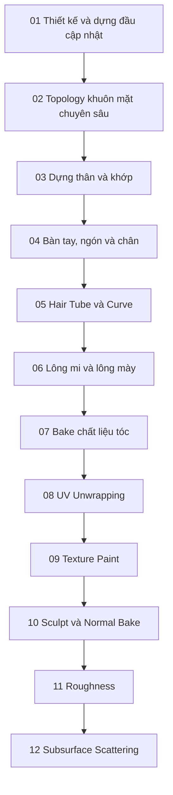

# Khóa học Blender — Tạo nhân vật 3D từ dựng hình đến vật liệu da

> **Ngôn ngữ:** Tiếng Việt.  
> **Hình thức:** 12 bài Markdown độc lập, có giải thích, thao tác thực hành và 5 câu trắc nghiệm kèm đáp án/giải thích mỗi bài.  
> **Định hướng:** character modeling, topology, hair, UV, PBR và hoàn thiện vật liệu trong Blender; có các lưu ý khi chuyển tài sản sang Unity.

## 1. Giới thiệu

Khóa học theo một quy trình sản xuất nhân vật cách điệu: từ hình tham chiếu, dựng đầu và cơ thể, tạo tóc/lông mày/lông mi, trải UV, vẽ màu, cho đến xây dựng Normal, Roughness và Subsurface Scattering. Nội dung được biên soạn lại thành hướng dẫn khoa học bằng tiếng Việt từ 12 bản ghi bài giảng đã cung cấp, sửa các thuật ngữ dịch sai rõ ràng và loại bỏ lời thoại dư thừa.

**Giới hạn phạm vi:** các bản ghi hiện có chưa cung cấp một chương độc lập về **rigging, skinning, animation, trang phục, export FBX/glTF hoặc import Unity đầy đủ**. Một số bài chỉ đề cập chúng như yêu cầu thiết kế hoặc bước tiếp theo; giáo trình không giả định đã dạy những kỹ thuật đó. Khi cần mô hình game-ready, nên tiếp tục học retopology chuyên sâu, rig và xuất tài sản.

## 2. Lộ trình học



Bài 01 và 02 là hai cách tiếp cận bổ trợ cho phần đầu/khuôn mặt, trong đó bài 02 đi sâu vào topology và các chi tiết trong miệng. Các bài sau có thể mở độc lập, nhưng học theo thứ tự sẽ thuận lợi nếu xây dựng cùng một nhân vật.

## 3. Danh mục bài học

| Bài | Tệp Markdown | Nội dung chính |
| --- | --- | --- |
| 01 | [Thiết kế và dựng đầu](01-thiet-ke-va-dung-dau-nhan-vat.md) | Tham chiếu, Mirror, Subdivision, mắt, mũi, tai, miệng |
| 02 | [Topology khuôn mặt](02-retopology-mat-mat-mui-mieng-va-chi-tiet-dau.md) | Edge loops, hốc mắt, môi, khoang miệng, răng, lưỡi |
| 03 | [Dựng thân người](03-mo-hinh-hoa-than-vai-hong-va-chan.md) | Vai, nách, ngực, hông, gốc chân, sculpt |
| 04 | [Bàn tay và ngón](04-dung-ban-tay-ngon-tay-mong-va-chan.md) | Ngón cái, đốt ngón, móng, khớp |
| 05 | [Dựng tóc](05-tao-toc-low-poly-voi-curve-va-texture.md) | Hair Tube, Curve, các lớp tóc, procedural material |
| 06 | [Lông mi và lông mày](06-tao-long-mi-va-long-may.md) | Mesh mỏng, UV, alpha, kiểm tra biểu cảm |
| 07 | [Bake tóc và lông](07-bake-vat-lieu-toc-long-mi-long-may.md) | Base Color, Alpha, Normal, Cycles Bake |
| 08 | [UV Unwrapping](08-uv-unwrapping-nhan-vat.md) | Seam, checker, UV islands, packing |
| 09 | [Texture Paint](09-texture-paint-da-mat-rang-luoi.md) | Da, môi, tàn nhang, răng, lưỡi |
| 10 | [Sculpt và Normal Map](10-sculpt-chi-tiet-va-bake-normal-map.md) | High-poly → low-poly, ray projection, bake |
| 11 | [Roughness](11-ve-roughness-map-cho-da-va-moi.md) | Phân vùng nhám/bóng, vật liệu da/môi |
| 12 | [Subsurface Scattering](12-subsurface-scattering-map-va-kiem-tra-da.md) | SSS map, key/back light và kiểm tra vật liệu |

## 4. Cách học đề xuất

1. **Đọc phần nguyên lý** trước khi thao tác; kiểm tra bạn đang ở `Object Mode`, `Edit Mode`, `Sculpt Mode`, hay `Texture Paint`.
2. **Làm bản sao `.blend`** theo số bài, tránh ghi đè checkpoint trước đó.
3. **Chụp ảnh kiểm tra** ở các góc trước, bên, sau và 3/4, đặc biệt khi chỉnh topology/UV.
4. **Giải bài trắc nghiệm** sau thực hành để xác định lỗ hổng hiểu biết.
5. **Lưu texture độc lập** và theo đúng tên để thuận tiện dựng vật liệu ở phần mềm khác.

## 5. Những điều cần lưu ý về Blender

- Nhiều bản ghi sử dụng Blender **3.5** hoặc giao diện cùng thời kỳ. Những phiên bản Blender mới có thể đổi tên node và các tham số `Principled BSDF`/SSS. Hãy dùng tên tính năng để tìm thay vì phụ thuộc vị trí nút trong video.
- Phím `Shift + Z` dùng cho wireframe là **phím được giảng viên tùy chỉnh**, không nên coi là mặc định trong mọi keymap.
- Nhiều công cụ thao tác trên object có khác biệt so với Edit Mode. Kiểm tra mode trước khi dùng phím tắt.
- `Non-Color` dành cho ảnh dữ liệu như Roughness/Normal/mask; ảnh Base Color thường cần sRGB.
- Các hiệu ứng shader procedural và SSS trong Blender **không tự động chuyển sang Unity** bằng việc xuất mesh. Phải chuẩn bị texture và shader engine đích.

## 6. Gợi ý cấu trúc dự án thực hành

```text
character-project/
├── references/
│   ├── front.png
│   └── side.png
├── blender/
│   ├── 01_head_blockout.blend
│   ├── 08_uv_unwrap.blend
│   └── 12_skin_sss.blend
├── textures/
│   ├── Character_BaseColor.png
│   ├── Skin_Normal.png
│   ├── Skin_Roughness.png
│   └── Skin_SSS_Weight.png
└── renders/
    ├── front.png
    ├── side.png
    └── three-quarter.png
```

Đây là cấu trúc mẫu để thực hành, không phải các file `.blend` và PNG đã được đính kèm trong bộ giáo trình này.

## 7. Nguồn nội dung và phạm vi bản biên soạn

Giáo trình được tổ chức từ các bản ghi bài giảng người học cung cấp (12 file Markdown). Hai bản ghi đầu đều nói về dựng đầu/khuôn mặt, có điểm chồng lặp và góc tiếp cận khác nhau. Nội dung đã được diễn giải lại bằng tiếng Việt và một số lưu ý kỹ thuật chung được bổ sung để tránh diễn đạt sai do nhận dạng giọng nói tự động. **Không đính kèm file model, hình tham chiếu, texture hay video gốc**, vì chúng không nằm trong tài liệu được cung cấp.

## 8. Kết quả sau khóa học

Người học có thể xây dựng một mô hình nhân vật cách điệu với mesh đầu/thân/tay, tóc dạng mesh nhẹ, UV và một bộ vật liệu da PBR cơ bản. Để thành asset game hoàn chỉnh cần tiếp tục rigging, weight painting, kiểm tra deform, tối ưu ngân sách polygon/texture và thử nghiệm import vào engine.
