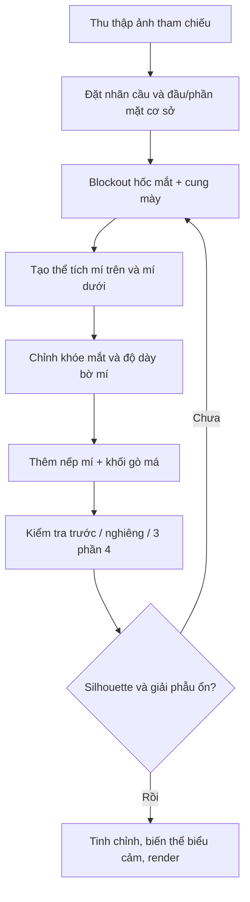

# KHÓA HỌC: ĐIÊU KHẮC MẮT NHÂN VẬT 3D TRONG BLENDER

> **Cấp độ:** Cơ bản → trung cấp · **Hình thức:** Học theo dự án · **Ngôn ngữ:** Tiếng Việt · **Thời lượng video gốc:** khoảng 32 phút · **Thời lượng thực hành đề xuất:** 4–7 giờ.

## Giới thiệu

Khóa học được biên soạn từ **một bản chép lời video hướng dẫn điêu khắc mắt trong Blender** do người học cung cấp. Bản chép lời có lỗi nhận dạng tiếng nói (chẳng hạn “soi mắt” thay cho *sculpt eyes*, “nếp nhăn nước mắt” thay cho *tear caruncle*). Giáo trình **diễn giải và hệ thống hóa** nội dung thành tiến trình dễ học, chứ không phải bản dịch nguyên văn.

Bạn sẽ bắt đầu với nhãn cầu hình cầu, xây dựng hốc mắt và khối lông mày, điêu khắc mí trên/mí dưới, xử lý khóe mắt, rồi tinh chỉnh, kiểm tra góc nhìn và chuẩn bị một bản render. Nội dung nhấn mạnh **hình khối lớn trước, chi tiết nhỏ sau** và dựa vào hình tham chiếu.

## Lộ trình học

| Bài | Tên bài | Thời lượng tự học | Video gốc |
|---|---|---:|---|
| 01 | Chuẩn bị dự án, tham chiếu và công cụ | 25–35 phút | 00:00–01:20 |
| 02 | Cấu trúc giải phẫu và những mốc hình khối | 30–40 phút | 01:35–03:30; 20:15–23:35 |
| 03 | Blockout hốc mắt và vùng chân mày | 30–45 phút | 01:10–03:30 |
| 04 | Điêu khắc mí mắt trên và dưới | 45–70 phút | 03:40–08:20 |
| 05 | Đường cong mí, khóe mắt và biểu cảm | 35–50 phút | 08:30–17:25 |
| 06 | Nếp mí, khối cơ và hoàn thiện vùng mắt | 35–50 phút | 17:35–25:45 |
| 07 | Tinh chỉnh, biến thể ánh nhìn và render | 30–45 phút | 25:48–31:48 |
| 08 | Dự án cuối khóa và phiếu tự đánh giá | 60–90 phút | Toàn bộ |
| 09 | Tra cứu công cụ, sửa lỗi và nguồn tham khảo | Tra cứu | Toàn bộ |

**Sản phẩm đầu ra:** 1 file `.blend` có nhãn cầu và cấu trúc vùng mắt, ảnh chụp 3 góc nhìn, ảnh render kiểm tra; tùy chọn tạo 3 biến thể mắt (bình thường, ngạc nhiên, buồn).

## Sơ đồ tổng quan quy trình

## Cấu trúc tệp

- `00-README.md`: chỉ dẫn và lộ trình.
- `01` → `07`: bài học kèm thao tác, bài tập, tiêu chí đạt.
- `08-du-an-cuoi-khoa.md`: đề bài, rubric, checklist.
- `09-thuat-ngu-va-khac-phuc-loi.md`: thuật ngữ, các vấn đề thường gặp, tài liệu.
- `NGUON-GOC-TRANSCRIPT.md`: thông tin xuất xứ và mốc liên quan; nội dung không sao chép toàn bộ phụ đề lỗi.

## Hướng dẫn học hiệu quả

1. Tạo một **bản sao dự án** trước khi thử Dyntopo hay remesh. Không thực hiện trên bản duy nhất đã rig/UV/texture.
2. Giữ ảnh tham chiếu mắt nhìn thẳng và nghiêng cạnh viewport. Kiểm tra hình khối thường xuyên ở nhiều góc.
3. Mỗi 10–15 phút lưu phiên bản `.blend` mới: `eye_01_blockout.blend`, `eye_02_lids.blend`, ...
4. Với mắt cách điệu, vẫn hiểu logic giải phẫu rồi mới phóng đại hoặc lược bỏ chi tiết.

## Lưu ý về phiên bản Blender

Video gốc đề cập **Ctrl + D** và Dyntopo; đường dẫn, phím tắt và tên cọ có thể thay đổi. Ưu tiên kiểm tra menu/Tool Settings của phiên bản đang cài. Dyntopo có thể làm hỏng hoặc làm mất **UV maps, color attributes, face sets**, nên nên dùng trên **bản sao mesh điêu khắc**, sau đó retopology và UV mới nếu cần làm nhân vật game.

## Nguồn

- **Nguồn chính:** bản chép lời được cung cấp, 00:00–32:04 (không có đường dẫn video gốc).
- **Bổ sung kỹ thuật:** [Blender 4.5 LTS Manual — Adaptive Resolution/Dyntopo](https://docs.blender.org/manual/en/4.5/sculpt_paint/sculpting/introduction/adaptive.html) và [Blender 4.3 Manual — Dyntopo](https://docs.blender.org/manual/en/4.3/sculpt_paint/sculpting/tool_settings/dyntopo.html).
- Các lời khuyên tổ chức file, bài tập và rubric là **phần biên soạn bổ sung**, không phải lời thoại nguyên văn.
