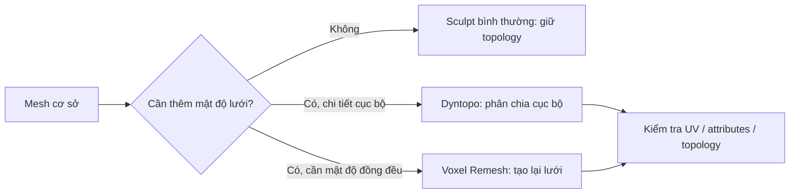

# Bài 01 — Chuẩn bị dự án, hình tham chiếu và công cụ Sculpt

**Mục tiêu:** mở được dự án, có nhãn cầu để định hình mí, sử dụng được các cọ chủ chốt mà không phá hỏng mesh gốc.

**Liên hệ video:** 00:00–01:20; các cọ được nhắc lại ở 21:55–22:10.

## 1. Vì sao đặt nhãn cầu trước?

Mí mắt là dải mô mềm **ôm theo bề mặt cong của nhãn cầu**. Không có nhãn cầu, rất dễ vẽ một đường mí như lát phẳng, khiến mắt lồi/lõm sai hoặc không thể mở/nhắm tự nhiên. Video gốc bắt đầu từ hình cầu đơn giản và xây mô quanh nó; không yêu cầu dựng chi tiết giác mạc ngay từ đầu.

## 2. Chuẩn bị scene

1. Tạo file mới, lưu `eye_00_start.blend`.
2. Nếu có sẵn đầu người, **duplicate** trước khi sửa. Nếu chưa có, dùng phần mặt cơ sở với đủ số polygon để điêu khắc.
3. `Shift + A` → **Mesh → UV Sphere**; đặt tên `Eyeball_L`. Di chuyển quả cầu vào đúng vị trí hốc mắt, xác định trục nhìn của mặt.
4. Tạo hoặc tải 2–3 **ảnh tham chiếu hợp pháp**: nhìn thẳng, nghiêng và ba phần tư. Mắt thật sẽ giúp học giải phẫu; ảnh stylized phục vụ biến thể về sau.
5. Tổ chức Collection: `Reference`, `Sculpt_Base`, `Eyeballs`, `Backups`. Bật đối xứng khi phù hợp nhưng vẫn kiểm tra nửa mặt bên kia.

> **Lưu ý:** Nhãn cầu có thể là hình cầu đơn giản trong giai đoạn học. Mô hình giác mạc/iris/pupil vật lý chính xác là một mục tiêu khác, không phải yêu cầu của video này.

## 3. Các công cụ quan trọng

| Cọ / Công cụ | Tác dụng khi sculpt mắt | Cảnh báo |
|---|---|---|
| **Clay Strips** | Tăng/giảm thể tích ở hốc mắt, nếp mí, gò má | Quét nhiều lớp quá nhanh tạo gợn, khối “đất nặn” |
| **Grab** | Dời khóe mắt, chỉnh biên dạng mí và biểu cảm | Dùng bán kính lớn, dịch ít mỗi lần |
| **Crease** | Phân tách nếp mí, ranh giới với sống mũi | Không rạch quá sâu từ đầu |
| **Scrape/Flatten** | Tinh chỉnh mặt phẳng xung quanh mắt | Dùng quá nhiều làm mất độ tròn tự nhiên |
| **Smooth** | Giảm gồ ghề sau khi đắp/loại khối | Không xóa hết gờ và độ dày bờ mí |
| **Dyntopo** | Tăng mật độ lưới cục bộ khi cần thêm chi tiết | Có thể ảnh hưởng UV, thuộc tính và topology |

**Phím dùng phổ biến:** Giữ `Shift` trong nhiều cấu hình Sculpt để tạm Smooth; `Ctrl` khi đang dùng một số cọ để đảo hướng tác động. **Không coi đây là quy tắc tuyệt đối**: tùy cọ, keymap và phiên bản, hãy thử trên bản sao.

## 4. Phân biệt Dyntopo, Voxel Remesh và sculpt thông thường

Dyntopo phân chia lưới ngay khi dùng cọ, giúp thêm chi tiết cục bộ nhưng có hạn chế. **Không nên bật cho mesh đã UV và rig đang dùng làm bản cuối của game**. Để làm game-ready: sculpt high-poly → retopology → UV → bake → rig.

Trong video gốc, giảng viên ban đầu **không bật Dyntopo** khi tạo khối lớn; sau đó bật để có thêm chi tiết, rồi có những lúc tiếp tục làm mà không cần Dyntopo.

## 5. Bài tập

- Dựng quả cầu nhãn cầu và phần mặt cơ sở, chụp góc chính diện và góc nghiêng.
- Thử 5 cọ trên một mesh bản sao; ghi lại cọ nào tăng thể tích, làm nét, làm phẳng, làm mượt.
- Lưu `eye_01_prepared.blend`.

**Đạt khi:** bạn chỉ ra được vị trí nhãn cầu và vùng dự kiến điêu khắc mí; không đắp mí trên một mặt phẳng trống.
