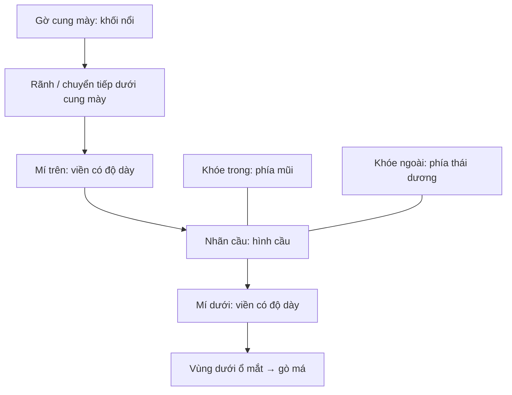

# Bài 02 — Giải phẫu tạo hình: hốc mắt, chân mày, mí và khóe mắt

**Mục tiêu:** gọi đúng các phần quan trọng và hiểu vì sao bề mặt quanh mắt có chỗ lồi, chỗ lõm.

**Liên hệ video:** 01:35–03:30, 05:12–06:20, 20:15–23:35, 29:32–31:48.

## 1. Các cấu trúc cần nhận biết

| Thuật ngữ | Tên tiếng Việt | Vai trò tạo hình |
|---|---|---|
| Eyeball | Nhãn cầu | Bề mặt cong để mí ôm quanh |
| Orbit / eye socket | Hốc mắt | Khoang xương chứa nhãn cầu và cấu trúc liên quan |
| Brow ridge / supraorbital region | Gờ trên ổ mắt / vùng cung mày | Hỗ trợ khối lồi phía trên mắt |
| Orbicularis oculi | Cơ vòng mắt | Khối cơ bao quanh khe mi, tham gia nhắm mắt |
| Upper eyelid | Mí trên | Tạo phần viền trên của khe mắt, thường che một phần mống mắt khi nhìn thẳng |
| Lower eyelid | Mí dưới | Nâng đỡ viền dưới, nối mềm xuống vùng dưới mắt |
| Medial canthus | Khóe mắt trong | Góc gần mũi |
| Lateral canthus | Khóe mắt ngoài | Góc gần thái dương/tai |
| Lacrimal caruncle | Cục lệ (mô hồng ở khóe mắt trong) | Chi tiết màu hồng nhỏ thường thấy ở mắt thật |
| Infraorbital / malar region | Vùng dưới hốc mắt / gò má | Chuyển tiếp từ mí dưới xuống má |

Trong transcript, cụm từ dịch máy “nếp nhăn nước mắt” nhiều khả năng ám chỉ **lacrimal caruncle** (cục lệ) — không phải một nếp nhăn. Đây là một chỗ được **chuẩn hóa thuật ngữ** khi biên soạn.

## 2. Lồi và lõm ở vùng quanh mắt

Hốc mắt không phải một lỗ khoét hình tròn đơn giản. Hãy quan sát:

- **Gờ cung mày** là khối nhô ở phía trên; phía dưới gờ thường có mặt phẳng hướng vào hốc mắt.
- **Bờ mí** có độ dày nhất định và ôm nhãn cầu, không phải nét kẻ mảnh.
- **Mí dưới** chuyển tiếp thành vùng dưới ổ mắt rồi đến **gò má**. Nối bằng thể tích mềm, không nên rạch ranh giới đều như vòng tròn.
- **Khóe mắt trong** gắn với vùng sống mũi; khóe ngoài gắn với vùng thái dương. Hai bên không nhất thiết nằm ngang.

**Sơ đồ trên mang tính thứ tự quan sát cấu trúc, không phải bản vẽ tỉ lệ giải phẫu.**

## 3. Hình dạng mắt không đối xứng tuyệt đối

Video nhấn mạnh: đường cong mí trên và mí dưới **không phải hai cung tròn phản chiếu**. Với mẫu minh họa trong video, đỉnh đường cong mí trên lệch về phía mũi hơn, trong khi điểm võng của mí dưới lệch về phía thái dương hơn. Đây là **gợi ý quan sát**, không phải quy tắc áp đặt cho mọi người.

Những yếu tố thay đổi tính cách mắt:

- Góc chênh lệch giữa khóe trong và khóe ngoài.
- Mức độ mí trên che mống mắt.
- Độ mở khe mi và độ cong đường viền dưới.
- Độ nổi của gờ cung mày, phần mô mềm và nếp mí.

## 4. Thực hành quan sát

Tìm 3 ảnh mắt (trực diện, 3/4, nghiêng). Với từng ảnh, dùng nét mảnh đánh dấu 8 điểm: khóe trong, khóe ngoài, đỉnh mí trên, đáy mí dưới, gờ cung mày, nếp mí, bờ xương dưới ổ mắt, chuyển tiếp gò má. Sau đó so sánh sự khác biệt giữa ba mẫu.

**Đạt khi:** bạn mô tả bằng lời được đâu là “hình khối chính”, đâu là “rãnh chi tiết”, và không nhầm cục lệ với mống mắt.
