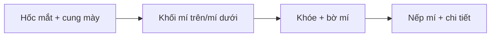

# Bài 03 — Blockout: tạo khối hốc mắt và vùng cung mày

**Mục tiêu:** tạo bố cục lớn quanh nhãn cầu trước khi vẽ chi tiết mí.

**Liên hệ video:** 01:10–03:30.

## 1. Quy tắc hình khối lớn → hình khối trung gian → chi tiết

Ở giai đoạn đầu, giảng viên chủ yếu **đắp/loại Clay Strips**, chỉnh hốc mắt và gờ cung mày, chưa thêm nếp nhăn hay texture. Đây là cách tránh sa đà vào chi tiết khi tỉ lệ còn sai.

## 2. Các bước

1. Đặt nhãn cầu vào hốc mắt đủ sâu để phần mặt bao quanh tạo cảm giác có xương và mô mềm. Kiểm tra mặt nghiêng để tránh nhãn cầu lồi khỏi mặt quá nhiều.
2. Chọn **Clay Strips** với bán kính khá lớn; đắp vùng cung mày thành **một khối liên tục**. Không vẽ lông mày bằng các sợi tóc ở bước này.
3. Dùng chiều tác động ngược (nếu cọ hỗ trợ) hoặc cọ phù hợp để tạo **vùng lõm dưới gờ cung mày** và khoảng trống quanh nhãn cầu.
4. Giữ không gian ở phía gần mũi để sau này đặt khóe trong và cục lệ.
5. Bổ sung khối chuyển tiếp về phía gò má. Nhìn cả mặt chính diện và 3/4.
6. Smooth rất nhẹ những chỗ gãy bậc, rồi quay lại khôi phục độ nổi nếu làm phẳng quá tay.

## 3. Ba lỗi phổ biến

| Dấu hiệu | Nguyên nhân | Khắc phục |
|---|---|---|
| Mắt như quả cầu dán lên bề mặt | Không có gờ cung mày và phần lõm hốc mắt | Xây thể tích xung quanh nhãn cầu trước |
| Hốc mắt thành hố tròn | Đào lõm đồng đều 360° | Tạo chuyển tiếp lồi/lõm không đều theo tham chiếu |
| Một góc trông ổn, góc khác vỡ hình | Chỉ sculpt ở chính diện | Kiểm tra nghiêng và 3/4 sau mỗi nhóm nét |

## 4. Bài tập

Tạo **hai blockout**: A có cung mày mềm, B có cung mày rõ. Cả hai **không được vẽ nếp mí hay lông mi**. Chụp hình chính diện/nghiêng/3-4. Viết 3 câu mô tả chỗ lồi – chỗ lõm.

**Tiêu chí đạt:** từ xa vẫn nhìn ra vùng hốc mắt và cung mày, không cần đường nét nhỏ.
