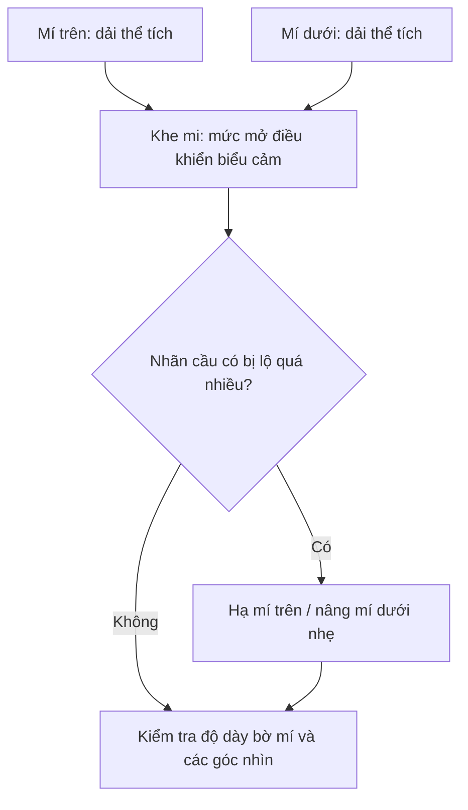

# Bài 04 — Điêu khắc mí mắt trên và mí mắt dưới

**Mục tiêu:** tạo hai mí có thể tích, bám theo nhãn cầu và có độ mở tự nhiên.

**Liên hệ video:** 03:40–08:20; tổng kết 29:40–30:40.

## 1. Mí không phải hai đường kẻ

Hãy coi mí như **dải vật chất có độ dày**. Độ mở giữa hai mí chính là khe mi. Bờ mí nằm ngay phía trước bề mặt nhãn cầu và “quấn” quanh đường cong hình cầu. Ở mắt nhìn thẳng tự nhiên, mí trên thường che một phần mống mắt; mức che thay đổi theo người và biểu cảm.

## 2. Dựng mí dưới trước

Trong video, giảng viên đắp một ít khối ở mí dưới trước, rồi mới thêm mí trên. Làm theo thứ tự này để hiểu việc tạo thành khe mi:

1. Ở Sculpt Mode, chọn Clay Strips và thêm một dải thể tích **từ khóe trong đến khóe ngoài** bên dưới nhãn cầu.
2. Nắn bằng Grab để dải mí chạy theo đường cong của quả cầu, không tạo đường thẳng trên không gian 3D.
3. Đảm bảo bờ mí rõ ràng nhưng không quá dày như ống tròn.
4. Quan sát phần chuyển tiếp giữa mí dưới và da dưới mắt; không ép thành rãnh sâu liên tục.

## 3. Tạo mí trên và điều chỉnh độ mở

1. Đắp dải mí trên từ vùng gần mũi qua phía ngoài, đi theo bề mặt nhãn cầu.
2. Dùng Grab dịch phần giữa mí trên thấp xuống đủ để có ánh nhìn bình thường; tránh mở quá rộng làm nhân vật trông hoảng sợ.
3. Dùng Scrape/Flatten **rất tiết chế** nhằm chỉnh các mặt phẳng lớn mà không làm bờ mí mỏng đi.
4. Dùng Smooth cục bộ nếu xuất hiện chỗ sần; sau đó **kiểm tra đường viền mép mí còn rõ không**.

## 4. Định hình hai đường cong khác nhau

Đường cong hai mí thường không đối xứng như hai nửa ellipse. Trong mẫu của video, phần cong của mí trên nổi bật hơn về phía gần mũi, còn đường cong mí dưới võng về phía ngoài hơn. Hãy so ảnh tham chiếu trước khi sao chép đặc điểm này.

## 5. Bật Dyntopo lúc nào?

Giảng viên bật Dyntopo khi cần thêm mật độ cho bờ mí. Nếu mesh có đủ độ phân giải, có thể tiếp tục **mà không bật**. Dyntopo không phải bước bắt buộc. Với dự án game-ready, giữ mesh high-poly riêng và chuẩn bị retopology sau.

## 6. Bài tập và tự kiểm

- Sculpt một mắt nhìn trung tính; sau đó làm bản sao mắt mở to hơn.
- Ở từng bản, kiểm tra chính diện, nghiêng, ba phần tư.
- Tự trả lời: mí trên có che một phần mống mắt không? Mí dưới có là “đường vẽ” quá mỏng không? Mí có ôm quanh quả cầu không?

**Đạt khi:** đường viền mượt mà, độ dày bờ mí hợp lý, không có khe hở khó hiểu giữa mí và nhãn cầu.
