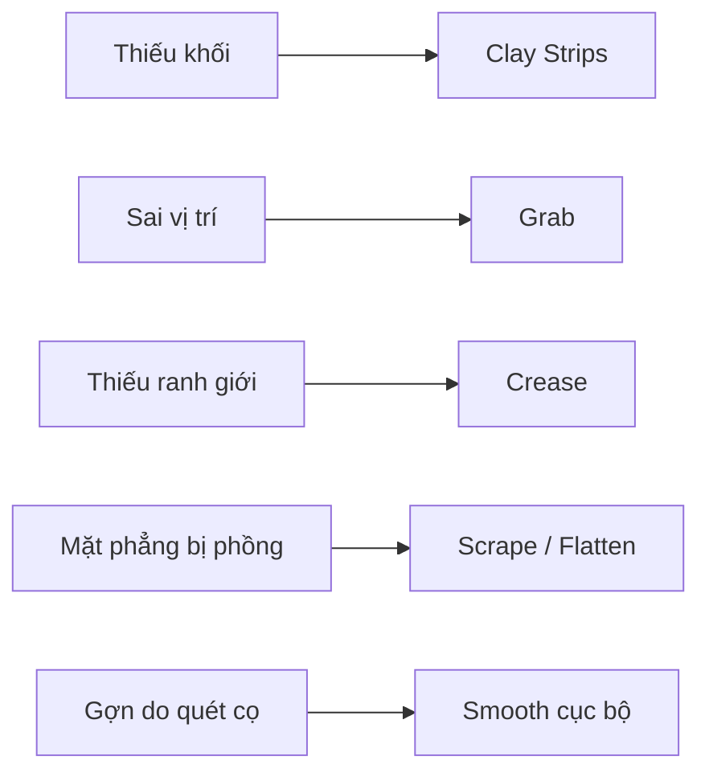

# Bài 06 — Nếp mí, cơ vòng mắt và chuyển tiếp gò má

**Mục tiêu:** thêm những khối trung bình làm mắt có chiều sâu, không biến mặt thành các rãnh cắt.

**Liên hệ video:** 17:35–25:45; 29:32–30:45.

## 1. Làm rõ nếp mí trên

Ở khoảng **17:35–19:40**, giảng viên bổ sung mô mềm **trên mí trên**, tạo chỗ cho nếp mí và dùng **Crease** để nhấn ranh giới. Hãy bắt đầu bằng một nếp rất nhẹ; nếp mí có hình dạng đa dạng theo người, kiểu mắt và biểu cảm.

1. Bổ sung thể tích phía trên bờ mí bằng Clay Strips (từng lớp mỏng).
2. Smooth cục bộ để thể tích mới hòa vào cung mày.
3. Dùng Crease nhẹ theo đường nếp mí theo ảnh tham chiếu; không đục rãnh sâu đều từ đầu đến cuối.
4. Di chuyển qua góc 3/4 để xác nhận nếp này có chiều sâu chứ không phải vết khắc phẳng.

## 2. Vùng cơ vòng mắt và xương bên dưới

Video nhắc tới **orbicularis oculi** (cơ vòng mắt), gờ xương, mô mềm vùng gò má; người hướng dẫn khuyên **dùng gương và sờ nhẹ vùng mặt mình để nhận biết các khối**. Điều này hỗ trợ việc quan sát, nhưng không thay thế ảnh/atlas giải phẫu.

Ở mí dưới:

- Xác định chỗ bờ mí kết thúc và mô mềm chuyển vào vùng dưới ổ mắt.
- Dùng Clay Strips bù những chỗ thiếu thể tích vùng gò má; tránh để vùng dưới mắt thành một hố lõm sâu vô cớ.
- Dùng Scrape/Flatten hạn chế để tách mặt phẳng; sau đó Smooth vừa đủ.

## 3. Tiết chế: các cọ chính cần dùng

Video liệt kê Clay Strips, Crease, Scrape và Smooth như bộ công cụ chủ lực, cộng Grab để dịch chuyển hình dạng. Chỉ cần vài cọ có kiểm soát sẽ hiệu quả hơn liên tục đổi 20 loại cọ.

## 4. Thao tác tự kiểm

Sau mỗi bước, thu nhỏ viewport: nếu mọi thứ trông giống một tập hợp rãnh hoặc khối đất không gắn kết, hãy quay về thể tích lớn. Video cảnh báo hậu quả của việc chỉ nhìn một phía trong thời gian dài (khoảng 21:01–21:15).

## 5. Bài tập

Hoàn thiện một vùng mắt gồm cung mày, nếp mí, mí dưới, khóe và gò má. Chụp **wireframe hoặc matcap** để tách vấn đề hình học khỏi vật liệu. Sửa ít nhất một lỗi nhìn nghiêng phát hiện sau khi thu nhỏ.

**Đạt khi:** nếp mí rõ nhưng không quá sắc, vùng dưới mắt có độ chuyển êm về má, không xuất hiện rãnh khép kín quanh mắt.
