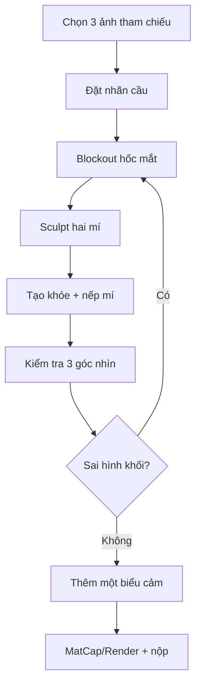

# Bài 08 — Dự án cuối khóa: Sculpt mắt nhân vật có biểu cảm

## Đề bài

Từ một phần đầu người hoặc base mesh, dùng Blender điêu khắc vùng mắt theo các bài đã học. Yêu cầu tạo hình có nhãn cầu, hốc mắt, cung mày, mí trên/dưới, hai khóe, nếp mí (nếu hình tham chiếu có), khối dưới ổ mắt và ít nhất **một** trạng thái biểu cảm ngoài trung tính.

## Gói bài nộp

- `eye_final.blend` — lưu Collection rõ ràng, không mất mesh tham chiếu.
- `render_front.png`, `render_three_quarter.png`, `render_side.png` — ảnh kiểm tra.
- `before_after.png` — ghép blockout và hoàn thiện.
- `README_project.md` — tối đa 300 chữ: tham chiếu đã dùng, kỹ thuật, lỗi lớn nhất, cách khắc phục.

## Quy trình khuyến nghị

## Rubric chấm điểm (100 điểm)

| Tiêu chí | Điểm | Dấu hiệu đạt |
|---|---:|---|
| Cấu trúc hốc mắt và khối cung mày | 20 | Nhãn cầu nằm trong khối, không bị “dán” trên mặt |
| Độ dày và đường cong mí | 25 | Hai mí khác nhau, bám nhãn cầu, có khối lượng |
| Khóe mắt, nếp mí, chuyển tiếp gò má | 20 | Khóe trong/ngoài hợp lý, không rãnh lạm dụng |
| Biểu cảm có chủ đích | 15 | Có một biến thể dễ nhận biết |
| Kiểm tra đa góc và chất lượng bề mặt | 10 | Không lỗi rõ ở góc nghiêng / 3-4 |
| Quản lý file, phiên bản, hình trình bày | 10 | File mở được, tên rõ, có đủ ảnh |

**Yêu cầu tối thiểu:** 70/100; riêng mục bờ mí phải đạt ít nhất 15/25. Đây là **rubric do giáo trình thiết kế**, không phải thang điểm của video gốc.

## Bài nâng cao tự chọn

- Làm hai kiểu mắt: realist và stylized nhưng giữ chung cấu trúc nền.
- Thử sculpt một bên mắt nhắm; nhận xét phần mí thay đổi như thế nào.
- Chuẩn bị bản high-poly để về sau **retopology → UV → bake → rig** cho nhân vật game.

## Checklist trước khi nộp

- [ ] Có ảnh tham chiếu và xác nhận tỉ lệ.
- [ ] Mí trên/mí dưới có thể tích và ôm nhãn cầu.
- [ ] Khóe mắt trong/ngoài và đường cong không “gãy”.
- [ ] Đã kiểm tra toàn bộ ít nhất 3 góc nhìn.
- [ ] Không để Dyntopo phá UV/mesh bản sản xuất duy nhất.
- [ ] Đủ ảnh và file `.blend`.
