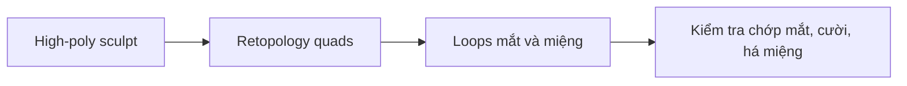

# Bài 01 — Retopology khuôn mặt và tư duy Edge Flow
**Tham chiếu video:** 00:00–02:29; 03:11–03:35; 21:11–21:54.

## Mục tiêu
Hiểu vì sao mặt người dạng high-poly nhiều tam giác cần được dựng lại một mesh tối ưu trước khi rig. Phân biệt hình dáng bề mặt với cấu trúc hình học phục vụ chuyển động.

## Khái niệm
- **Vertex / Edge / Face:** đỉnh, cạnh, mặt.
- **Triangle / Quad / N-gon:** mặt tam giác, tứ giác, nhiều hơn bốn cạnh.
- **Retopology:** dựng mesh mới trên high-poly với số mặt vừa đủ, edge flow được thiết kế.
- **Edge loop:** chuỗi cạnh thường chạy vòng quanh cấu trúc mắt, môi, mũi.
- **Edge flow:** hướng luồng cạnh giúp lưới giãn theo chuyển động.
- **Pole:** đỉnh nhận số cạnh khác 4; thường dùng để điều hướng số lượng dải loop.

## Nguyên tắc
1. Thiết kế các loop quanh miệng và mắt trước, sau đó mới lấp đầy má, trán, hàm.
2. Quads tạo luồng rõ để sửa và subdivide nhưng không tự đảm bảo animation tốt.
3. Giữ mật độ cao hơn ở mí, khóe miệng và vùng nếp gấp; phần trán phẳng có thể thưa.
4. Không sao chép từng lỗ chân lông hay vết nhăn từ sculpt sang mesh retopo; dùng normal/texture ở giai đoạn tiếp theo.
5. Pole không sai theo bản chất; tránh dồn pole ngay chỗ biến dạng lớn.

## Thực hành
Mở model đầu, bật Wireframe, quan sát tam giác dày. Phác 2 loop quan trọng trên ảnh front view; xác định 3 vùng có thể giảm mật độ. Giải thích tại sao công cụ Decimate không thay thế retopo thủ công.

## Tự kiểm tra
- Hai mesh chồng vị trí có chắc đã nối thành một bề mặt? Không.
- Pole 5 cạnh có phải luôn là lỗi? Không.
- Chỉ nhìn hình ở tư thế trung tính có đủ để đánh giá? Không; cần thử biến dạng.

**Kết quả:** một sơ đồ ý tưởng về lưới mắt–môi–hàm.