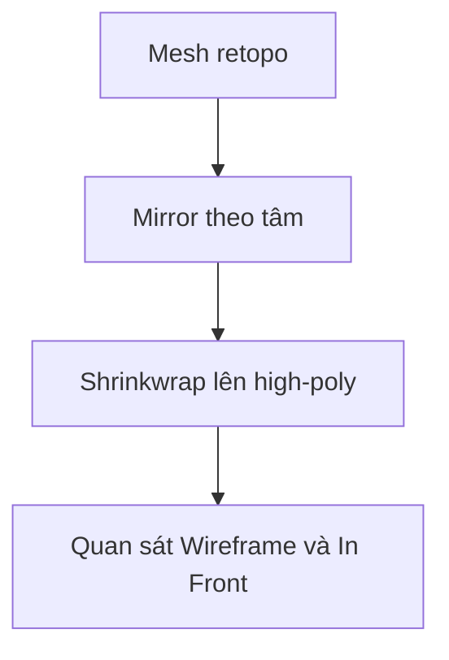

# Bài 03 — Thiết lập Snapping, Shrinkwrap và Mirror
**Tham chiếu video:** 03:35–06:34.

## Chuẩn bị mesh retopo
1. Object Mode → `Shift + A > Mesh > Plane`, đặt tên `HEAD_RETOPO`.
2. `Tab` vào Edit Mode; xoay mặt phẳng cho cùng chiều mặt, `S` thu nhỏ và đặt gần vùng môi.
3. Chuyển chọn Vertex, Edge, Face bằng `1`, `2`, `3` trên hàng phím số.
4. Bật **Snap to Face**, dùng **Face Project** nếu phiên bản hỗ trợ. Di chuyển thử một đỉnh dọc bề mặt tham chiếu.

## Shrinkwrap
Thêm modifier **Shrinkwrap**; Target = mesh high-poly; Wrap Method = **Nearest Surface Point**; Snap Mode = **On Surface** để bắt đầu. Có thể chỉnh Offset dương rất nhỏ theo đơn vị mesh khi bị z-fighting. Shrinkwrap liên tục chiếu vị trí đỉnh lên mục tiêu; Snap chỉ giúp khi thao tác.

## Mirror
Thêm **Mirror** trục X khi trục local phù hợp; bật **Merge + Clipping**. **Merge** hàn trong phạm vi Merge Distance; **Clipping** ngăn kéo đỉnh qua mặt phẳng gương trong quá trình chỉnh. Đặt **Object Origin** đúng trục đối xứng; Clipping không tự nối các đỉnh lệch xa tâm.

## Làm việc dễ nhìn
- Object Properties → Viewport Display → **In Front**.
- Bật **Wireframe Overlay**, đặt một màu viewport riêng cho mesh retopo.
- Phím thao tác: `E` Extrude, `G` Move, `R` Rotate, `S` Scale, `G G` Slide theo ngữ cảnh.
- Thứ tự modifier đáng thử: **Mirror → Shrinkwrap**. Khi thêm Subdivision, thử **Mirror → Subdivision → Shrinkwrap**, kiểm tra sai lệch và hiệu năng; không có stack đúng cho mọi bề mặt.

## Thực hành
Dựng một dải quad ngắn ở má bằng `E`; thử bật/tắt snapping, Shrinkwrap và Clipping; lưu `02_loops.blend`.

## Kiểm tra
- [ ] Target đúng object.
- [ ] Origin và trục Mirror đúng.
- [ ] Không có hai nửa mesh chồng nhau.
- [ ] Quad bám đúng bề mặt.