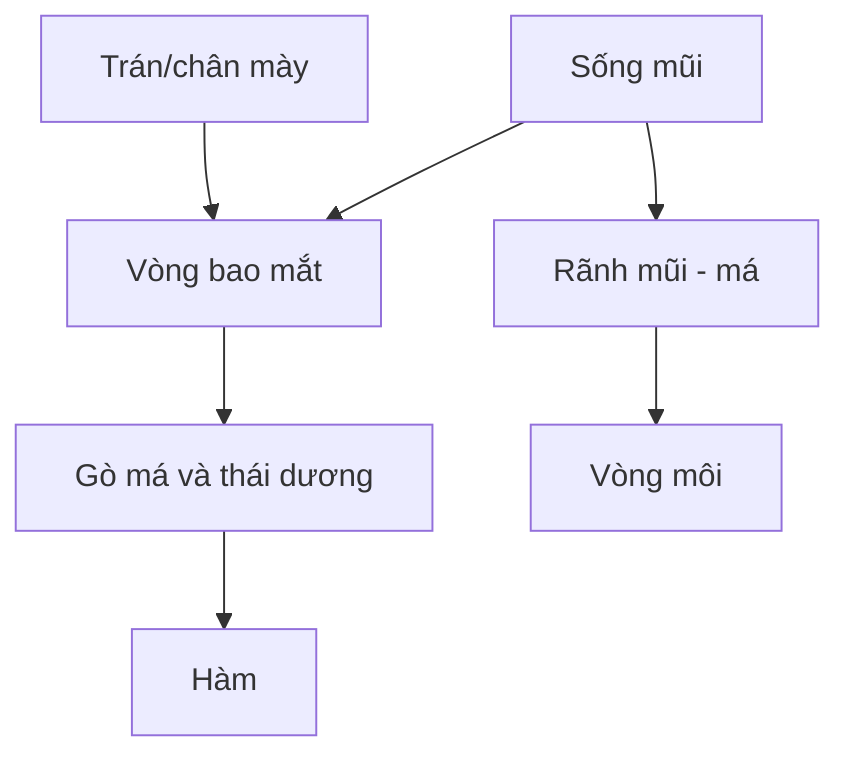

# Bài 05 — Vòng mí mắt, sống mũi và gò má
**Tham chiếu video:** 07:12–10:29.

## Mục tiêu
Dựng loop quanh mí, vòng bao mắt dạng “gọng kính”, và dải chuyển tiếp từ mũi tới gò má/cằm, phù hợp chuyển động chớp mắt và biểu cảm.

## Quy trình theo video
1. Chọn một mặt quad của vòng miệng và `Shift + D` nhân bản. Đưa mặt sao chép lên phần mí dưới để có mảnh khởi tạo **rời**.
2. Chọn cạnh của mảnh này và `E` dọc theo đường cong mí dưới, đến đuôi mắt, vòng theo mí trên.
3. Nối hai đầu vòng; dùng `F` tại vị trí hợp lệ, kiểm tra không có mặt xoắn hoặc n-gon không mong muốn.
4. Dùng `Alt + click` chọn edge loop trong ngữ cảnh phù hợp, `S` chỉnh toàn vòng nhẹ nhàng, `G` sửa đỉnh.
5. Từ phần dưới mắt, xây đường cạnh theo nếp gò má và hai bên mũi; tạo vòng bao mắt phía trên sống mũi.
6. Nhìn góc 3/4 để đảm bảo loop không cắt xuyên nhãn cầu.

## Sơ đồ mối liên hệ các vùng

*Sơ đồ trên là hướng nối vùng, không phải bản vẽ vertex chính xác.*

## Phân biệt loop và mesh liền khối
Các mảnh `Shift + D` nhìn như gần nhau nhưng chưa nhất thiết nối. Ở bài 07 ta sẽ nối tất cả bằng các mặt và đỉnh thật sự liên thông; Shrinkwrap không tự hàn lưới.

## Lỗi thường gặp
- Mí quá gần nhãn cầu làm xung đột khi chớp → tạo không gian hốc mắt.
- Quad quá nhọn ở đuôi mắt → dàn đều và hướng ra thái dương.
- Loop mắt thiếu dải phụ → khó biến dạng khi nheo mắt.

## Bài tập và tiêu chí
Dựng ít nhất một loop mí và một vòng bao mắt, chụp ảnh front/side có Wireframe; kiểm tra hai bên đối xứng.